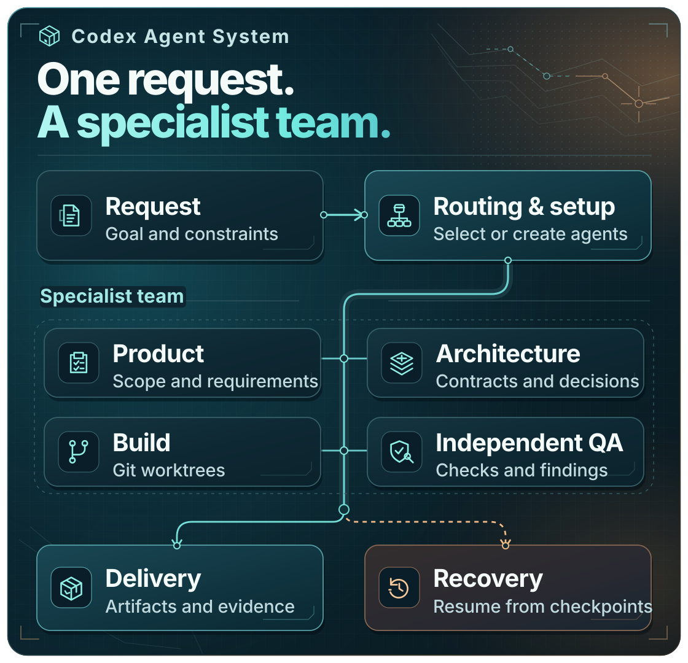

# Codex Agent System

**One conversation. A whole product team. From the first idea to release evidence.**

Give Codex the goal in your own words. Start with one task, bring in the specialists a project actually needs, or build a reusable agent for work your team repeats. Keep the decisions, sources, and next action with the project as work changes hands.

**[Start in Codex](START_HERE.md)** · **[Install or update](docs/INSTALL.md)** · **[See the full workflow](#one-entry-from-idea-to-release)** · **[What’s new](#what-is-new-in-v170)** · [Покроковий старт українською](docs/uk/FIRST_RUN.md)

## What's new in v1.7.0

| Go straight to… | What you can do |
| --- | --- |
| [**Interactive UX**](docs/technical/UX_PROTOTYPE.md) | Walk through screens, failures, and recovery in a browser. Every screen points to the reviewed design or experience. Export the route you actually took. |
| [**Document templates**](docs/technical/DOCUMENT_TEMPLATES.md) | Reuse reviewed layouts for product briefs, PRFAQs, decisions, and other documents. Use conditional and repeating sections, companion files, and revision-specific review. |
| [**BMad module import and migration**](docs/technical/BMAD_MODULE_MIGRATION.md) | Inspect Stable and Preview source, convert legacy registrations, rehearse an approved migration separately, and preserve team and personal overrides. |
| [**Tracker trees**](docs/technical/TRACKER_SYNC.md) | Compare local, prior, and remote state. Preview one effect on [GitHub, Linear, Jira Cloud, Notion, or Trello](docs/technical/TRACKER_PROVIDERS.md), then reconcile a lost response before repeating an action. |

**Also in the current suite:** [resumable workshops](docs/technical/WORKSHOP.md), [effect of a changed requirement](docs/technical/TICKET_REPLAN.md), [parallel worktrees and recovery](docs/technical/TICKET_WORKTREES.md), [sprint continuity](docs/technical/TICKET_TREE.md#keep-a-sprint-plan-while-the-backlog-changes), [native Codex skill and role import](docs/technical/CONSTRUCTOR_IMPORT.md), and [evidence for a specific candidate](docs/technical/TICKET_QUALITY_GATE.md). [Release notes and observed limits](releases/README.md)

## One entry, from idea to release

*The map shows how the components work together. [Follow the worked project with copyable prompts](docs/technical/END_TO_END.md) · [Open the diagram at full size](assets/marketing/release-1.7/workflow-en.svg) · [Схема українською](assets/marketing/release-1.7/workflow-uk.svg).*

1. **Start with a goal.** Open your project in Codex. Ask in plain language. For an explicit reusable entry, invoke the optional `$atelier-orchestrator`.
2. **Choose the smallest route that fits.** The orchestrator can propose direct work, a specialist, or a product director. App, ChatBot, and Game directors coordinate their domains. For a role your team will reuse, `$agent-foundry` helps design, stage, and verify it.
3. **Give the team distinct jobs.** A director or coordinator tracks the outcome. Product and architecture specialists settle what to deliver and how it fits. Builders take bounded tasks; separate Git worktrees give parallel changes their own space. An independent reviewer checks the exact candidate and its evidence.
4. **Keep the work recoverable.** The project keeps decisions, sources, tasks, and checkpoints. When a requirement changes, inspect what it affects. After an interruption, continue from the saved state, or read back an uncertain external result before another action.
5. **Review the result and hand it off.** Use the prototype, code, behavior checks, and evidence for the version being reviewed. Release or change external systems only under the applicable project approvals. Keep the next action and the rollback path for the person who takes over.

## See what carries through

| A hard moment in a real project | What the system keeps with the work |
| --- | --- |
| A requirement changes after planning | The source, dependent tasks, and evidence that now needs another look. [Trace the change](docs/technical/TICKET_CHANGE_REVIEW.md) |
| Two builders work at once, or one stops | Each assignment's own worktree, exact base, checkpoint, and a reviewed integration decision. [See the worktree procedure](docs/technical/TICKET_WORKTREES.md) |
| A tool made a change but the response disappeared | The approved action and read-back needed to reconcile what the provider actually did. [See tracker recovery](docs/technical/TRACKER_SYNC.md) |
| Someone else needs to release or own the result | The reviewed version, actual behavior, unresolved limits, and next action. [Review a candidate](docs/technical/TICKET_QUALITY_GATE.md) |

## Choose where to start

| What you want to do | Use this entry |
| --- | --- |
| **Try one task in Codex** | [Install and verify](START_HERE.md#install-and-verify), open a disposable project, and paste the first task. No specialist team is required for a small change. |
| **Coordinate a project from one conversation** | Install **Atelier Orchestrator** as an optional skill. Start with `$atelier-orchestrator` and describe the outcome, sources, and limits in plain language. [Choose a route](START_HERE.md) |
| **Create a reusable specialist** | Start with `$agent-foundry`. Turn the recurring job into a reviewed spec, stage the specialist, and prove its first useful task in Codex. [Constructor and role catalog](docs/CAPABILITIES.md#constructors-and-roles) |
| **Use a visual Mac workbench** | [Set up Agent Atelier](apps/agent-atelier/README.md#build-and-launch) to inspect local projects, prepare bounded tasks, and review results in a browser. |
| **Go deeper with a product team** | [App, ChatBot, and Game workflows](docs/CAPABILITIES.md#product-families) · [Full worked journey](docs/technical/END_TO_END.md) · [All skills and roles](docs/CAPABILITIES.md#all-skills-and-roles) |

[English](docs/en/GUIDE.md) · [Українська](docs/uk/GUIDE.md) · [Deutsch](docs/de/GUIDE.md) · [Italiano](docs/it/GUIDE.md) · [Español](docs/es/GUIDE.md) · [Français](docs/fr/GUIDE.md) · [简体中文](docs/zh-CN/GUIDE.md) · [Another language](START_HERE.md#use-another-language)

## Technical topics

| When you need… | Open |
| --- | --- |
| **Work grounded in your own sources** | [Context and handoffs](docs/OPERATING_MODEL.md#project-context-and-handoffs) · [RAG](docs/OPERATING_MODEL.md#retrieval-and-rag) · [Worked retrieval example](docs/technical/RETRIEVAL.md) |
| **Clear boundaries for models, tools, and roles** | [Harness and authority](docs/OPERATING_MODEL.md#harness-and-authority) · [Routing and subagents](docs/OPERATING_MODEL.md#routes-and-subagents) · [Model choice and cost](docs/OPERATING_MODEL.md#models-and-cost) |
| **Proof that a change works** | [Evaluations and evidence](docs/OPERATING_MODEL.md#evals-and-evidence) · [Native Codex canary](evaluations/README.md#run-a-focused-native-codex-canary) · [Matched BMad comparison method](docs/technical/CODEX_COMPARISONS.md) |
| **Recovery from a partial or unknown outcome** | [Tools, receipts, and recovery](docs/OPERATING_MODEL.md#tools-evidence-and-recovery) · [Verification expectations](governance/VALIDATION.md) · [Install and rollback](docs/INSTALL.md) |

## Illustrated workflows

[My Day: revise a daily plan](marketing/en/README.md#showcase-product) · [Global Logistics: handle a delayed shipment](marketing/en/README.md#showcase-operations) · [Sunridge Studio: build a playable slice](marketing/en/README.md#showcase-game) · [RAG](marketing/en/README.md#showcase-retrieval) · [Evals](marketing/en/README.md#showcase-evaluation) · [Усі ілюстрації](marketing/uk/README.md)

[Stable release](https://github.com/alex-hohaizel/codex-agents/releases/latest) · [Component versions](releases/README.md) · [Package verification](governance/PACKAGES.md) · [Contributor and update process](governance/UPDATE_CONTRACT.md) · [Rights](RIGHTS.md)
