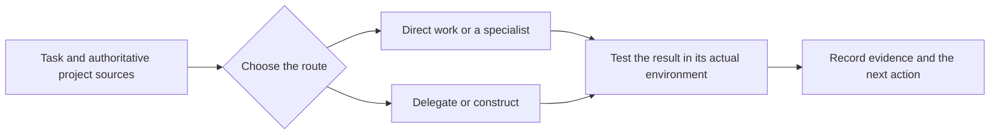

# Codex Agent System

Reusable Codex skills, specialist roles, and a local Mac workbench. Start with a task you can verify. Use a focused skill for a repeatable job, a director for a product, or Agent Foundry to design an agent around an unmet need.

**Read in your language**

[English](docs/en/GUIDE.md) · [Українська](docs/uk/GUIDE.md) · [Deutsch](docs/de/GUIDE.md) · [Italiano](docs/it/GUIDE.md) · [Español](docs/es/GUIDE.md) · [Français](docs/fr/GUIDE.md) · [简体中文](docs/zh-CN/GUIDE.md) · [Another language](START_HERE.md#use-another-language)

[Install and try it](START_HERE.md) · [Capability map](docs/CAPABILITIES.md) · [Engineering guide](docs/OPERATING_MODEL.md) · [Agent Atelier](apps/agent-atelier/README.md) · [Stable download](https://github.com/alex-hohaizel/codex-agents/releases/latest)

## Your first task

1. [Install the Codex skills](docs/INSTALL.md) and open a fresh Codex chat in a folder with a file you can safely change.
2. Ask: “Correct one typo in this file. Keep the rest unchanged and show me how you checked the result.” You can write the request and receive the answer in your own language.
3. For a recurring workflow, choose a [skill](docs/CAPABILITIES.md#all-skills-and-roles). For help choosing a route, install Atelier Orchestrator and start a request with `$atelier-orchestrator`.

## Choose a path

| I want to | Start here | What I can verify |
| --- | --- | --- |
| Learn the system and finish a small job | [Install and try it](START_HERE.md) | One bounded change and the visible result |
| Continue an existing project | [Context, decisions, and handoffs](docs/OPERATING_MODEL.md#project-context-and-handoffs) | The source of each requirement, decision, and next step |
| Build or run an app, chatbot, or game | [App, ChatBot, and Game Atelier](docs/CAPABILITIES.md#product-families) | A tested artifact and its acceptance evidence |
| Create a team, an agent, or a reusable skill | [Constructors and roles](docs/CAPABILITIES.md#constructors-and-roles) | The exact sources and a successful task in the intended Codex session |
| Add knowledge retrieval, use tools, or run evals | [Engineering guide](docs/OPERATING_MODEL.md) | A scoped corpus, measured behavior, and actual operation receipts |
| Explore local Codex projects in a visual panel | [Agent Atelier](apps/agent-atelier/README.md) | A bound project, a prepared task, its execution, and readable evidence |

## How it works

The harness combines Codex instructions, permissions, role definitions, contracts, and runnable checks. Context capsules carry the necessary source pins, decisions, authority, requirements, and handoff state. Retrieval can add ranked evidence when exact files, structured filters, and lexical search leave a measured gap. Evals exercise realistic positive, negative, and recovery cases, including actual Codex sessions. [Architecture and operating practices](docs/OPERATING_MODEL.md)

## See what you can build

The showcase follows example workflows across applications, games, assistants, operations, and specialist agents. It connects each illustration to the instructions and capabilities needed for the underlying work.

[Explore the visual showcase](marketing/README.md) · [Повний україномовний огляд](marketing/uk/README.md)

[Release and component versions](releases/current.json) · [Verification and evidence](governance/VALIDATION.md) · [Rights](RIGHTS.md)
