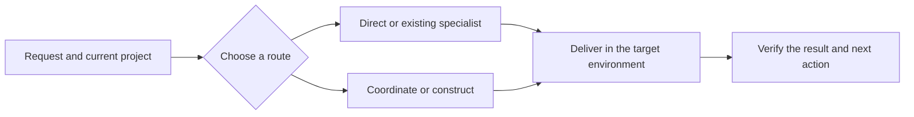
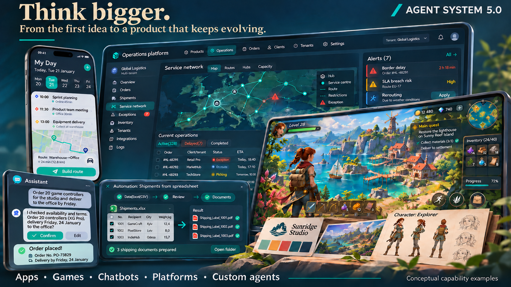

# Codex Agent System

Reusable skills, specialist roles, and a local workbench for Codex. Start with a task in your own language. The system can handle a focused change directly, continue work with its current owner, coordinate specialists, or help you build a reusable agent for a recurring workflow.

[Start with a task](#quickstart) · [Explore the system](#capabilities) · [Inspect the evidence](#verification-and-releases) · [Browse the showcase](#showcase)

## Quickstart

1. Follow [Start here](START_HERE.md) for the supported Codex setup. Use the [current release record](releases/current.json) to select the exact package and migration.
2. Try the [direct repair canary](evaluations/README.md#run-a-focused-native-codex-canary). It creates a disposable project, asks real Codex to correct one typo in `README.md`, and verifies that `notes.md` is unchanged.
3. For help choosing a route, install the optional Atelier Orchestrator and start with `$atelier-orchestrator`. For ongoing work, point Codex to the actual project and its checkpoint. Do not restate facts the project already records.

Skills can be used separately. The local workbench is optional. You can give instructions and request artifacts in the language you use at work. The [installation guide](docs/en/GUIDE.md) covers discovery, updating, and recovery.

## Capabilities

| Use the system to… | Starting point | What you can check |
| --- | --- | --- |
| Fix, verify, or research a focused task | Direct Codex work or an existing skill | The resulting change, sources, and a relevant check |
| Continue an existing product | Its current project agent, an Atelier director, or Orchestrator | Current requirements, identity, decisions, deferred work, and a verified next step |
| Build a reusable workflow or a project agent | Skill constructor or Agent Foundry | Triggering, tool scope, a staged bundle, and the original task run through the intended consumer |
| Build and operate an app, chatbot, or game | A family director and its specialists | Requirements, production artifacts, real client behavior, rollout readiness, and remaining evidence |
| Coordinate specialists and independent review | Native Codex roles and scoped handoffs | The named actor, exact inputs and outputs, integration, and distinct acceptance |
| Explore local Codex work and supported connections | Agent Atelier for Mac | Source-backed work, explicit project binding, specific tool capabilities, and actual receipts |

[Full capability and tool map](docs/CAPABILITIES.md) · [33 core skills](kit/skills/) · [Optional Orchestrator](optional-skills/atelier-orchestrator/) · [Maintenance skill](maintenance-skill/) · [12 role profiles](agent-profiles/) · [Local workbench](apps/agent-atelier/)

## How it works



- **Harness** gives Codex maintained instructions, source-controlled contracts, runnable checks, and evidence it can inspect. The simplest route uses the smallest useful set of controls.
- **Context capsules** retain the original objective, authoritative sources, current decisions, requirements, permissions and the next step. Native project state stays authoritative. Handoffs carry the relevant portion of that evidence to a named actor.
- **Search and retrieval-augmented generation (RAG)** start with exact files, IDs and ordinary search. Evaluate lexical or hybrid semantic retrieval against a real corpus if the task needs it. A vector database and global chat index are optional extensions.
- **Evals** test routing, use of tools, artifact outcomes, cost and preservation on pinned cases. Code checks, model behavior, native discovery, installation and external outcomes have separate records.
- **Tool and effect controls** use the actual host capabilities and permissions. Inspect the operation and target before dispatch. Reconcile an unknown write at its destination before retrying it.

[Engineering and operating guide](docs/OPERATING_MODEL.md) · [Capability and tool map](docs/CAPABILITIES.md) · [Context contract](standards/context-capsule.md) · [Production quality](standards/production-quality.md) · [Evaluation sources](evaluations/)

## Verification and releases

The [release record](releases/current.json) is the source of truth for the current repository edition, core skill suite, optional components, and local service. These independently versioned components have their own compatibility and migration requirements. Follow the [update contract](governance/UPDATE_CONTRACT.md) to decide what changes version, what is checked, and how to roll back.

Run source checks from the repository root:

```sh
python3 -B kit/verify_release.py
python3 -B scripts/materialize_standards.py --check
python3 -B scripts/check_repository.py
```

[Validation and scoped evidence](governance/VALIDATION.md) · [Requirements](governance/requirements.csv) · [Packages](governance/PACKAGES.md) · [Change history](CHANGELOG.md) · [Rights](RIGHTS.md)

A source archive and a successful workflow confirm their documented checks. Follow the migration and verify fresh Codex discovery after installation. Work continuity has a separate guide and depends on the hosted capabilities available there. This independent project does not imply OpenAI endorsement.

## Showcase

The artwork shows a small slice of the workflows you can design. You can combine the system's skills, compatible tools, data and integrations for other problems. Each actual workflow depends on its capabilities, access and environment.

| Explore the English materials | Переглянути українські матеріали |
| --- | --- |
| [English gallery, PDF and downloads](marketing/campaign/README.md) | [Українська галерея, PDF і пакунки](marketing/campaign/README.uk.md) |

<details>
<summary>Preview the campaign cover</summary>



</details>

[English](docs/en/GUIDE.md) · [Українська](docs/uk/GUIDE.md) · [Deutsch](docs/de/GUIDE.md) · [Italiano](docs/it/GUIDE.md) · [Español](docs/es/GUIDE.md) · [Français](docs/fr/GUIDE.md) · [简体中文](docs/zh-CN/GUIDE.md)
