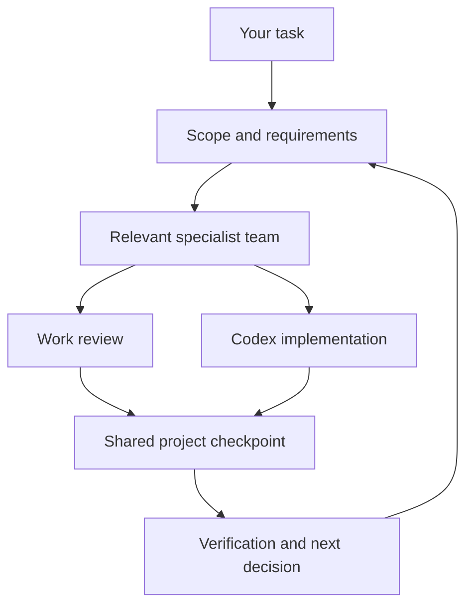

# Agent System · Work + Codex

**Describe the result. Build the right team. Keep the knowledge.**

A reusable system of **33 specialized skills** for taking a focused task or a whole product through research, requirements, design, implementation, verification and continued improvement. Use it to review a backend architecture, build an integration, restore an existing service, shape a mobile app or develop a game. The team and depth follow the actual task.

[English](docs/en/GUIDE.md) · [Українська](docs/uk/GUIDE.md) · [Deutsch](docs/de/GUIDE.md) · [Italiano](docs/it/GUIDE.md) · [Español](docs/es/GUIDE.md) · [Français](docs/fr/GUIDE.md) · [简体中文](docs/zh-CN/GUIDE.md)

**[Start here →](START_HERE.md)** · **[Explore 10 visual directions →](marketing/README.md)** · [Changes](CHANGELOG.md) · [Upgrade an existing project](releases/migrations/5.0.0.md)

## What can you ask it to do?

| Your goal | Where you start | What you work toward |
| --- | --- | --- |
| “Review retries and consistency in my payments backend.” | Agent constructor | A scoped specialist, evidence, failure cases and a reviewable fix plan |
| “Create an agent that reconciles spreadsheets and prepares shipping documents.” | Agent constructor | A tailored workflow, data boundaries, integration contracts and verification |
| “Build a useful mobile app from this idea.” | App director | Research, coherent concepts, specification, UX, Android/iOS/web implementation, QA and release preparation |
| “Improve our support bot without losing its personality or memory rules.” | ChatBot director | Conversation, knowledge, media, integrations, tests and a controlled migration |
| “Make a mobile game with lasting progression and a consistent visual identity.” | Game director | Concepts, full game/system design, assets, native implementation, QA and live operations |
| “Fix this one bug in the current product.” | The relevant existing agent | A targeted change with the accepted product requirements preserved |

Outputs depend on the actual scope, connected tools, data access and execution environment. This is a workflow system for capable hosts; it does not grant new service access or replace device testing.

## One system, two places to work

Work is useful for clarifying the goal, comparing choices, reviewing designs and inspecting connected evidence. Codex is useful for editing a real repository, running scripts, testing and preparing a concrete implementation. Both can do overlapping work when the required tools exist.

The continuity comes from the same project, source revision, requirements, decisions and checkpoint. A handoff carries the selected language, task status and actual evidence. There is no claim that one chat can silently see another chat or start a desktop session.



## What is included?

| Family | Skills | Purpose |
| --- | ---: | --- |
| Constructors | 2 | Tailored agents and reusable specialist skills |
| App | 11 | Research through product operations |
| ChatBot | 11 | Conversation, knowledge, integration and ongoing service |
| Game | 9 | Studio identity through native game development and live operations |

The optional [repository maintenance skill](maintenance-skill/SKILL.md) is separate from these 33. It carries the owner's future publication contract into skill-management work.

## Start without an existing installation

1. Open [START_HERE.md](START_HERE.md) and choose your language.
2. Connect GitHub in the host you use and grant this repository access; because it is private, only authorized accounts can read it.
3. Follow your guide's **Work installation** or **Codex installation** steps. Reading or downloading the repository is not installation.
4. Run the guide's first small task and verify the actual loaded source.
5. For an existing product, adopt the new toolkit through the migration checklist before the next dependent stage.

To choose Ukrainian, for example, begin with: “Use Ukrainian for this setup and future project communication. Read docs/uk/GUIDE.md and save preferred_language=uk in the project context.” Every guide contains its own complete bootstrap prompt.

## Versions that mean something

- **Reusable suite: 5.0.0.** The canonical source skills preserve the verified release bytes.
- **Repository/documentation: 1.0.0.** This initial repository release adds onboarding, translations, release governance, migration instructions and marketing concept studies.
- **Project-agent and native schema versions are separate.** Updating a skill does not rename a game state schema or migrate a running product.

Every future relevant update must include applicable source, documentation, translations, packages, change notes and existing-project migration instructions. See the [update contract](governance/UPDATE_CONTRACT.md) and [permanent agent instructions](AGENTS.md). An enabled daily fallback checks accessible approved sources; the [synchronization status](governance/SYNC_STATUS.md) records its scope, first eligible check and access limits. Integrity, behavior, host discovery and product acceptance are separate checks.

## Visual presentation, ready for a decision


[Open the full-size boards and offline gallery](marketing/README.md). These are alternatives for selection; no campaign identity has been approved.

[Ten distinct concept boards](marketing/README.md) explore different ways to explain the system. Each has a hero, team/process graphic, practical use cases and a defined visual identity for later ads, decks and landing pages. No final campaign direction is selected in this release.

The [quality model](governance/QUALITY_MODEL.md) shows what technical depth means in practice: causal requirements, explicit data and recovery rules, preserved design, relevant performance budgets and evidence from the actual target environment.

## Verify and build packages

From this repository root, with Python 3.9 or newer:

```sh
python3 -B kit/verify_release.py
python3 -B scripts/check_repository.py
python3 -B scripts/build_packages.py
```

The generated Work and Codex ZIP packages and SHA256SUMS appear in `dist/`. CI builds the same artifacts; private-repository artifacts require authorized GitHub access. See the guide for installation, update journals and safe rollback.

[Source provenance](kit/PROVENANCE.md) · [Requirements](governance/requirements.csv) · [Distribution rights](RIGHTS.md)

This independent project is not an official OpenAI product. Host capabilities and access vary. No speed, revenue or superiority claim is presented as measured evidence.
