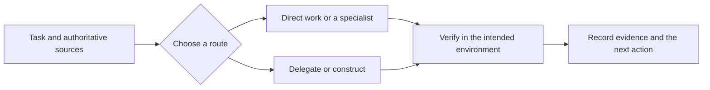

# Engineering with Codex Agent System

[Repository home](../README.md) · [Install](INSTALL.md) · [Capability map](CAPABILITIES.md) · [Illustrated workflows](../marketing/README.md)

## Engineering topics

| Open a topic | What you can decide or check |
| --- | --- |
| [Harness and authority](#harness-and-authority) | Which parts of the host control instructions, execution, and evidence |
| [Routing and subagents](#routes-and-subagents) | When to work directly, use a specialist, delegate, or build an agent |
| [Context and handoffs](#project-context-and-handoffs) | Which sources, requirements, decisions, and permissions cross a task boundary |
| [RAG and retrieval](#retrieval-and-rag) | When exact lookup is enough and how to evaluate lexical, semantic, or hybrid ranking |
| [Tools, permissions, and recovery](#tools-evidence-and-recovery) | What a tool may do and how to verify an operation's outcome |
| [Evals and evidence](#evals-and-evidence) | What static checks, native runs, and independent review can each establish |
| [Models and cost](#models-and-cost) | How model settings resolve and when to evaluate a different model or effort |

Start with the requested outcome, authoritative sources, and an acceptance check. For a narrow task, open only the records and checks it needs. For a change that affects several systems, carry the same source pins, task authority, and acceptance criteria through each step.

## Harness and authority

| Layer | Where it lives | What to inspect |
| --- | --- | --- |
| Runtime | Native Codex host and tools | Effective sandbox, connector availability, approvals, and account scope |
| Instructions and discovery | `AGENTS.md`, skill frontmatter, and linked resources | Loaded source, working-directory precedence, stable names, and exact paths |
| Workflow | Orchestrator, product families, and constructors | Task intent, prerequisites, applicable domain rules, and consumer |
| State | Native project records and a bounded task capsule | Exact revision, current decision, musts, deferred work, and pins |
| Checks | Schemas, source reads, sandbox fixtures, native evals, and independent review | Test outcome, actual artifact and consumer behavior, attribution, and limits |

The harness is the combination of these controls around the model. Keep durable project instructions and resource links in `AGENTS.md` and skill entrypoints. Enforce target, permission, and state checks at the operation itself. For example, the workbench's `task.prepare` binds the task to the selected sources and paths, and `task.dispatch` checks those pins and authority again before the turn starts. [Managed Codex profile](../host-profiles/codex/AGENTS.md) · [Adaptive work](../standards/adaptive-work.md) · [Workbench API](../apps/agent-atelier/shared/API.md)

## Routes and subagents

1. Start from the requested outcome, existing owner, actual inputs, permitted changes, and one appropriate acceptance check.
2. Work directly for a narrow task. Use a relevant skill or director for a recurring method or connected lifecycle. Let Orchestrator choose when the route is uncertain.
3. Delegate when the outputs are separable or review must be independent. Give each actor a bounded task, paths, authorized actions, source revision, budget, stop conditions, output, and return address. Assign a single writer per shared mutable target unless the consumer implements a tested concurrency contract.
4. Use Foundry to build an agent for a demonstrated recurring gap. Agree on the passport and verify the staged consumer using an original task. Build a reusable skill when its trigger, resources, and result can be specified and tested independently.
5. Integrate the actual result, retain its source and checks, and record each accepted and unresolved obligation. Route preparation, a subagent spawn, a result, and independent review are distinct observations.



[Orchestrator instructions](../optional-skills/atelier-orchestrator/SKILL.md) · [Agent Foundry](../kit/skills/agent-foundry/SKILL.md) · [Role sources](../agent-profiles/manifest.json) · [Team deliberation](../optional-skills/atelier-orchestrator/references/team-deliberation.md)

## Project context and handoffs

Use the [project ticket tree](technical/TICKET_TREE.md) to inspect selected work,
prerequisites and declared acceptance evidence. For changed requirements, use the
[plan change review](technical/TICKET_CHANGE_REVIEW.md) to bind refinements to exact sources and
report affected work and proof. Use [reviewed workflow evidence](technical/CODEX_COMPARISONS.md)
to compare independently reviewed runs on a pinned task.

For work that spans sessions, bind each Builder to its own Git worktree
and preserve the worker's active reservation. Confirm interruption and
reconcile effects before authorizing continuation. Reconcile an existing
GitHub tracker through the project's explicit issue map. Apply independent
QA to the integrated result using checks linked to the current criteria
and candidate. [Worktree recovery](technical/TICKET_WORKTREES.md) ·
[GitHub Issues](technical/TICKET_GITHUB.md) · [Candidate evidence](technical/TICKET_QUALITY_GATE.md)

Open the project’s authoritative requirements, identity, decisions, and checkpoint by ID or exact path. Use a capsule to carry a focused projection across a task, session, agent, or environment. Identify the original goal, applicable requirements and musts, source and revision hashes, accepted decisions and supersession, deferred work, allowed effects, output, recovery and next action. Record the gaps alongside the loaded references. A changed dependency invalidates the proof it affects.

In a handoff, preserve the project owner, actual files, and current authority. Limit read scope to what the consumer needs. When history is incomplete, recover the task from verified project sources and name the gaps. For a shipment exception, pass the shipment identifier, the permitted read scope, the current dispatch rule and its revision, the selected alternative, and the pending approval to the receiver. Check those records against the owning system before continuing. The project's native records remain authoritative. [Context capsule contract and commands](../standards/context-capsule.md) · [Handoff template](../templates/HANDOFF.md) · [Project context template](../templates/project-context.json) · [Global Logistics example](../marketing/en/README.md#showcase-operations)

## Retrieval and RAG

Retrieval-augmented generation supplies evidence from an authorized corpus to the model for the current question. Start with an exact ID, current API or database read, or a lexical search. If held-out questions expose material misses such as paraphrases or language changes, compare semantic or hybrid ranking over the same sources and permissions.

| If you need to find | Begin with | Check before adding complexity |
| --- | --- | --- |
| A current record by its ID | Exact lookup in the authoritative system | Correct record, revision or timestamp, and access |
| A policy by title or wording | Search over documents the caller may read | Correct clause, current revision, and a citation |
| A policy described in different terms or languages | Compare lexical and semantic or hybrid candidates | Relevant source appears in the results, citations support the answer, and latency and cost fit the task |

The repository supplies the knowledge workflow, context contracts, and evaluation patterns. Indexing, embedding, and hosting are implementation choices for your application. Follow the worked example for source authority, filtering, deletion, safe abstention, and deciding whether ranking improved the result. [Worked RAG example and evaluation](technical/RETRIEVAL.md) · [ChatBot knowledge skill](../kit/skills/chatbot-atelier-knowledge/SKILL.md) · [AI and data profiles](../standards/ai-production.md)

## Tools, evidence, and recovery

Choose an actual supported tool operation with known input schema, target, rights, cost, and receipt. Verify inputs before the effect and read the result from the owning system. After a timeout, pending status, or missing receipt, check the authoritative state for the exact target and request before any replay. Retry only with authority and a tested duplicate-prevention mechanism. Keep an unresolved effect open with the next fact needed to resolve it.

Agent Atelier discovers local native Codex project and chat metadata with coverage, opens history on demand, binds explicit folders, and prepares source-backed tasks. Review the original goal, selected skills, access, plan, and acceptance before starting the task. Dispatch rechecks authority and sources. When using a separate Codex desktop client, coordinate ownership of the same project and task before writing from either client. Inspect the native result and exact receipt before accepting an effect. Keep evidence local and scope telemetry by ownership and content policy. [Workbench guide](../apps/agent-atelier/README.md) · [Operation API](../apps/agent-atelier/shared/API.md) · [Resumable work](../governance/RESUMABLE_WORK.md)

<a name="evaluations-and-observed-results"></a>
## Evals and evidence

Choose a case that would change whether you adopt the result. For a new route, check a request that should select it, a similar request that should stay direct, and a denied or incomplete input that should stop the operation.

| Check | Evidence to keep |
| --- | --- |
| Trigger and route | Positive and nearby negative requests, explicit and natural routing, and the resolved skill source |
| Context and handoff | Original requirements, denied reads, stale references, restored identity, and resumed behavior |
| Consumer and tool effect | Exact artifact, real runtime when available, target/state/receipt, and relevant failure and recovery behavior |
| Attribution and cost | Source, input, model and host, observed actor, retries, elapsed time, cost and usage when reported |
| Judgment | Criteria, independent actor or method, scoped verdict, and unverified areas |

Run deterministic checks first for source and structure. Use a native session to observe the selected route, the actual artifact, and its use by the intended consumer. Keep hard requirements and reference fidelity explicit in the acceptance criteria. If a case concerns a real device, permission boundary, provider, or external effect, collect the result on the affected target under the matching conditions.

```bash
python3 -B kit/verify_release.py
python3 -B scripts/materialize_standards.py --check
python3 -B scripts/check_repository.py
receipt_dir="$(mktemp -d)"
python3 -B evaluations/native_canary.py --case p01-direct --output "$receipt_dir/direct.jsonl"
```

Run these commands from the repository source directory. The canary uses the native Codex CLI and a signed-in host. Keep raw inputs, paths, and diagnostics private. Record the fixture, exact source, model, observed artifact, and outcome with any scoped public result. [Native eval suite and prerequisites](../evaluations/README.md) · [Validation and evidence](../governance/VALIDATION.md) · [OpenAI evaluation practices](https://developers.openai.com/api/docs/guides/evaluation-best-practices)

## Models and cost

The session chooses the main model. For a subagent, an explicit model or effort in its role file has precedence. For each unset field, Codex resolves the spawn option, the matching `[agents]` default, and then the parent setting. A different model selected by a spawn option or default can use that model's own default effort when neither setting specifies effort. [Codex model selection for subagents](https://learn.chatgpt.com/docs/agent-configuration/subagents#custom-agents)

The managed v1.9 release record selects GPT-6.2 Sol Ultra. The launchers, Workbench, supplied roles and newly generated agents use that model and effort. Check the observed model and effort in the task receipt, even when the launcher and role selectors already agree. An unmanaged Codex session uses its own configuration. [Role definitions](../agent-profiles/manifest.json) · [Model options in Codex](https://learn.chatgpt.com/docs/models?surface=cli)

Change one variable at a time. Compare the current and candidate settings on the same source, task cases, permissions, and pass criteria. Track missed requirements, erroneous tool actions, retries, time, and cost when available. Use a lower effort only for an explicit scoped requirement after a reviewed comparison demonstrates a meaningful timing improvement and preserves the same quality criteria. Retain the exact model and effort in the receipt.

## Install, verify, and recover

Use the stable GitHub asset, exact source, attestation, and manifest. Review the audit, apply its plan once, retain the journal, and check fresh Codex discovery and behavior separately. Use per-component journals when recovering. Reconcile unknown external effects before resuming. Preserve existing project authority and unpublished local changes. [Install in Codex](INSTALL.md) · [Packages](../governance/PACKAGES.md)
