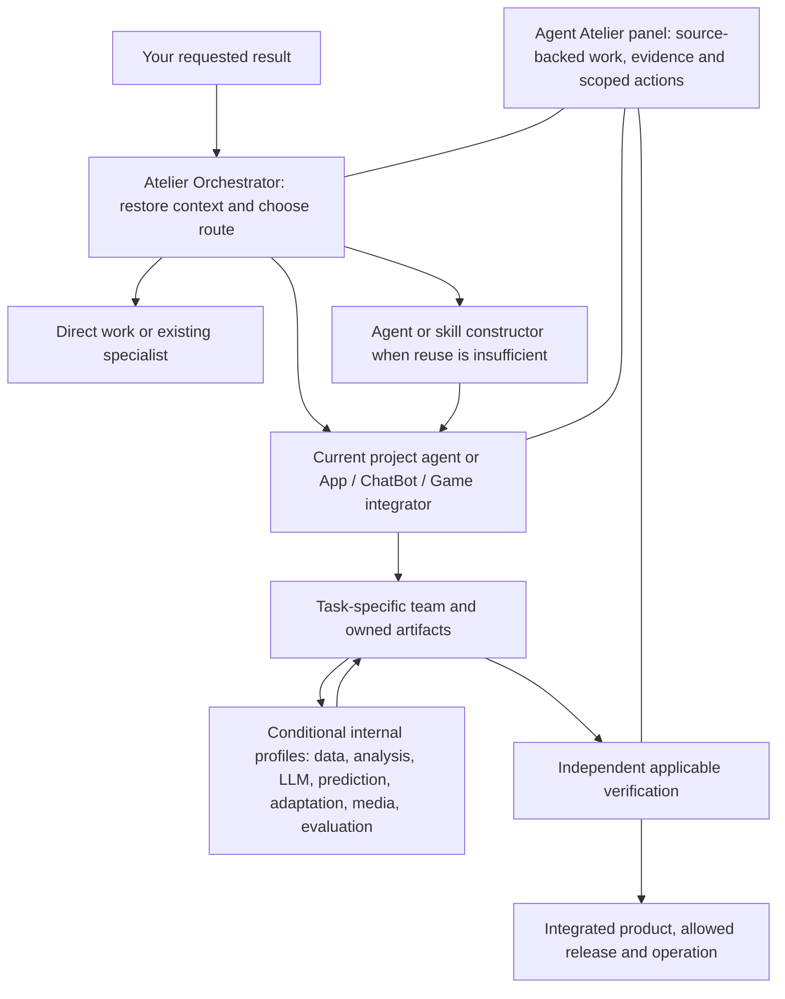

# System evolution: AI, data, ML and creative production

[Українська версія](README.uk.md)

**Revised passport0.2, 10 November 2026.** Active implementation remains core6.0.0 / Orchestrator1.1.0 / Agent Atelier0.2.0. Repository1.3.2 revises documentation only. [STATUS.json](STATUS.json) binds the current proposal and pending implementation approval; [revision history](REVISIONS.en.md) preserves0.1.

The recommendation is a compatible extension of the same35 owned sources and12 role profiles. Seven AI/data competence areas are conditional internal profiles with existing owners; no mandatory additional skill, role, pack or framework. Priority is context continuity, accepted professional design and a working source-backed panel. All17 original capabilities remain. Every claimed improvement needs actual-task evidence; any confirmed degradation of any existing working behavior rejects the candidate without compensation. Target core6.1.0 / Orchestrator1.2.0 / service0.3.0 / repository1.4.0 remains unimplemented.

## Read in this order

| Your question | Read |
| --- | --- |
| What did the audit actually find? | [Findings and limits](AUDIT.en.md) |
| What will change, why, where and with whose authority? | [Complete passport 0.2](PASSPORT.en.md) |
| Is every item of the request covered? | [Request matrix](MATRIX.en.md) and [machine register](REQUESTS.json) |
| How will each capability work? | [Seven operational recipes and cross-cutting rules](CAPABILITIES.en.md) |
| What exists today in each skill, role and service component? | [Current component handbook](CURRENT-SYSTEM.en.md) and [source cards](current-components.json) |
| What do all the helper scripts actually do? | [Helper reference](HELPERS.en.md) and [complete index](helper-catalog.json) |
| How can we tell it works? | [29 acceptance cases](ACCEPTANCE.en.md) and [machine register](ACCEPTANCE.json) |
| What proves practical improvement without loss? | [Actual-task protocol and strict adoption](REAL-TASKS.en.md) |
| What is the machine-checkable construction plan? | [Native skill.blueprint/2 proposal](BLUEPRINT.json), revision index2 corresponding to passport0.2; approval is empty |
| What informed technology choices? | [Dated primary sources](SOURCES.json) |
| How do I use the current system? | [Current full guide](../../en/GUIDE.md), [installation entry](../../../START_HERE.md) |

## How the parts fit

This is the proposed responsibility flow, not a live execution graph. Existing product state and authority remain in their native records.

The orchestrator is the entry and integration route. The constructor makes a justified new agent. Product directors lead their product. Specialists own bounded work. Subagents are actual delegated actors when the host supports them. The panel is an interface to real state and admitted actions. A ledger or validator records/checks work; an executor performs it. These distinctions prevent a generated package or an attractive panel from being mistaken for the finished product.

## What changes for a user

You can describe “turn reviews into useful product signals” or “harden this prototype” without naming internal modules. The system establishes the outcome, uses the existing product context and chooses the needed specialists. It should return an editable working result, readable evidence, limitations and a useful next action. For forecasting, it can explain that current data cannot support a trustworthy estimate. For media, it preserves approved identity through variants and actual product use. For a nontechnical team, the result includes the product's own usable interface and operational path.

The evidence standard is concrete. A model name, installed package, valid JSON or claimed expert role is insufficient. A new capability needs the implementation and the actual checks appropriate to its claim. Paid APIs, large downloads, training devices, external deployment and real-user studies retain their own access and authorization conditions. WORK live work remains deferred.

## Plain-language terms

| Term | Meaning here |
| --- | --- |
| Pipeline | Connected repeatable steps with known inputs, outputs and recovery |
| Dataset | A versioned collection of the data used for a result |
| Lineage | Which source, transformation and run produced an artifact |
| Feature | Information supplied to a predictive model at the time of a prediction |
| Label / target | The outcome the model learns to predict |
| Embedding | A numeric representation used for similarity; it does not establish truth |
| Leakage | Training or evaluation using information unavailable at the claimed prediction time |
| Baseline | A simple honest comparison that a more complex method must justify improving |
| Holdout | Data protected from model selection and used for final evaluation |
| Serving / inference | Using the saved model to produce an actual result for a consumer |
| LoRA | One way to adapt a compatible model with additional learned parameters |
| Drift | A relevant change in inputs, relationships or observed quality over time |
| Abstention | Explaining that a reliable answer or prediction cannot currently be given |
| Reconciliation | Checking the destination after an uncertain response before retrying an effect |
| Production-ready | Meets the particular product's verified operational requirements; never a universal certificate |

## Document scope

English is the default; every handbook document in this directory has a full Ukrainian counterpart. The current installation guide remains complete in all seven advertised languages. This proposal's detailed handbook is offered in English and Ukrainian; it does not advertise five nonexistent handbook translations. Source names, IDs and commands stay unchanged. Before the implemented release, every changed guide workflow must be translated equivalently.

The source baseline, current findings, proposed architecture, future acceptance plan and later implementation evidence are different records. No private product data, raw local inventory, credentials or account-specific packages are part of this handbook. The original request remains the authority; the machine registers make its coverage inspectable rather than replacing it.
