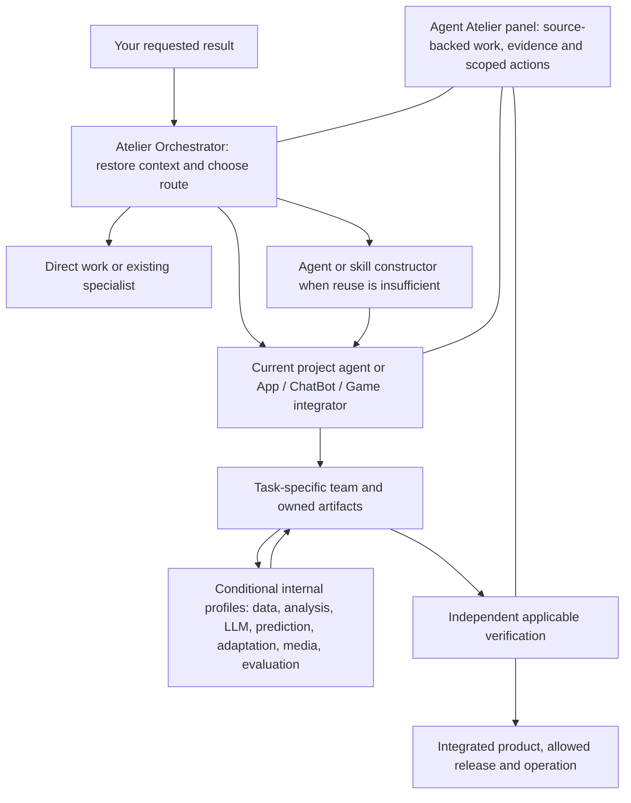

# System evolution: AI, data, ML and creative production

[Українська версія](README.uk.md)

**Approved passport0.2, implementation checkpoint, 10 November2026.** Prepared source candidate: repository1.4.0-rc.3 / core6.1.0 / Orchestrator1.2.0 / maintenance1.1.0 / Agent Atelier0.3.1. This is not final1.4.0, host installation or full acceptance. The earlier core6.0.0 / Orchestrator1.1.0 / service0.2.0 catalogues are historical baseline. [STATUS.json](STATUS.json) and the [implementation record](IMPLEMENTATION.en.md) distinguish current source and observed evidence; [revision history](REVISIONS.en.md) preserves0.1.

The candidate compatibly extends the same35 owned sources and12 role profiles. Seven AI/data areas are conditional profiles with existing owners; no mandatory additional skill, role, pack or framework. Priority is context continuity, accepted professional design and a working source-backed panel. All17 original capabilities remain in scope. Any confirmed degradation of existing working behavior rejects the candidate without compensation. Source materialization, bounded cold/UI checks and actual review analysis are documented; all full acceptance cases and final1.4.0 adoption remain open. WORK remains deferred.

After rejecting8c3a557, the owner accepted the shown revision6 visual foundation: “Так, цю основу приймаю”. This scope is visual only; it does not accept all29 full cases. Actual operator/report/requirements/mobile/locale observations, corrected cold discovery and a proper reflow-equivalent check are bounded to revision6. That earlier source task had independent9/9 bounded-source review. The subsequently admitted priority baseline is commit d6336bb4a43cacc6fc2042ea0edb6f8d540ad33a:33 core6.1 sources plus installed Orchestrator1.2 and12 preserved roles. Optional maintenance remains uninstalled. New rc.3 source, service replacement, exact CI and full-case acceptance each require their own evidence. The shared UI rule learned from this actual failure does not guarantee future quality.

The [real-task handbook](REAL-WORLD.en.md) explains the actual data, native adaptation and media experiments, including rejected models, plus the service repairs and task-only context isolation. The [29-case execution ledger](FULL-CASE-RESULTS.en.md) records results and remaining gates separately from the immutable original acceptance plan.

## Read in this order

| Your question | Read |
| --- | --- |
| What is implemented in this candidate, and what has actually been checked? | [Implementation checkpoint](IMPLEMENTATION.en.md), [human component handbook](IMPLEMENTED-COMPONENTS.en.md) and [candidate source cards](implementation-components.json) |
| What did the real public-review task find? | [Sanitized study and useful product needs](REVIEW-STUDY.en.md) |
| What did the audit actually find? | [Findings and limits](AUDIT.en.md) |
| What will change, why, where and with whose authority? | [Complete passport 0.2](PASSPORT.en.md) |
| Is every item of the request covered? | [Request matrix](MATRIX.en.md) and [machine register](REQUESTS.json) |
| How will each capability work? | [Seven operational recipes and cross-cutting rules](CAPABILITIES.en.md) |
| What was present in the audited baseline? | [Historical component handbook](CURRENT-SYSTEM.en.md) and [baseline source cards](current-components.json) |
| What do all the helper scripts actually do? | [Helper reference](HELPERS.en.md) and [complete index](helper-catalog.json) |
| How can we tell it works? | [29 acceptance cases](ACCEPTANCE.en.md) and [machine register](ACCEPTANCE.json) |
| What proves practical improvement without loss? | [Actual-task protocol and strict adoption](REAL-TASKS.en.md) |
| What is the machine-checkable construction plan? | [Historical native skill.blueprint/2 proposal](BLUEPRINT.json), revision index2 for passport0.2; its empty approval predates the exact later implementation authorization recorded in the implementation checkpoint |
| What informed technology choices? | [Dated primary sources](SOURCES.json) |
| How do I use the current system? | [Current full guide](../../en/GUIDE.md), [installation entry](../../../START_HERE.md) |

## How the parts fit

This is the proposed responsibility flow, not a live execution graph. Existing product state and authority remain in their native records.

The orchestrator is the entry and integration route. The constructor makes a justified new agent. Product directors lead their product. Specialists own bounded work. Subagents are actual delegated actors when the host supports them. The panel is an interface to real state and admitted actions. A ledger or validator records/checks work; an executor performs it. These distinctions prevent a generated package or an attractive panel from being mistaken for the finished product.

## What changes for a user

You can describe “turn reviews into useful product signals” or “harden this prototype” without naming internal modules. The system establishes the outcome, uses the existing product context and chooses the needed specialists. It should return an editable working result, readable evidence, limitations and a useful next action. For forecasting, it can explain that current data cannot support a trustworthy estimate. For media, it preserves approved identity through variants and actual product use. For a nontechnical team, the result includes the product's own usable interface and operational path.

The evidence standard is concrete. A model name, installed package, valid JSON or claimed expert role is insufficient. A new capability needs the implementation and the actual checks appropriate to its claim. Paid APIs, large downloads, training devices, external deployment and real-user studies retain their own access and authorization conditions. WORK live work remains deferred.

## Plain-language terms

| Term | Meaning here |
| --- | --- |
| Pipeline | Connected repeatable steps with known inputs, outputs and recovery |
| Dataset | A versioned collection of the data used for a result |
| Lineage | Which source, transformation and run produced an artifact |
| Feature | Information supplied to a predictive model at the time of a prediction |
| Label / target | The outcome the model learns to predict |
| Embedding | A numeric representation used for similarity; it does not establish truth |
| Leakage | Training or evaluation using information unavailable at the claimed prediction time |
| Baseline | A simple honest comparison that a more complex method must justify improving |
| Holdout | Data protected from model selection and used for final evaluation |
| Serving / inference | Using the saved model to produce an actual result for a consumer |
| LoRA | One way to adapt a compatible model with additional learned parameters |
| Drift | A relevant change in inputs, relationships or observed quality over time |
| Abstention | Explaining that a reliable answer or prediction cannot currently be given |
| Reconciliation | Checking the destination after an uncertain response before retrying an effect |
| Production-ready | Meets the particular product's verified operational requirements; never a universal certificate |

## Document scope

English is the default; narrative handbook documents have Ukrainian counterparts. The full installation guide is available in all seven advertised languages, including equivalent candidate workflow changes. Detailed evolution documentation is EN/UK; five additional handbook translations are not advertised. Source names, IDs and commands stay unchanged. Semantic self-review and structural parity are not independent native-human certification or runtime proof.

The source baseline, current findings, proposed architecture, future acceptance plan and later implementation evidence are different records. No private product data, raw local inventory, credentials or account-specific packages are part of this handbook. The original request remains the authority; the machine registers make its coverage inspectable rather than replacing it.
