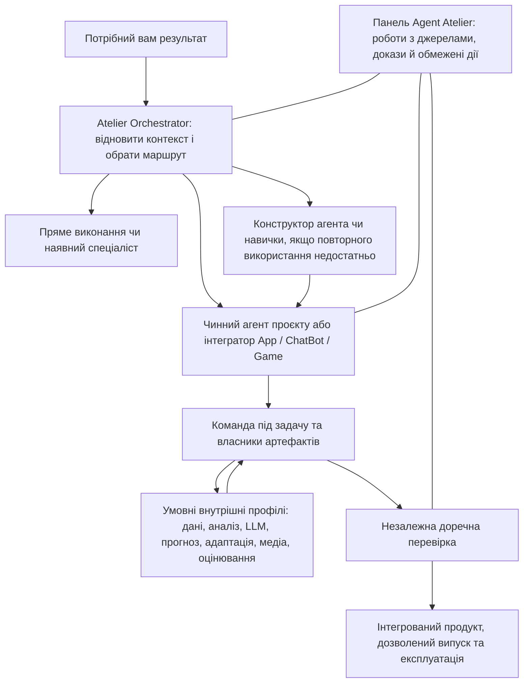

# Розвиток системи: AI, дані, ML і виробництво матеріалів

[English version](README.md)

**Погоджений паспорт0.2, checkpoint реалізації,10 листопада2026.** Підготовлений кандидат у джерелах: repository1.4.0-rc.2 / core6.1.0 / Orchestrator1.2.0 / maintenance1.1.0 / Agent Atelier0.3.0. Це не фінальна1.4.0, встановлення чи повне приймання. Попередні каталоги core6.0.0 / Orchestrator1.1.0 / service0.2.0 є історичною базою. [STATUS.json](STATUS.json) і [запис реалізації](IMPLEMENTATION.uk.md) розрізняють джерела та спостережені докази; [історія редакцій](REVISIONS.uk.md) зберігає0.1.

Кандидат сумісно розширює ті самі35 джерел і12 ролей. Сім AI/data напрямів — умовні профілі з чинними власниками; додаткові обов’язкові навички, ролі, пакет чи framework не потрібні. Пріоритет — контекст, прийнятий професійний дизайн і робоча панель із джерелами. Усі17 можливостей залишаються в обсязі. Підтверджене погіршення чинного працездатного відхиляє кандидата без компенсації. Матеріалізацію джерел, обмежені cold/UI-перевірки й реальний аналіз відгуків задокументовано; повні сценарії приймання та фінальне прийняття1.4.0 відкриті. WORK відкладено.

Після відхилення8c3a557 власник прийняв показану візуальну основу revision6: «Так, цю основу приймаю». Це лише візуальний обсяг: усі29 повних сценаріїв і прийняття системи відкриті. Фактичні operator/report/requirements/mobile/locale спостереження, виправлений cold-discovery і коректний reflow-equivalent перевірено в обсязі revision6. Фінальна source-задача має незалежні9/9 обмеженого source-bound перегляду; точні Git/CI й допуск сумісного пріоритетного оновлення окремі. Спільне UI-правило, виведене з реального провалу, не гарантує майбутньої якості.

## Порядок читання

| Ваше питання | Де прочитати |
| --- | --- |
| Що реалізовано й справді перевірено? | [Checkpoint](IMPLEMENTATION.uk.md), [людський довідник](IMPLEMENTED-COMPONENTS.uk.md) і [картки кандидата](implementation-components.json) |
| Що дав реальний аналіз відгуків? | [Очищене дослідження та продуктові потреби](REVIEW-STUDY.uk.md) |
| Що насправді виявив аудит? | [Висновки й межі](AUDIT.uk.md) |
| Що, навіщо, де і за якими правами зміниться? | [Повний паспорт 0.2](PASSPORT.uk.md) |
| Чи покрито кожний пункт запиту? | [Матриця запиту](MATRIX.uk.md) і [машинний реєстр](REQUESTS.json) |
| Як працюватиме кожна можливість? | [Сім робочих рецептів і спільні правила](CAPABILITIES.uk.md) |
| Що було в проаудитованій історичній базі? | [Довідник історичної бази](CURRENT-SYSTEM.uk.md) і [джерельні картки](current-components.json) |
| Що реально роблять усі скрипти-помічники? | [Довідка помічників](HELPERS.uk.md) і [повний індекс](helper-catalog.json) |
| Як визначити, що воно працює? | [29 сценаріїв приймання](ACCEPTANCE.uk.md) і [машинний реєстр](ACCEPTANCE.json) |
| Що доведе практичне покращення без втрат? | [Протокол реальних задач і суворого прийняття](REAL-TASKS.uk.md) |
| Де машинно перевірний план побудови? | [Рідна пропозиція skill.blueprint/2](BLUEPRINT.json), історичний індекс2 для паспорта0.2; порожнє погодження передує точному наступному дозволу реалізації, описаному в checkpoint |
| На чому базується вибір технологій? | [Датовані первинні джерела](SOURCES.json) |
| Як користуватись чинною системою? | [Чинний повний посібник](../../uk/GUIDE.md), [вхід до установки](../../../START_HERE.md) |

## Як складники працюють разом

Це пропонований розподіл відповідальності, а не граф живого виконання. Стан продукту й повноваження залишаються у своїх рідних записах.

Оркестратор — вхід і маршрут інтеграції. Конструктор створює обґрунтовано потрібного агента. Продуктові директори ведуть свій продукт. Спеціалісти відповідають за обмежену роботу. Сабагенти — справді делеговані виконавці, якщо хост їх підтримує. Панель — інтерфейс реального стану й допущених дій. Журнал чи validator записує/перевіряє роботу; executor її виконує. Так пакет агента чи привабливий екран не підміняють завершений продукт.

## Що зміниться для користувача

Можна описати «перетвори відгуки на корисні сигнали для продукту» чи «доведи цей прототип до робочого інструмента», не називаючи внутрішні модулі. Система встановлює результат, бере чинний контекст і обирає потрібних спеціалістів. На виході — редагований робочий результат, зрозумілі докази, обмеження й корисна наступна дія. Для прогнозу вона може пояснити, чому наявних даних недостатньо для надійної оцінки. Для медіа зберігає прийняту ідентичність у варіантах і використанні продуктом. Для нетехнічної команди результат включає власний зручний інтерфейс продукту та експлуатаційний шлях.

Стандарт доказу конкретний. Назви моделі, встановленого пакета, правильного JSON чи заявленої експертної ролі недостатньо. Потрібні реалізація й фактичні перевірки, доречні твердженню. Платні API, великі завантаження, пристрої навчання, зовнішній деплой і дослідження реальних користувачів зберігають свої умови доступу й погодження. Живу роботу WORK відкладено.

## Терміни людською мовою

| Термін | Що означає тут |
| --- | --- |
| Pipeline | Пов'язані повторювані кроки з відомими входами, виходами й відновленням |
| Dataset | Версійована сукупність даних, використаних для результату |
| Lineage | З якого джерела, перетворення й запуску отримано артефакт |
| Feature / ознака | Інформація, доступна прогнозній моделі на момент прогнозу |
| Label / target | Результат, який модель навчається передбачати |
| Embedding | Числове подання для пошуку схожості; воно не доводить істинності |
| Leakage | Використання в навчанні чи оцінюванні інформації, недоступної на заявлений момент прогнозу |
| Baseline | Просте чесне порівняння, покращення якого складнішим методом потрібно обґрунтувати |
| Holdout | Дані, захищені від підбору моделі й використані для фінального оцінювання |
| Serving / inference | Використання збереженої моделі для фактичного результату споживачу |
| LoRA | Один зі способів адаптувати сумісну модель додатковими навченими параметрами |
| Drift | Суттєва зміна входів, залежностей чи спостереженої якості з часом |
| Abstention | Пояснення, що зараз неможливо дати надійну відповідь чи прогноз |
| Reconciliation | Звірка з місцем виконання після невідомої відповіді перед повтором ефекту |
| Production-ready | Перевірена відповідність експлуатаційним вимогам конкретного продукту; не універсальний сертифікат |

## Межі документації

Англійська — основна; текстові довідники мають українські відповідники. Повний посібник встановлення є всіма сімома заявленими мовами, включно з рівноцінними змінами процедур кандидата. Докладна документація розвитку — EN/UK; п’ять інших перекладів не заявляються. Назви джерел, ID й команди збережено. Змістовна самоперевірка та структурна відповідність не є незалежною перевіркою носія мови чи доказом runtime.

Початкові джерела, висновки, пропонована архітектура, майбутнє приймання й пізніші докази реалізації — різні записи. Приватні продуктові дані, сирий локальний інвентар, секрети й пакети окремих акаунтів сюди не входять. Початковий запит залишається авторитетним; машинні реєстри роблять покриття видимим, а не замінюють його.
