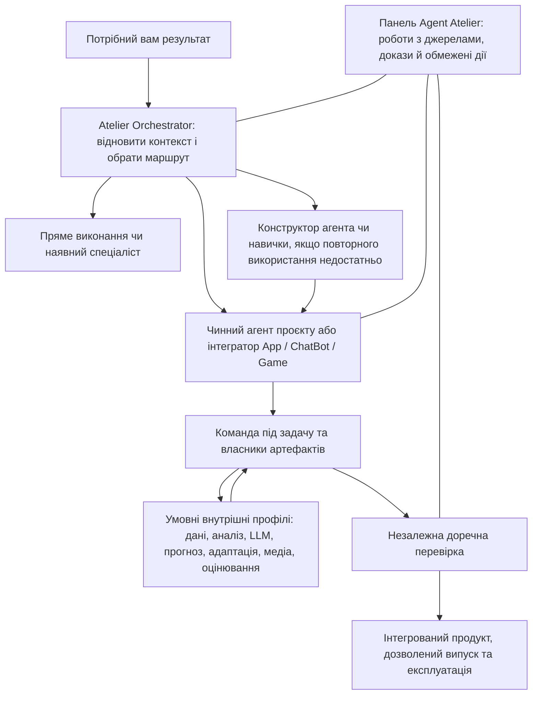

# Розвиток системи: AI, дані, ML і виробництво матеріалів

[English version](README.md)

**Скоригований паспорт0.2, 10 листопада 2026.** Чинна реалізація — core6.0.0 / Orchestrator1.1.0 / Agent Atelier0.2.0. Repository1.3.2 змінює лише документацію. [STATUS.json](STATUS.json) закріплює поточну пропозицію й очікування погодження реалізації; [історія редакцій](REVISIONS.uk.md) зберігає0.1.

Рекомендація — сумісне розширення тих самих35 власних джерел і12 ролей. Сім AI/data напрямів — умовні внутрішні профілі з чинними власниками; додаткові навички, ролі, пакет чи framework не обов’язкові. Пріоритет — безперервність контексту, прийнятий професійний дизайн і робоча панель зі справжніми джерелами. Усі17 початкових можливостей збережені. Заявлене покращення потребує доказу на реальній задачі; підтверджене погіршення чинного працездатного відхиляє кандидата без компенсації. Цільові core6.1.0 / Orchestrator1.2.0 / service0.3.0 / repository1.4.0 ще не реалізовані.

## Порядок читання

| Ваше питання | Де прочитати |
| --- | --- |
| Що насправді виявив аудит? | [Висновки й межі](AUDIT.uk.md) |
| Що, навіщо, де і за якими правами зміниться? | [Повний паспорт 0.2](PASSPORT.uk.md) |
| Чи покрито кожний пункт запиту? | [Матриця запиту](MATRIX.uk.md) і [машинний реєстр](REQUESTS.json) |
| Як працюватиме кожна можливість? | [Сім робочих рецептів і спільні правила](CAPABILITIES.uk.md) |
| Що сьогодні є в кожній навичці, ролі та компоненті сервісу? | [Довідник чинних компонентів](CURRENT-SYSTEM.uk.md) і [джерельні картки](current-components.json) |
| Що реально роблять усі скрипти-помічники? | [Довідка помічників](HELPERS.uk.md) і [повний індекс](helper-catalog.json) |
| Як визначити, що воно працює? | [29 сценаріїв приймання](ACCEPTANCE.uk.md) і [машинний реєстр](ACCEPTANCE.json) |
| Що доведе практичне покращення без втрат? | [Протокол реальних задач і суворого прийняття](REAL-TASKS.uk.md) |
| Де машинно перевірний план побудови? | [Рідна пропозиція skill.blueprint/2](BLUEPRINT.json), індекс редакції2 відповідає паспорту0.2; погодження порожнє |
| На чому базується вибір технологій? | [Датовані первинні джерела](SOURCES.json) |
| Як користуватись чинною системою? | [Чинний повний посібник](../../uk/GUIDE.md), [вхід до установки](../../../START_HERE.md) |

## Як складники працюють разом

Це пропонований розподіл відповідальності, а не граф живого виконання. Стан продукту й повноваження залишаються у своїх рідних записах.

Оркестратор — вхід і маршрут інтеграції. Конструктор створює обґрунтовано потрібного агента. Продуктові директори ведуть свій продукт. Спеціалісти відповідають за обмежену роботу. Сабагенти — справді делеговані виконавці, якщо хост їх підтримує. Панель — інтерфейс реального стану й допущених дій. Журнал чи validator записує/перевіряє роботу; executor її виконує. Так пакет агента чи привабливий екран не підміняють завершений продукт.

## Що зміниться для користувача

Можна описати «перетвори відгуки на корисні сигнали для продукту» чи «доведи цей прототип до робочого інструмента», не називаючи внутрішні модулі. Система встановлює результат, бере чинний контекст і обирає потрібних спеціалістів. На виході — редагований робочий результат, зрозумілі докази, обмеження й корисна наступна дія. Для прогнозу вона може пояснити, чому наявних даних недостатньо для надійної оцінки. Для медіа зберігає прийняту ідентичність у варіантах і використанні продуктом. Для нетехнічної команди результат включає власний зручний інтерфейс продукту та експлуатаційний шлях.

Стандарт доказу конкретний. Назви моделі, встановленого пакета, правильного JSON чи заявленої експертної ролі недостатньо. Потрібні реалізація й фактичні перевірки, доречні твердженню. Платні API, великі завантаження, пристрої навчання, зовнішній деплой і дослідження реальних користувачів зберігають свої умови доступу й погодження. Живу роботу WORK відкладено.

## Терміни людською мовою

| Термін | Що означає тут |
| --- | --- |
| Pipeline | Пов'язані повторювані кроки з відомими входами, виходами й відновленням |
| Dataset | Версійована сукупність даних, використаних для результату |
| Lineage | З якого джерела, перетворення й запуску отримано артефакт |
| Feature / ознака | Інформація, доступна прогнозній моделі на момент прогнозу |
| Label / target | Результат, який модель навчається передбачати |
| Embedding | Числове подання для пошуку схожості; воно не доводить істинності |
| Leakage | Використання в навчанні чи оцінюванні інформації, недоступної на заявлений момент прогнозу |
| Baseline | Просте чесне порівняння, покращення якого складнішим методом потрібно обґрунтувати |
| Holdout | Дані, захищені від підбору моделі й використані для фінального оцінювання |
| Serving / inference | Використання збереженої моделі для фактичного результату споживачу |
| LoRA | Один зі способів адаптувати сумісну модель додатковими навченими параметрами |
| Drift | Суттєва зміна входів, залежностей чи спостереженої якості з часом |
| Abstention | Пояснення, що зараз неможливо дати надійну відповідь чи прогноз |
| Reconciliation | Звірка з місцем виконання після невідомої відповіді перед повтором ефекту |
| Production-ready | Перевірена відповідність експлуатаційним вимогам конкретного продукту; не універсальний сертифікат |

## Межі документації

Англійська — основна; кожен документ довідника тут має повну українську пару. Чинний посібник установки залишається повним усіма сімома заявленими мовами. Детальний довідник пропозиції доступний англійською й українською; ще п'ять неіснуючих перекладів довідника не рекламуються. Назви джерел, IDs і команди сталі. Перед реалізованим випуском кожен змінений робочий процес посібника перекладається рівноцінно.

Початкові джерела, висновки, пропонована архітектура, майбутнє приймання й пізніші докази реалізації — різні записи. Приватні продуктові дані, сирий локальний інвентар, секрети й пакети окремих акаунтів сюди не входять. Початковий запит залишається авторитетним; машинні реєстри роблять покриття видимим, а не замінюють його.
