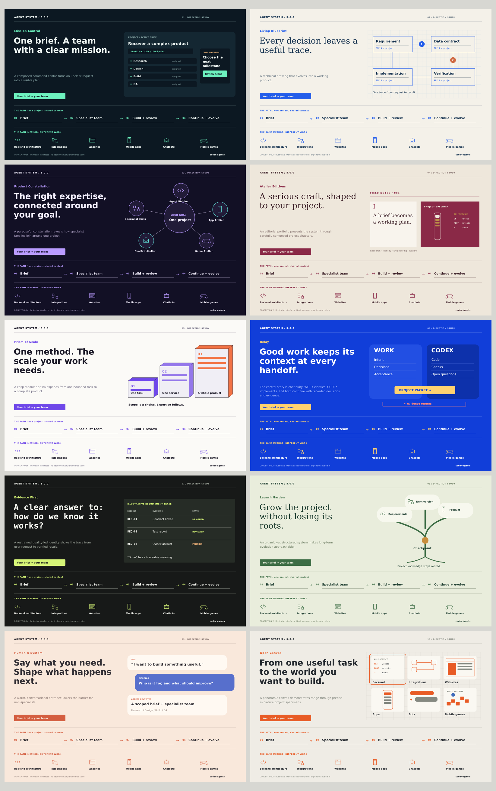

# Ten visual directions

[English](README.md) · [Українська](README.uk.md)

These are **ten design concepts for selection**, not a finished advertisement. They explain the same system through different visual identities. No direction has been selected. The approved system version remains 5.0.0; these marketing studies have their own version, 1.0.

**Open [the offline concept gallery](concept-gallery.html)** after downloading or cloning the repository. GitHub shows HTML source rather than running it. Open the file in a browser; no server, installation or network is needed. Choose English or Ukrainian in the top-right corner. Use the numbered list or arrow keys to compare directions. `?lang=uk#06` opens the Ukrainian Relay direction. The language choice is remembered on this device where browser storage is available.

The gallery includes each full-size board, narrative, target audience, typography, palette, motion plan, cross-format adaptations and the visual rules to preserve. The **Copy selection** button prepares a message for discussion; it does not approve or publish anything.

[Full English contact sheet](../assets/marketing/concept-contact-sheet.en.svg) · [Full Ukrainian contact sheet](../assets/marketing/concept-contact-sheet.uk.svg)

| # | Direction | Main story | Detailed brief |
| --- | --- | --- | --- |
| 01 | Mission Control | One brief, a clear team, visible owner decisions | [Read](concepts/01-mission-control.en.md) |
| 02 | Living Blueprint | Connected requirements, architecture, implementation and verification | [Read](concepts/02-living-blueprint.en.md) |
| 03 | Product Constellation | Specialist families connected around one project | [Read](concepts/03-product-constellation.en.md) |
| 04 | Atelier Editions | A premium editorial practice, told through project chapters | [Read](concepts/04-atelier-editions.en.md) |
| 05 | Prism of Scale | Flexible scope from one task to a complete product | [Read](concepts/05-prism-of-scale.en.md) |
| 06 | Relay | Context carried between WORK and CODEX, with a return path | [Read](concepts/06-relay.en.md) |
| 07 | Evidence First | A trace from each requirement to an inspectable result | [Read](concepts/07-evidence-first.en.md) |
| 08 | Launch Garden | Long-term evolution with project knowledge preserved | [Read](concepts/08-launch-garden.en.md) |
| 09 | Human × System | Plain-language requests become a scoped next step | [Read](concepts/09-human-and-system.en.md) |
| 10 | Open Canvas | Breadth: backend, integrations, web, apps, bots and games | [Read](concepts/10-open-canvas.en.md) |

## How a selected direction becomes final material

1. Pick a number and describe the changes you want. The gallery's selection text can be pasted into the conversation.
2. Agree the audience, marketplace, offer and supported claims. Choose the formats: GitHub hero, 16:9 deck, PDF, 9:16 video or social assets.
3. Record the selected number and exact refinements in `selection.json`. Keep status `unselected` until the owner chooses; change it to `approved-direction` only after an explicit choice.
4. Lock the palette, typography, visual grammar, icon construction, motion rules and examples. Record intentional changes with their reason. Do not merge incompatible directions silently.
5. Produce the final storyboard and representative final-quality frames before deriving every format. Check that the final frames still match the approved concept.
6. Create the requested files, check legibility at their actual display size, verify language parity and review every factual claim. Keep the source SVGs and editable layouts.
7. Save the assets, final version, claim evidence and identity manifest in this repository. Include the same branding changes in release notes when relevant. Publishing or buying advertising follows the owner's explicit scope.

## Design integrity

Every board uses the same comparison regions: a hero with a meaningful graphic, a visible work route and six use-case categories. The illustrated interfaces are examples, not screenshots of deployed products. The team drawing is a role model; true parallel subagents depend on the environment. No speed, revenue, superiority, compliance or certification claim has been measured by these studies. No vendor endorsement is implied.

These concept names are working labels, not proposed registered brands. Trademark or market-name availability has not been established. Existing skill and agent icons are not changed by this exploration.

`build_concepts.py` reproduces the SVGs, briefs and offline gallery from the reviewed source. It uses Python 3 and Pillow for text measurement; no fonts are bundled. The SVG font stacks use DejaVu with common system fallbacks. Small font substitutions can vary between machines, so final commercial assets need visual checks in their export environment.
