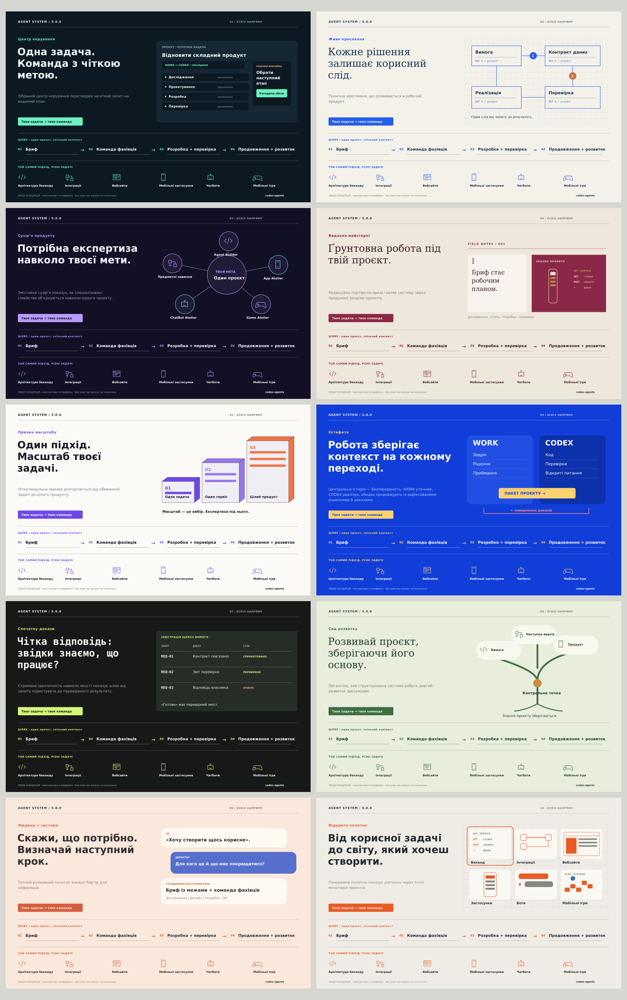

# Десять візуальних напрямів

[English](README.md) · [Українська](README.uk.md)

Це **десять дизайн-концепцій для вибору**, а не готова реклама. Вони пояснюють ту саму систему через різні візуальні ідентичності. Жоден напрям не обрано. Затверджена версія системи залишається 5.0.0; ці рекламні ескізи мають окрему версію 1.0.

**Відкрий [офлайн-галерею концепцій](concept-gallery.html)** після завантаження або клонування репозиторію. GitHub показує вихідний HTML, а не запускає його. Відкрий файл у браузері: сервер, встановлення й мережа не потрібні. Обери English або Українська вгорі праворуч. Порівнюй напрями через нумерований список або стрілки клавіатури. `?lang=uk#06` відкриває українську «Естафету». Вибір мови запам’ятовується на цьому пристрої, якщо браузер дозволяє локальне зберігання.

У галереї є повне полотно, сценарій, аудиторія, типографіка, палітра, план руху, адаптації під формати й правила збереження ідентичності кожного напряму. Кнопка **Скопіювати вибір** готує текст для обговорення; вона нічого не затверджує й не публікує.

[Повний англійський огляд](../assets/marketing/concept-contact-sheet.en.svg) · [Повний український огляд](../assets/marketing/concept-contact-sheet.uk.svg)

| № | Напрям | Головна історія | Докладний бриф |
| --- | --- | --- | --- |
| 01 | Центр керування | Одна задача, зрозуміла команда, видимі рішення власника | [Читати](concepts/01-mission-control.uk.md) |
| 02 | Живе креслення | Пов’язані вимоги, архітектура, реалізація й перевірка | [Читати](concepts/02-living-blueprint.uk.md) |
| 03 | Сузір’я продукту | Спеціалізовані сімейства навколо одного проєкту | [Читати](concepts/03-product-constellation.uk.md) |
| 04 | Видання майстерні | Преміальна редакційна практика через розділи проєкту | [Читати](concepts/04-atelier-editions.uk.md) |
| 05 | Призма масштабу | Гнучкий масштаб від однієї задачі до цілого продукту | [Читати](concepts/05-prism-of-scale.uk.md) |
| 06 | Естафета | Контекст переходить між WORK і CODEX та повертається з результатами | [Читати](concepts/06-relay.uk.md) |
| 07 | Спочатку докази | Шлях від кожної вимоги до результату, який можна перевірити | [Читати](concepts/07-evidence-first.uk.md) |
| 08 | Сад розвитку | Довгий розвиток зі збереженням знань проєкту | [Читати](concepts/08-launch-garden.uk.md) |
| 09 | Людина × система | Запит людською мовою стає конкретним наступним кроком | [Читати](concepts/09-human-and-system.uk.md) |
| 10 | Відкрите полотно | Діапазон: бекенд, інтеграції, веб, застосунки, боти й ігри | [Читати](concepts/10-open-canvas.uk.md) |

## Як обраний напрям перетворюється на фінальний матеріал

1. Обери номер і опиши бажані зміни. Текст вибору з галереї можна вставити в чат.
2. Узгодь аудиторію, майданчик, пропозицію та підтверджені твердження. Обери формати: обкладинка GitHub, презентація 16:9, PDF, відео 9:16 або матеріали для соцмереж.
3. Зафіксуй номер і точні уточнення в `selection.json`. До вибору власника лишай `unselected`; `approved-direction` — лише після явного вибору.
4. Зафіксуй палітру, типографіку, візуальну граматику, побудову іконок, рух та приклади. Запиши навмисні зміни й причини. Не змішуй несумісні напрями мовчки.
5. Створи фінальну розкадровку й репрезентативні кадри фінальної якості до адаптації всіх форматів. Перевір їхню відповідність затвердженій концепції.
6. Створи потрібні файли, перевір читабельність у реальному розмірі, рівнозначність мов і кожне фактичне твердження. Збережи SVG та редаговані макети.
7. Збережи матеріали, фінальну версію, докази тверджень і маніфест ідентичності в цьому репозиторії. За потреби внеси зміни бренду в опис випуску. Публікація чи придбання реклами — у межах явного доручення власника.

## Цілісність дизайну

Усі полотна мають однакові блоки порівняння: обкладинка зі змістовною графікою, видимий маршрут роботи та шість категорій задач. Інтерфейси — приклади, а не скриншоти випущених продуктів. Команда — модель ролей; справжні паралельні сабагенти залежать від середовища. Ці ескізи не вимірювали швидкість, дохід, перевагу, відповідність стандартам або сертифікацію. Підтримка виробників не мається на увазі.

Назви концепцій — робочі позначення, а не запропоновані зареєстровані бренди. Доступність торговельних марок чи ринкових назв не встановлено. Ця робота не змінює наявні іконки навичок і агентів.

`build_concepts.py` відтворює SVG, брифи й офлайн-галерею з перевіреного джерела. Потрібні Python 3 і Pillow для вимірювання тексту; шрифти не включено. SVG використовує DejaVu та поширені системні альтернативи. Заміна шрифтів може трохи відрізнятися між пристроями, тому фінальні комерційні експорти потрібно візуально перевіряти у відповідному середовищі.
