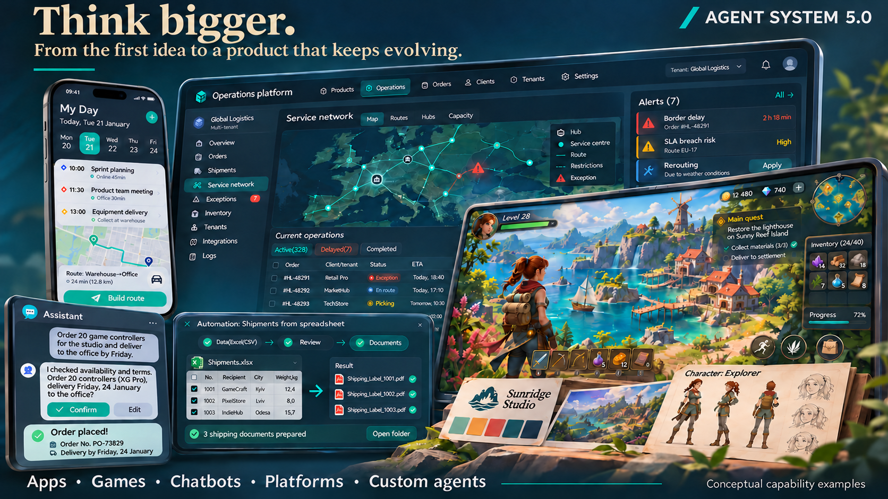

# Think bigger — English and Ukrainian campaign

[Українська](README.uk.md) · [English gallery](en.html) · [Українська галерея](uk.html)



One connected campaign presents applications, games, assistants, platforms, routine automation and custom specialists through the actual-looking products in the original composition. The English and Ukrainian editions follow the same ten material IDs, subjects, layout and product identity. English is the default repository edition; use the language switch in either gallery to change language while retaining the current material.

## The ten materials

| # | Material | What it makes visible |
| --- | --- | --- |
| 01 | Think bigger | The complete product range in the restored original composition |
| 02 | My Day | An agenda, a route and a reviewed daily-plan change across clients |
| 03 | Sunridge Studio and the game world | Studio identity, character art, gameplay, systems and progression |
| 04 | Assistant | A conversation, explicit confirmation and a coherent controller order |
| 05 | Global Logistics | Platform breadth and a concrete reviewed route change |
| 06 | Routine automation | Spreadsheet review, three prepared documents and one visible exception |
| 07 | Custom specialists | An agent constructor and reusable competence with an API-contract review |
| 08 | The product lifecycle | Research and design through build, quality, release and evolution |
| 09 | The same project continues | Requirements, decisions and identity carried into useful new capabilities |
| 10 | Your next task | An invitation to bring a focused task, existing project or new product |

The gallery includes the exact source-backed directory of **33 capabilities: 2 constructors, 11 App, 11 ChatBot and 9 Game**. It stays below the visual material in expandable families. Marketing is not an exhaustive technical inventory, and a mockup is not proof that its illustrated product has shipped.

## Files for viewing and downloading

| Edition | Gallery | Compact PDF |
| --- | --- | --- |
| English | [en.html](en.html) | [Campaign.en.pdf](pdf/Campaign.en.pdf) |
| Українська | [uk.html](uk.html) | [Campaign.uk.pdf](pdf/Campaign.uk.pdf) |

Download the repository and open `marketing/campaign/index.html`, `en.html` or `uk.html` in a browser. GitHub displays HTML source rather than executing it. The repository galleries reference the corresponding PNGs under `assets/marketing/campaign/en/` and `assets/marketing/campaign/uk/`; keep that directory layout. Viewing a downloaded repository requires no server, font download or internet. Canonical source links require internet.

The two tracked PDFs are compact, full-resolution JPEG delivery copies. They contain all ten whole images without cropping. Original PNGs remain the canonical artwork. Full lossless PDFs and self-contained HTML copies are generated separately as delivery/CI artifacts; they are not duplicated in Git. A standalone locale HTML embeds its own ten images and can be viewed without the repository. Keep its companion PDFs beside it when using its download links; switching language also requires the other locale HTML beside it.

## Localization and visual preservation

The requested localization changes Ukrainian text to English while retaining the campaign's composition, devices, colors, lighting, subjects and product identity. “Мій день” becomes **My Day**, “Асистент” becomes **Assistant**; **Global Logistics** and **Sunridge Studio** remain unchanged. Quantities, SKU/shipment identifiers, dates, prices and currencies retain their source meaning. Each localized pair must have the same dimensions and material ID.

All ten Ukrainian source hashes are locked in `campaign.json`. The historical first cover remains byte for byte identical to the recovered original, SHA-256 `ac9fad92384396039af134c824cf1663e0e00ca1d94fc3fc7767b997d4d82c4f`, dimensions **1672 × 941 px**. Only that first Ukrainian image is the recovered historical artwork; the other nine Ukrainian materials are its later continuation. English images are new localized derivatives, not recovered historical files.

The English localization is intended as a text-only visual edit. Equal dimensions, correct pairing and the source-image checks do not establish pixel-identical non-text regions between generated language editions. Review actual paired images for text completeness and visual preservation. The exporter itself never edits source bitmaps. Its full lossless PDFs must preserve every source RGB pixel for each language; the compact copies intentionally use JPEG compression for smaller downloads.

## Build and verification

```sh
python3 -B marketing/campaign/build_campaign.py --check-source
python3 -B marketing/campaign/build_campaign.py
python3 -B marketing/campaign/check_campaign.py
```

Dependencies are Pillow and pypdf. The normal build writes only the small repository-facing set here: `index.html`, `en.html`, `uk.html`, `pdf/Campaign.en.pdf`, `pdf/Campaign.uk.pdf` and `exports.json`. Use `--output /absolute/staging-directory` for a staged build; HTML asset references are intended for the final `marketing/campaign/` location.

Full lossless PDFs, compact delivery copies, embedded-image locale HTMLs and their receipt go to `reports/local-campaign-artifacts/` by default, outside reusable package inputs. Use `--artifacts-output /absolute/private-directory` to choose another location. If that option is explicitly supplied to the checker, a missing or partial private artifact set fails verification. On a fresh checkout, the default checker can verify tracked sources and outputs without inventing a prior private export result.

The checks cover all twenty required images, the ten paired dimensions/IDs, all ten protected Ukrainian hashes, localized metadata, all 33 capability names, complete HTML structure, PDF page counts, source dimensions, whole-image placement, receipt hashes and full-PDF RGB equality where those full artifacts exist. Receipts have no run timestamps, keeping the build reproducible. Visual review, English wording, browser layout, remote publication and CI each require their own observed evidence; hashes alone do not prove them.

## Scope and compatibility

The suite remains **5.0.0**. Canonical skill sources, installed icons, generated-agent versions and native product schemas are unchanged. This presentation update requires no host reinstall, product migration, memory reset or production deployment. It changes the advertising and its documentation, not an existing application's behavior.

The images are **conceptual capability examples**, not evidence of real orders, customers, revenue, performance or released products. Source generation, localization, review and publication status are recorded separately. The builder performs no GitHub write or installation. Continue from the active campaign pointer and its current evidence rather than reconstructing rejected visual branches.
