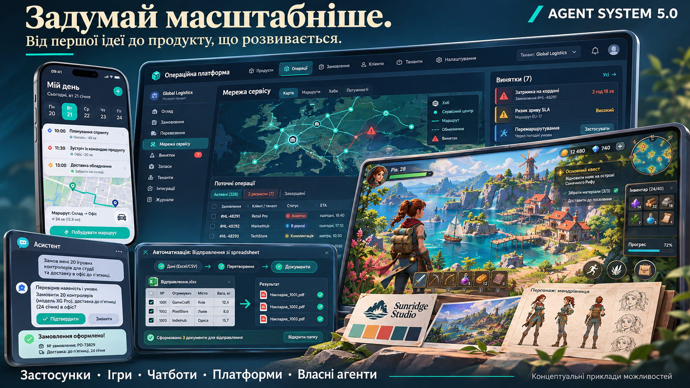

# Задумай масштабніше — англійська й українська кампанія

[English](README.md) · [English gallery](en.html) · [Українська галерея](uk.html)



Одна пов’язана кампанія показує застосунки, ігри, асистентів, платформи, автоматизацію рутини й власних спеціалістів через предметні продукти в оригінальній композиції. Англійська й українська версії мають ті самі десять ID матеріалів, сюжети, компонування та продуктову ідентичність. Типова мова репозиторію — англійська; перемикач у будь-якій галереї змінює мову, зберігаючи поточний матеріал.

## Десять матеріалів

| № | Матеріал | Що він показує |
| --- | --- | --- |
| 01 | Задумай масштабніше | Увесь діапазон продуктів у відновленій оригінальній композиції |
| 02 | Мій день | Розклад, маршрут і переглянуту зміну плану дня в різних клієнтах |
| 03 | Sunridge Studio та ігровий світ | Ідентичність студії, арт персонажа, геймплей, системи й прогресію |
| 04 | Асистент | Розмову, явне підтвердження та узгоджене замовлення контролерів |
| 05 | Global Logistics | Масштаб платформи й конкретну переглянуту зміну маршруту |
| 06 | Автоматизація рутини | Перевірку таблиці, три підготовлені документи та один видимий виняток |
| 07 | Власні спеціалісти | Конструктор агента й перевикористовувану компетенцію на прикладі перевірки API-контракту |
| 08 | Життєвий цикл продукту | Від дослідження й дизайну через створення, якість і випуск до розвитку |
| 09 | Продовження того самого проєкту | Збереження вимог, рішень та ідентичності в нових корисних можливостях |
| 10 | Твоя наступна задача | Запрошення принести окрему задачу, чинний проєкт або новий продукт |

Галерея містить точний довідник **33 компетенцій із посиланнями на джерела: 2 конструктори, 11 App, 11 ChatBot і 9 Game**. Він розташований під візуальними матеріалами в сімействах, які можна розгорнути. Реклама не є вичерпним технічним переліком, а макет не доводить, що зображений продукт уже випущено.

## Файли для перегляду й завантаження

| Версія | Галерея | Компактний PDF |
| --- | --- | --- |
| English | [en.html](en.html) | [Campaign.en.pdf](pdf/Campaign.en.pdf) |
| Українська | [uk.html](uk.html) | [Campaign.uk.pdf](pdf/Campaign.uk.pdf) |

Завантаж репозиторій і відкрий `marketing/campaign/index.html`, `en.html` або `uk.html` у браузері. GitHub показує вихідний HTML, а не виконує його. Галереї репозиторію посилаються на відповідні PNG у `assets/marketing/campaign/en/` та `assets/marketing/campaign/uk/`; збережи цю структуру каталогів. Для перегляду завантаженого репозиторію не потрібні сервер, завантаження шрифтів чи інтернет. Посилання на канонічні джерела потребують мережі.

Два PDF у репозиторії — компактні копії для передачі, які використовують JPEG із повною роздільністю. Вони містять усі десять цілих зображень без обрізання. Оригінальні PNG залишаються канонічним артом. Повні PDF без втрат і самодостатні HTML-копії створюються окремо як матеріали передачі/CI; їх не дублюють у Git. Самодостатній HTML однієї мови містить свої десять зображень і відкривається без репозиторію. Для його посилань завантаження тримай відповідні PDF поруч; для перемикання мови також потрібен сусідній HTML іншої мови.

## Локалізація й збереження графіки

Запитана локалізація замінює український текст англійським, зберігаючи композицію, пристрої, кольори, освітлення, сюжети та продуктову ідентичність кампанії. «Мій день» стає **My Day**, «Асистент» — **Assistant**; **Global Logistics** і **Sunridge Studio** не змінюються. Кількості, SKU/ID відправлень, дати, ціни й валюти зберігають зміст джерела. Кожна локалізована пара має однакові розміри й ID матеріалу.

Хеші всіх десяти українських джерел зафіксовані в `campaign.json`. Історична перша обкладинка побайтово тотожна відновленому оригіналу: SHA-256 `ac9fad92384396039af134c824cf1663e0e00ca1d94fc3fc7767b997d4d82c4f`, розміри **1672 × 941 px**. Лише перше українське зображення є відновленим історичним артом; дев’ять інших українських матеріалів — його пізніше продовження. Англійські зображення — нові локалізовані похідні, а не знайдені історичні файли.

Англійська локалізація задумана як візуальна правка лише тексту. Однакові розміри, правильні пари й перевірки джерел не доводять піксельної тотожності нетекстових ділянок між згенерованими мовними версіями. Переглядай фактичні пари зображень, перевіряючи повноту перекладу й збереження графіки. Сам експортер ніколи не змінює вихідні растри. Його повні PDF без втрат мають зберігати кожний RGB-піксель джерела кожною мовою; компактні копії свідомо використовують JPEG для менших завантажень.

## Збірка й перевірка

```sh
python3 -B marketing/campaign/build_campaign.py --check-source
python3 -B marketing/campaign/build_campaign.py
python3 -B marketing/campaign/check_campaign.py
```

Залежності — Pillow і pypdf. Звичайна збірка записує сюди лише невеликий набір для репозиторію: `index.html`, `en.html`, `uk.html`, `pdf/Campaign.en.pdf`, `pdf/Campaign.uk.pdf` і `exports.json`. Для тимчасової збірки використовуй `--output /absolute/staging-directory`; посилання на зображення в HTML розраховані на остаточне розташування `marketing/campaign/`.

Повні PDF без втрат, компактні копії для передачі, HTML зі вбудованими зображеннями й записи перевірок типово потрапляють до `reports/local-campaign-artifacts/`, поза входами багаторазових пакетів. `--artifacts-output /absolute/private-directory` задає інший каталог. Якщо цей параметр явно передати перевірці, відсутній або неповний приватний набір спричинить помилку. У свіжій копії репозиторію типова перевірка може перевірити джерела й результати Git, не вигадуючи результат попереднього приватного експорту.

Перевірки охоплюють усі двадцять потрібних зображень, десять пар розмірів/ID, десять захищених українських хешів, локалізовані метадані, усі 33 канонічні назви, повну HTML-структуру, кількість PDF-сторінок, розміри джерел, розміщення цілого зображення, хеші результатів і RGB-тотожність повних PDF там, де є ці повні матеріали. Записи не містять часу запуску, тому збірка відтворювана. Візуальна оцінка, англійські формулювання, браузерна верстка, віддалена публікація й CI потребують окремих фактичних доказів; самі хеші цього не доводять.

## Межі й сумісність

Комплект залишається **5.0.0**. Канонічні джерела навичок, установлені іконки, версії створених агентів і нативні схеми продуктів не змінені. Це презентаційне оновлення не потребує перевстановлення в середовищі, міграції продукту, скидання пам’яті чи деплою. Воно змінює рекламу й її документацію, а не поведінку чинного застосунку.

Зображення є **концептуальними прикладами можливостей**, а не доказами реальних замовлень, клієнтів, доходу, продуктивності або випущених продуктів. Створення джерел, локалізація, оцінка й публікація фіксуються окремо. Збирач не записує в GitHub і нічого не встановлює. Продовжуй від поточного покажчика кампанії та її доказів, не відтворюючи відхилені візуальні гілки.
