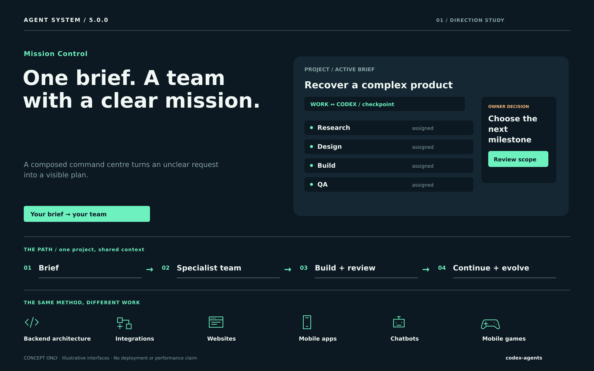

# 01 — Mission Control

> One brief. A team with a clear mission.

A composed command centre turns an unclear request into a visible plan. Specialists have a purpose, the owner sees decisions, and progress is tied to evidence.

## Audience

Technical founders and engineering leads who want oversight without coordinating every role.

## Graphic direction

A dark operational canvas; one brief at the centre, clearly named specialist lanes, compact evidence cards. Mint shows active work; amber marks an owner decision.

## Narrative

Open on one plain-language brief. Reveal the director and four roles. Follow one requirement into implementation and verification. Finish with a shared WORK + CODEX checkpoint.

## Motion / storyboard

Cards enter in causal order; a single route line follows the active handoff. 12–18 seconds. Reduced-motion version uses discrete cuts.

## Identity to preserve

Preserve the navy/mint ratio, rectangular panels, left-aligned type, status vocabulary and one amber owner-decision signal. No decorative radar or fake live metrics.

## Palette and typography

| Role | Value |
| --- | --- |
| Background | `#0C1822` |
| Foreground | `#F1F8F5` |
| Primary accent | `#6DF1BE` |
| Secondary accent | `#F1B777` |
| Surface | `#142732` |
| Type | `Arial, sans-serif` |

## Adaptation

GitHub hero: crop the headline and primary graphic to 1600×640, retain the system name and concept status. Marketplace: use 16:9 hero → lifecycle → six use cases → evidence → first brief. Vertical 9:16: split the hero, handoff and use-case panels into separate frames; never scale the entire board into unreadable text. Social 1:1: one promise and one graphic. A full PDF/deck, video or final brand kit is made only after a direction is selected.

## Claims and proof

The graphic demonstrates an intended method. Do not present illustrated screens as shipped products or illustrative states as measured results. No superiority, revenue, speed, autonomy, compliance, certification or vendor-endorsement claim without attributable evidence. Real subagent availability, tools, platforms and deployment permissions are checked per environment.

