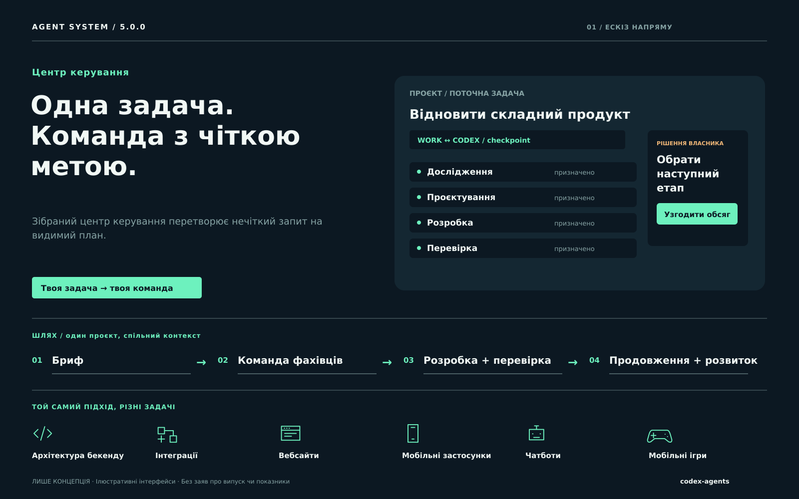

# 01 — Центр керування

> Одна задача. Команда з чіткою метою.

Зібраний центр керування перетворює нечіткий запит на видимий план. Кожен фахівець має роль, власник бачить рішення, а прогрес спирається на докази.

## Аудиторія

Технічні засновники й керівники розробки, яким потрібен контроль без ручної координації кожної ролі.

## Графічний напрям

Темне операційне полотно; одна задача в центрі, підписані доріжки фахівців, компактні картки доказів. М’ятний означає активну роботу; бурштиновий — рішення власника.

## Сценарій

Почати з одного запиту людською мовою. Показати директора й чотири ролі. Простежити вимогу до реалізації та перевірки. Завершити спільною контрольною точкою WORK + CODEX.

## Рух / розкадрування

Картки з’являються в причинному порядку; одна лінія відстежує активну передачу. 12–18 секунд. Версія зі зменшеним рухом — послідовна зміна кадрів.

## Ідентичність для збереження

Зберегти співвідношення темно-синього й м’ятного, прямокутні панелі, ліве вирівнювання, словник станів та один бурштиновий сигнал рішення власника. Без декоративного радара й вигаданих live-метрик.

## Палітра й типографіка

| Role | Value |
| --- | --- |
| Background | `#0C1822` |
| Foreground | `#F1F8F5` |
| Primary accent | `#6DF1BE` |
| Secondary accent | `#F1B777` |
| Surface | `#142732` |
| Type | `Arial, sans-serif` |

## Адаптація

Обкладинка GitHub: кадрувати заголовок і головну графіку до 1600×640, зберегти назву системи та статус концепції. Майданчик продажу: обкладинка 16:9 → життєвий цикл → шість типів задач → докази → перший бриф. Вертикаль 9:16: розділити hero, передачу й приклади на окремі кадри; не зменшувати все полотно до нечитабельного тексту. Соцмережі 1:1: одна обіцянка й одна графіка. Повний PDF, презентація, відео або фінальний бренд-пакет створюється після вибору напряму.

## Твердження й докази

Графіка пояснює задуманий підхід. Ілюстративні екрани не видавати за випущені продукти, а приклади станів — за виміряні результати. Заяви про перевагу, дохід, швидкість, автономність, відповідність стандартам, сертифікацію або підтримку виробника потребують конкретних доказів. Наявність справжніх сабагентів, інструментів, платформ і дозволів на випуск перевіряється в кожному середовищі.

