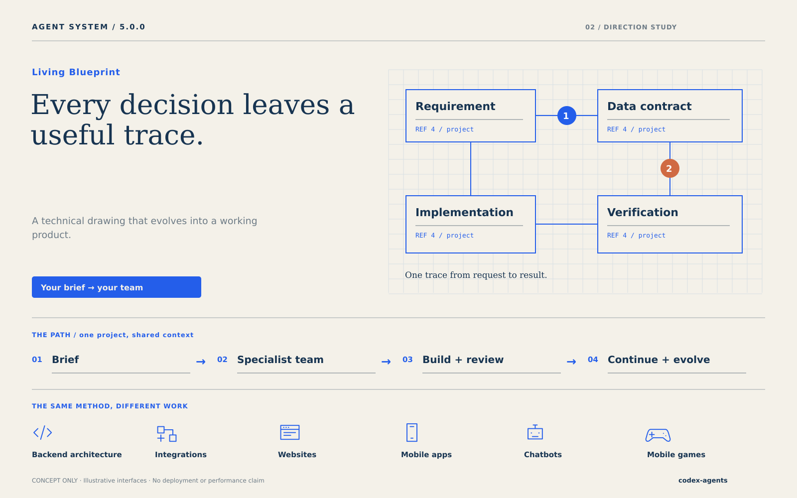

# 02 — Living Blueprint

> Every decision leaves a useful trace.

A technical drawing that evolves into a working product. Requirements, architecture and tests remain visibly connected, from a single backend concern to a whole system.

## Audience

Architects, backend leads and teams that need explicit contracts, trade-offs and continuity.

## Graphic direction

Ivory drafting paper, cobalt construction lines, annotation numbers and restrained rust corrections. Product silhouettes grow out of the same measured grid.

## Narrative

Start with a requirement annotation. Unfold its data contract, design decision, implementation and test. Zoom out to show apps, games and integrations sharing the method.

## Motion / storyboard

Lines draw once, annotations settle into place, then the blueprint becomes a product outline. Never imply that drawing alone produces tested software.

## Identity to preserve

Keep the paper background, cobalt geometry, numbered annotations and serif headline with sans-serif technical captions.

## Palette and typography

| Role | Value |
| --- | --- |
| Background | `#F4F1E9` |
| Foreground | `#173451` |
| Primary accent | `#245EEA` |
| Secondary accent | `#D06A43` |
| Surface | `#FFFFFF` |
| Type | `Georgia, serif` |

## Adaptation

GitHub hero: crop the headline and primary graphic to 1600×640, retain the system name and concept status. Marketplace: use 16:9 hero → lifecycle → six use cases → evidence → first brief. Vertical 9:16: split the hero, handoff and use-case panels into separate frames; never scale the entire board into unreadable text. Social 1:1: one promise and one graphic. A full PDF/deck, video or final brand kit is made only after a direction is selected.

## Claims and proof

The graphic demonstrates an intended method. Do not present illustrated screens as shipped products or illustrative states as measured results. No superiority, revenue, speed, autonomy, compliance, certification or vendor-endorsement claim without attributable evidence. Real subagent availability, tools, platforms and deployment permissions are checked per environment.

