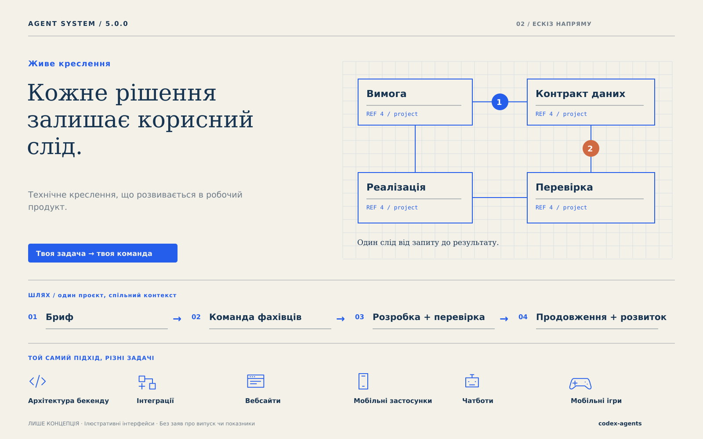

# 02 — Живе креслення

> Кожне рішення залишає корисний слід.

Технічне креслення, що розвивається в робочий продукт. Вимоги, архітектура й перевірки залишаються пов’язаними — від однієї проблеми бекенду до цілої системи.

## Аудиторія

Архітектори, бекенд-ліди й команди, яким потрібні точні контракти, обґрунтовані компроміси та безперервність.

## Графічний напрям

Креслярський папір кольору слонової кістки, кобальтові лінії, номери виносок і стримані теракотові уточнення. Силуети продуктів виростають із тієї самої розмірної сітки.

## Сценарій

Почати з виноски вимоги. Розкрити її контракт даних, рішення, реалізацію та тест. Віддалити камеру й показати застосунки, ігри та інтеграції з тим самим підходом.

## Рух / розкадрування

Лінії прокреслюються один раз, виноски стають на місця, потім креслення переходить у контур продукту. Не створювати враження, що саме креслення вже є перевіреним ПЗ.

## Ідентичність для збереження

Зберегти паперове тло, кобальтову геометрію, нумеровані виноски та заголовок із засічками з технічними підписами без засічок.

## Палітра й типографіка

| Role | Value |
| --- | --- |
| Background | `#F4F1E9` |
| Foreground | `#173451` |
| Primary accent | `#245EEA` |
| Secondary accent | `#D06A43` |
| Surface | `#FFFFFF` |
| Type | `Georgia, serif` |

## Адаптація

Обкладинка GitHub: кадрувати заголовок і головну графіку до 1600×640, зберегти назву системи та статус концепції. Майданчик продажу: обкладинка 16:9 → життєвий цикл → шість типів задач → докази → перший бриф. Вертикаль 9:16: розділити hero, передачу й приклади на окремі кадри; не зменшувати все полотно до нечитабельного тексту. Соцмережі 1:1: одна обіцянка й одна графіка. Повний PDF, презентація, відео або фінальний бренд-пакет створюється після вибору напряму.

## Твердження й докази

Графіка пояснює задуманий підхід. Ілюстративні екрани не видавати за випущені продукти, а приклади станів — за виміряні результати. Заяви про перевагу, дохід, швидкість, автономність, відповідність стандартам, сертифікацію або підтримку виробника потребують конкретних доказів. Наявність справжніх сабагентів, інструментів, платформ і дозволів на випуск перевіряється в кожному середовищі.

