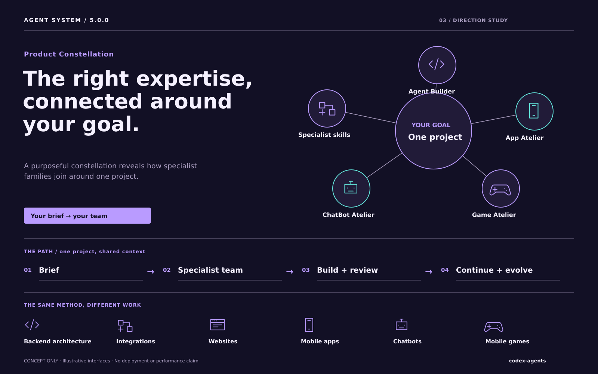

# 03 — Product Constellation

> The right expertise, connected around your goal.

A purposeful constellation reveals how specialist families join around one project. The emphasis is collaboration across disciplines, with an obvious centre and readable relationships.

## Audience

Creators with multidisciplinary projects: an app, its support bot, integration services and launch materials.

## Graphic direction

A deep-plum field, large labelled nodes and a deliberate five-cluster orbit. Connections express real handoffs; small stars are absent.

## Narrative

Place the owner’s goal at the centre. Activate only relevant families. Show one cross-family task and return its evidence to the project checkpoint.

## Motion / storyboard

Orbit is a compositional metaphor, not perpetual motion. Nodes illuminate on demand; lines appear only when a handoff occurs.

## Identity to preserve

Preserve central-goal hierarchy, five readable family clusters, plum/lilac/turquoise palette and meaningful labelled edges.

## Palette and typography

| Role | Value |
| --- | --- |
| Background | `#121025` |
| Foreground | `#F5F1FF` |
| Primary accent | `#B99BFF` |
| Secondary accent | `#62E4DA` |
| Surface | `#211B38` |
| Type | `Arial, sans-serif` |

## Adaptation

GitHub hero: crop the headline and primary graphic to 1600×640, retain the system name and concept status. Marketplace: use 16:9 hero → lifecycle → six use cases → evidence → first brief. Vertical 9:16: split the hero, handoff and use-case panels into separate frames; never scale the entire board into unreadable text. Social 1:1: one promise and one graphic. A full PDF/deck, video or final brand kit is made only after a direction is selected.

## Claims and proof

The graphic demonstrates an intended method. Do not present illustrated screens as shipped products or illustrative states as measured results. No superiority, revenue, speed, autonomy, compliance, certification or vendor-endorsement claim without attributable evidence. Real subagent availability, tools, platforms and deployment permissions are checked per environment.

