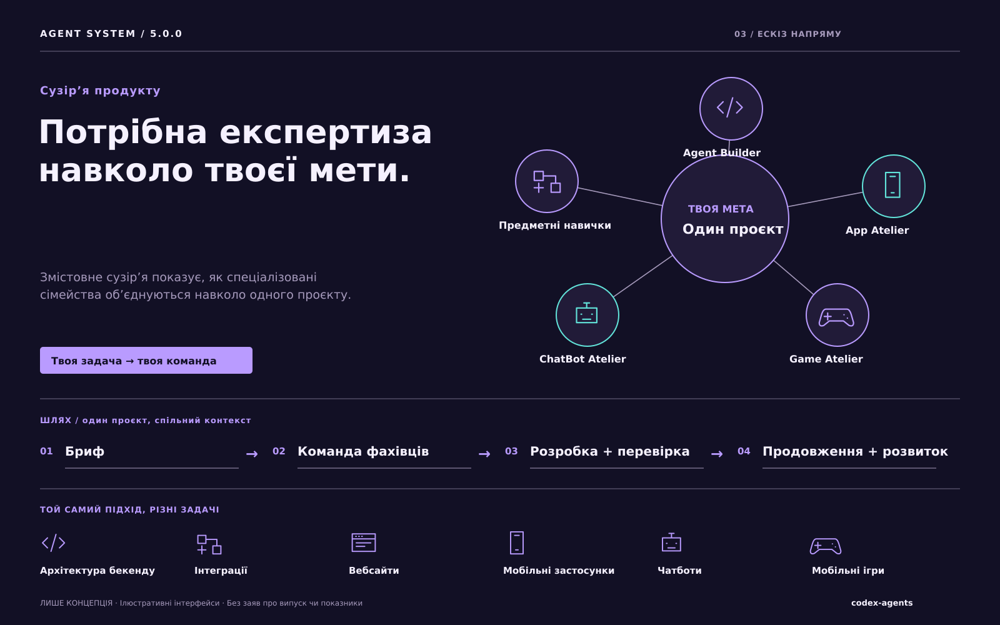

# 03 — Сузір’я продукту

> Потрібна експертиза навколо твоєї мети.

Змістовне сузір’я показує, як спеціалізовані сімейства об’єднуються навколо одного проєкту. Акцент — на співпраці дисциплін із чітким центром і зрозумілими зв’язками.

## Аудиторія

Автори міждисциплінарних проєктів: застосунок, бот підтримки, інтеграційні сервіси та матеріали запуску.

## Графічний напрям

Глибоке сливове поле, великі підписані вузли й продумана орбіта п’яти кластерів. Зв’язки означають реальні передачі; дрібних декоративних зірок немає.

## Сценарій

Розмістити мету власника в центрі. Активувати лише потрібні сімейства. Показати одну міжсімейну задачу й повернути докази до контрольної точки проєкту.

## Рух / розкадрування

Орбіта — композиційна метафора без постійного обертання. Вузли активуються за потреби; лінії з’являються лише під час передачі.

## Ідентичність для збереження

Зберегти ієрархію центральної мети, п’ять читабельних кластерів, сливово-бузково-бірюзову палітру й змістовні підписані зв’язки.

## Палітра й типографіка

| Role | Value |
| --- | --- |
| Background | `#121025` |
| Foreground | `#F5F1FF` |
| Primary accent | `#B99BFF` |
| Secondary accent | `#62E4DA` |
| Surface | `#211B38` |
| Type | `Arial, sans-serif` |

## Адаптація

Обкладинка GitHub: кадрувати заголовок і головну графіку до 1600×640, зберегти назву системи та статус концепції. Майданчик продажу: обкладинка 16:9 → життєвий цикл → шість типів задач → докази → перший бриф. Вертикаль 9:16: розділити hero, передачу й приклади на окремі кадри; не зменшувати все полотно до нечитабельного тексту. Соцмережі 1:1: одна обіцянка й одна графіка. Повний PDF, презентація, відео або фінальний бренд-пакет створюється після вибору напряму.

## Твердження й докази

Графіка пояснює задуманий підхід. Ілюстративні екрани не видавати за випущені продукти, а приклади станів — за виміряні результати. Заяви про перевагу, дохід, швидкість, автономність, відповідність стандартам, сертифікацію або підтримку виробника потребують конкретних доказів. Наявність справжніх сабагентів, інструментів, платформ і дозволів на випуск перевіряється в кожному середовищі.

