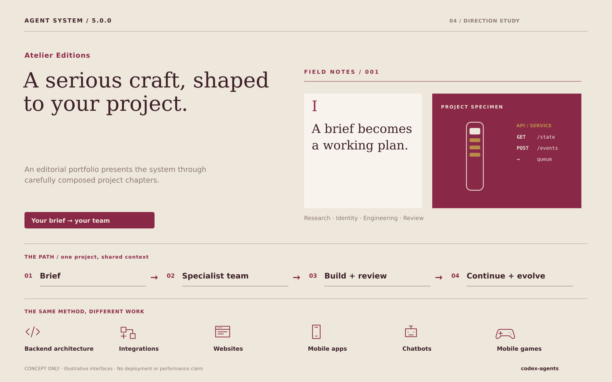

# 04 — Atelier Editions

> A serious craft, shaped to your project.

An editorial portfolio presents the system through carefully composed project chapters. It feels like a premium creative and engineering practice with concrete deliverables.

## Audience

Independent creators, product owners and buyers who value coherent experience, design and documented work.

## Graphic direction

Oversized editorial serif, burgundy folio numbers, generous paper margins and specimen-like product frames. Each chapter is an outcome.

## Narrative

Turn the brief into chapter one. Move through research, visual identity, engineering, independent review and release preparation. End on a living project archive.

## Motion / storyboard

Page-like cuts and slow typographic reveals. Avoid simulated paper textures that obscure the actual interface or claims.

## Identity to preserve

Preserve burgundy/ivory, folio numbering, generous negative space, serif hierarchy and consistent project specimen frames.

## Palette and typography

| Role | Value |
| --- | --- |
| Background | `#EEE7DB` |
| Foreground | `#3C2028` |
| Primary accent | `#8A2947` |
| Secondary accent | `#B98C47` |
| Surface | `#F8F4ED` |
| Type | `Georgia, serif` |

## Adaptation

GitHub hero: crop the headline and primary graphic to 1600×640, retain the system name and concept status. Marketplace: use 16:9 hero → lifecycle → six use cases → evidence → first brief. Vertical 9:16: split the hero, handoff and use-case panels into separate frames; never scale the entire board into unreadable text. Social 1:1: one promise and one graphic. A full PDF/deck, video or final brand kit is made only after a direction is selected.

## Claims and proof

The graphic demonstrates an intended method. Do not present illustrated screens as shipped products or illustrative states as measured results. No superiority, revenue, speed, autonomy, compliance, certification or vendor-endorsement claim without attributable evidence. Real subagent availability, tools, platforms and deployment permissions are checked per environment.

