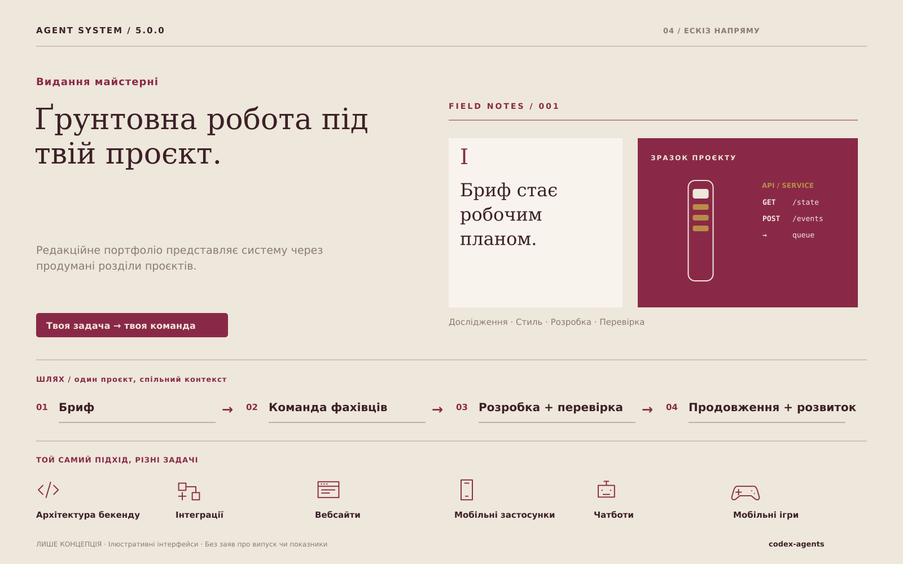

# 04 — Видання майстерні

> Ґрунтовна робота під твій проєкт.

Редакційне портфоліо представляє систему через продумані розділи проєктів. Враження преміальної творчої та інженерної практики з конкретними результатами.

## Аудиторія

Незалежні автори, власники продуктів і покупці, що цінують цілісний досвід, дизайн та задокументовану роботу.

## Графічний напрям

Велика редакційна антиква, бордові номери сторінок, щедрі паперові поля й продуктові рамки як зразки. Кожен розділ — результат.

## Сценарій

Перетворити бриф на перший розділ. Пройти дослідження, візуальну ідентичність, інженерію, незалежну перевірку й підготовку випуску. Завершити живим архівом проєкту.

## Рух / розкадрування

Монтажні переходи як сторінки й повільне розкриття типографіки. Уникати текстур паперу, що заважають інтерфейсу або змісту.

## Ідентичність для збереження

Зберегти бордово-кремову палітру, нумерацію, великий вільний простір, ієрархію антикви й однакові рамки зразків проєктів.

## Палітра й типографіка

| Role | Value |
| --- | --- |
| Background | `#EEE7DB` |
| Foreground | `#3C2028` |
| Primary accent | `#8A2947` |
| Secondary accent | `#B98C47` |
| Surface | `#F8F4ED` |
| Type | `Georgia, serif` |

## Адаптація

Обкладинка GitHub: кадрувати заголовок і головну графіку до 1600×640, зберегти назву системи та статус концепції. Майданчик продажу: обкладинка 16:9 → життєвий цикл → шість типів задач → докази → перший бриф. Вертикаль 9:16: розділити hero, передачу й приклади на окремі кадри; не зменшувати все полотно до нечитабельного тексту. Соцмережі 1:1: одна обіцянка й одна графіка. Повний PDF, презентація, відео або фінальний бренд-пакет створюється після вибору напряму.

## Твердження й докази

Графіка пояснює задуманий підхід. Ілюстративні екрани не видавати за випущені продукти, а приклади станів — за виміряні результати. Заяви про перевагу, дохід, швидкість, автономність, відповідність стандартам, сертифікацію або підтримку виробника потребують конкретних доказів. Наявність справжніх сабагентів, інструментів, платформ і дозволів на випуск перевіряється в кожному середовищі.

