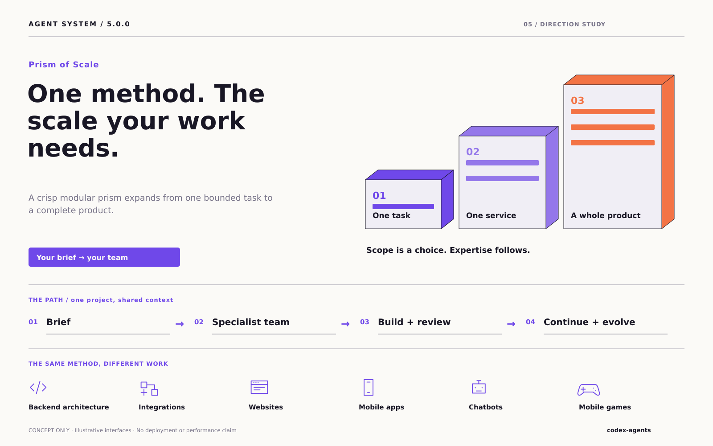

# 05 — Prism of Scale

> One method. The scale your work needs.

A crisp modular prism expands from one bounded task to a complete product. It makes flexible scope tangible without pretending every project needs the largest team.

## Audience

People comparing a small focused assignment with a larger product initiative; useful for future packaging tiers without inventing prices.

## Graphic direction

Black oversized type, white space and violet/orange folded modules. Small, medium and large scopes share one visual construction grammar.

## Narrative

Isolate a backend decision. Expand it into a service, then an app with support and integrations. Show that scope is deliberately chosen before work expands.

## Motion / storyboard

Modules unfold along one axis, then lock into a stable composition. Every expansion is labelled as a scope decision.

## Identity to preserve

Keep fold angles, three scope levels, bold grotesk headings and violet/orange accents; preserve the small-task route in every adaptation.

## Palette and typography

| Role | Value |
| --- | --- |
| Background | `#FBFAF7` |
| Foreground | `#191725` |
| Primary accent | `#6F48E9` |
| Secondary accent | `#F37345` |
| Surface | `#F0EEF5` |
| Type | `Arial, sans-serif` |

## Adaptation

GitHub hero: crop the headline and primary graphic to 1600×640, retain the system name and concept status. Marketplace: use 16:9 hero → lifecycle → six use cases → evidence → first brief. Vertical 9:16: split the hero, handoff and use-case panels into separate frames; never scale the entire board into unreadable text. Social 1:1: one promise and one graphic. A full PDF/deck, video or final brand kit is made only after a direction is selected.

## Claims and proof

The graphic demonstrates an intended method. Do not present illustrated screens as shipped products or illustrative states as measured results. No superiority, revenue, speed, autonomy, compliance, certification or vendor-endorsement claim without attributable evidence. Real subagent availability, tools, platforms and deployment permissions are checked per environment.

