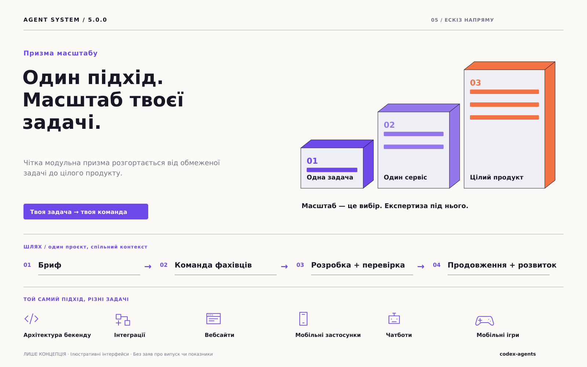

# 05 — Призма масштабу

> Один підхід. Масштаб твоєї задачі.

Чітка модульна призма розгортається від обмеженої задачі до цілого продукту. Гнучкий масштаб стає наочним без припущення, що кожному проєкту потрібна найбільша команда.

## Аудиторія

Люди, що порівнюють вузьку задачу з великим продуктовим задумом; підходить для майбутніх пакетів без вигадування цін.

## Графічний напрям

Великий чорний шрифт, білий простір і фіолетово-помаранчеві складені модулі. Малий, середній і великий масштаби мають одну візуальну граматику.

## Сценарій

Виокремити рішення в бекенді. Розгорнути його в сервіс, потім у застосунок із підтримкою та інтеграціями. Показати свідомий вибір масштабу до розширення робіт.

## Рух / розкадрування

Модулі розкриваються вздовж однієї осі й фіксуються в стійкій композиції. Кожне розширення підписане як рішення про масштаб.

## Ідентичність для збереження

Зберегти кути складок, три масштаби, жирний гротеск і фіолетово-помаранчеві акценти; у кожній адаптації лишити маршрут малої задачі.

## Палітра й типографіка

| Role | Value |
| --- | --- |
| Background | `#FBFAF7` |
| Foreground | `#191725` |
| Primary accent | `#6F48E9` |
| Secondary accent | `#F37345` |
| Surface | `#F0EEF5` |
| Type | `Arial, sans-serif` |

## Адаптація

Обкладинка GitHub: кадрувати заголовок і головну графіку до 1600×640, зберегти назву системи та статус концепції. Майданчик продажу: обкладинка 16:9 → життєвий цикл → шість типів задач → докази → перший бриф. Вертикаль 9:16: розділити hero, передачу й приклади на окремі кадри; не зменшувати все полотно до нечитабельного тексту. Соцмережі 1:1: одна обіцянка й одна графіка. Повний PDF, презентація, відео або фінальний бренд-пакет створюється після вибору напряму.

## Твердження й докази

Графіка пояснює задуманий підхід. Ілюстративні екрани не видавати за випущені продукти, а приклади станів — за виміряні результати. Заяви про перевагу, дохід, швидкість, автономність, відповідність стандартам, сертифікацію або підтримку виробника потребують конкретних доказів. Наявність справжніх сабагентів, інструментів, платформ і дозволів на випуск перевіряється в кожному середовищі.

