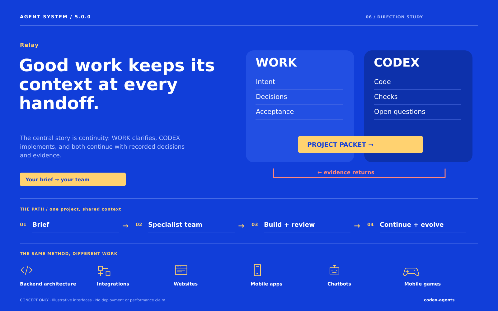

# 06 — Relay

> Good work keeps its context at every handoff.

The central story is continuity: WORK clarifies, CODEX implements, and both continue with recorded decisions and evidence. Handoffs are the hero.

## Audience

Users who already switch between planning and coding tools and want a repeatable joint workflow.

## Graphic direction

Electric cobalt, warm yellow batons and a strong split-screen WORK/CODEX layout. The same project packet appears on both sides.

## Narrative

Write one brief in WORK. Carry requirements, decisions and acceptance criteria into CODEX. Return code, checks and open questions. Continue without a fresh project.

## Motion / storyboard

A single baton crosses the split and returns with evidence. Use clear pauses; no implication of built-in live synchronisation.

## Identity to preserve

Preserve the two named modes, visible shared packet, cobalt/yellow/coral ratio and the return path as well as the outbound path.

## Palette and typography

| Role | Value |
| --- | --- |
| Background | `#113ED9` |
| Foreground | `#FFFFFF` |
| Primary accent | `#FFD270` |
| Secondary accent | `#FF877C` |
| Surface | `#224FE3` |
| Type | `Arial, sans-serif` |

## Adaptation

GitHub hero: crop the headline and primary graphic to 1600×640, retain the system name and concept status. Marketplace: use 16:9 hero → lifecycle → six use cases → evidence → first brief. Vertical 9:16: split the hero, handoff and use-case panels into separate frames; never scale the entire board into unreadable text. Social 1:1: one promise and one graphic. A full PDF/deck, video or final brand kit is made only after a direction is selected.

## Claims and proof

The graphic demonstrates an intended method. Do not present illustrated screens as shipped products or illustrative states as measured results. No superiority, revenue, speed, autonomy, compliance, certification or vendor-endorsement claim without attributable evidence. Real subagent availability, tools, platforms and deployment permissions are checked per environment.

