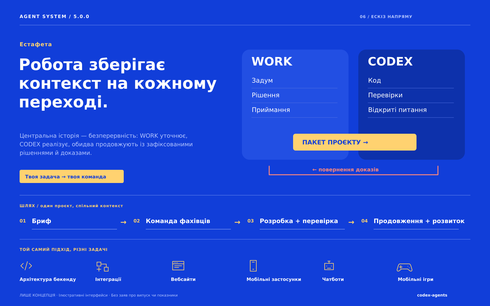

# 06 — Естафета

> Робота зберігає контекст на кожному переході.

Центральна історія — безперервність: WORK уточнює, CODEX реалізує, обидва продовжують із зафіксованими рішеннями й доказами. Головний герой — передача контексту.

## Аудиторія

Користувачі, що вже перемикаються між плануванням і розробкою та хочуть повторювану спільну роботу.

## Графічний напрям

Електричний кобальт, теплі жовті естафетні блоки та сильна композиція WORK/CODEX навпіл. Той самий пакет проєкту присутній з обох боків.

## Сценарій

Написати один бриф у WORK. Передати вимоги, рішення та критерії приймання в CODEX. Повернути код, перевірки й відкриті питання. Продовжити той самий проєкт.

## Рух / розкадрування

Один естафетний блок перетинає поділ і повертається з доказами. Чіткі паузи; без натяку на вбудовану синхронізацію в реальному часі.

## Ідентичність для збереження

Зберегти два підписані режими, видимий спільний пакет, кобальтово-жовто-коралове співвідношення та зворотний маршрут поряд із прямим.

## Палітра й типографіка

| Role | Value |
| --- | --- |
| Background | `#113ED9` |
| Foreground | `#FFFFFF` |
| Primary accent | `#FFD270` |
| Secondary accent | `#FF877C` |
| Surface | `#224FE3` |
| Type | `Arial, sans-serif` |

## Адаптація

Обкладинка GitHub: кадрувати заголовок і головну графіку до 1600×640, зберегти назву системи та статус концепції. Майданчик продажу: обкладинка 16:9 → життєвий цикл → шість типів задач → докази → перший бриф. Вертикаль 9:16: розділити hero, передачу й приклади на окремі кадри; не зменшувати все полотно до нечитабельного тексту. Соцмережі 1:1: одна обіцянка й одна графіка. Повний PDF, презентація, відео або фінальний бренд-пакет створюється після вибору напряму.

## Твердження й докази

Графіка пояснює задуманий підхід. Ілюстративні екрани не видавати за випущені продукти, а приклади станів — за виміряні результати. Заяви про перевагу, дохід, швидкість, автономність, відповідність стандартам, сертифікацію або підтримку виробника потребують конкретних доказів. Наявність справжніх сабагентів, інструментів, платформ і дозволів на випуск перевіряється в кожному середовищі.

