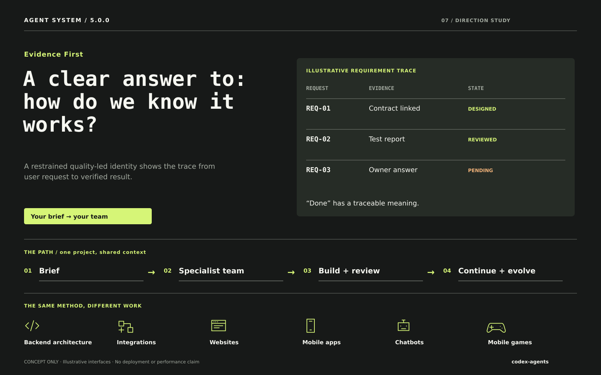

# 07 — Evidence First

> A clear answer to: how do we know it works?

A restrained quality-led identity shows the trace from user request to verified result. It presents review and acceptance as part of the work, with honest unresolved states.

## Audience

Engineering buyers, regulated or complex internal teams and technically sceptical users who need inspectable outputs.

## Graphic direction

Graphite background, acid-lime marks, large requirement IDs and an intentionally readable evidence table. Example data is labelled as illustrative.

## Narrative

Ask what “done” means. Attach acceptance criteria to a requirement. Show the implementation, QA finding and result. End with a real stop condition when evidence is missing.

## Motion / storyboard

A requirement row gains links one by one. Pass/pending states appear only as an explanatory example; no rolling fake success counter.

## Identity to preserve

Preserve readable IDs, explicit example labels, three honest states and generous table spacing. Never use quality badges as certification.

## Palette and typography

| Role | Value |
| --- | --- |
| Background | `#171918` |
| Foreground | `#F6F7F1` |
| Primary accent | `#D6F577` |
| Secondary accent | `#F0B279` |
| Surface | `#262C26` |
| Type | `Courier New, monospace` |

## Adaptation

GitHub hero: crop the headline and primary graphic to 1600×640, retain the system name and concept status. Marketplace: use 16:9 hero → lifecycle → six use cases → evidence → first brief. Vertical 9:16: split the hero, handoff and use-case panels into separate frames; never scale the entire board into unreadable text. Social 1:1: one promise and one graphic. A full PDF/deck, video or final brand kit is made only after a direction is selected.

## Claims and proof

The graphic demonstrates an intended method. Do not present illustrated screens as shipped products or illustrative states as measured results. No superiority, revenue, speed, autonomy, compliance, certification or vendor-endorsement claim without attributable evidence. Real subagent availability, tools, platforms and deployment permissions are checked per environment.

