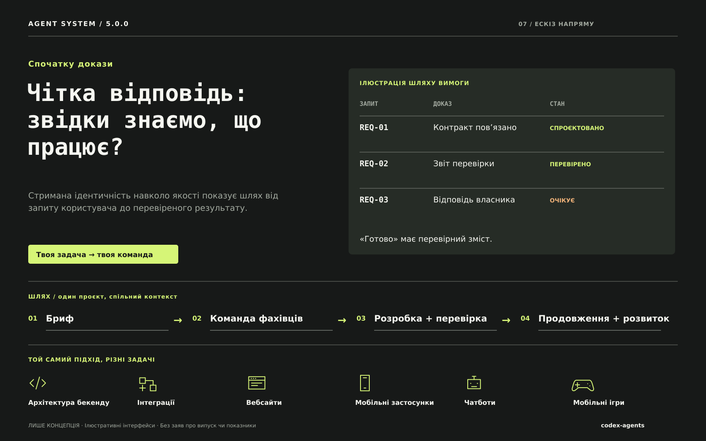

# 07 — Спочатку докази

> Чітка відповідь: звідки знаємо, що працює?

Стримана ідентичність навколо якості показує шлях від запиту користувача до перевіреного результату. Перевірка й приймання — частина роботи, а невирішені стани видимі.

## Аудиторія

Інженерні покупці, складні внутрішні команди й технічно скептичні користувачі, яким потрібні результати для перевірки.

## Графічний напрям

Графітове тло, лаймові позначки, великі ID вимог і навмисно читабельна таблиця доказів. Приклад даних явно позначено як ілюстративний.

## Сценарій

Запитати, що означає «готово». Прикріпити критерії приймання до вимоги. Показати реалізацію, зауваження QA та результат. Завершити реальною зупинкою, коли доказів бракує.

## Рух / розкадрування

Рядок вимоги поступово отримує посилання. Стани passed/pending — лише пояснювальний приклад; без вигаданого лічильника успіху.

## Ідентичність для збереження

Зберегти читабельні ID, явні позначення прикладів, три чесні стани й вільну таблицю. Не подавати значки як сертифікацію.

## Палітра й типографіка

| Role | Value |
| --- | --- |
| Background | `#171918` |
| Foreground | `#F6F7F1` |
| Primary accent | `#D6F577` |
| Secondary accent | `#F0B279` |
| Surface | `#262C26` |
| Type | `Courier New, monospace` |

## Адаптація

Обкладинка GitHub: кадрувати заголовок і головну графіку до 1600×640, зберегти назву системи та статус концепції. Майданчик продажу: обкладинка 16:9 → життєвий цикл → шість типів задач → докази → перший бриф. Вертикаль 9:16: розділити hero, передачу й приклади на окремі кадри; не зменшувати все полотно до нечитабельного тексту. Соцмережі 1:1: одна обіцянка й одна графіка. Повний PDF, презентація, відео або фінальний бренд-пакет створюється після вибору напряму.

## Твердження й докази

Графіка пояснює задуманий підхід. Ілюстративні екрани не видавати за випущені продукти, а приклади станів — за виміряні результати. Заяви про перевагу, дохід, швидкість, автономність, відповідність стандартам, сертифікацію або підтримку виробника потребують конкретних доказів. Наявність справжніх сабагентів, інструментів, платформ і дозволів на випуск перевіряється в кожному середовищі.

