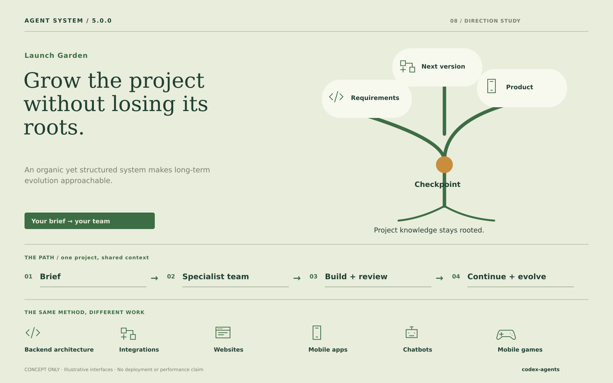

# 08 — Launch Garden

> Grow the project without losing its roots.

An organic yet structured system makes long-term evolution approachable. Roots are requirements; branches are specialist disciplines; new versions preserve project knowledge.

## Audience

Long-running pet projects, independent products and owners who want continuity through updates.

## Graphic direction

Sage paper, forest-green branching geometry and restrained seed-yellow markers. Product cards remain architectural, avoiding a generic botanical illustration.

## Narrative

Plant a clear requirement. Develop its relevant branches. Release a tested increment. Carry the project roots through the next system upgrade and rollback checkpoint.

## Motion / storyboard

A branch extends only after a decision. Milestone rings record stages; roots stay visible. No promise of automatic growth, users or revenue.

## Identity to preserve

Preserve roots/branches meaning, sage/forest palette, curved connectors and clear milestone labels; do not replace the project with a new seed on update.

## Palette and typography

| Role | Value |
| --- | --- |
| Background | `#E9EDDC` |
| Foreground | `#203F32` |
| Primary accent | `#3D6D45` |
| Secondary accent | `#C88E3D` |
| Surface | `#F7F8EE` |
| Type | `Georgia, serif` |

## Adaptation

GitHub hero: crop the headline and primary graphic to 1600×640, retain the system name and concept status. Marketplace: use 16:9 hero → lifecycle → six use cases → evidence → first brief. Vertical 9:16: split the hero, handoff and use-case panels into separate frames; never scale the entire board into unreadable text. Social 1:1: one promise and one graphic. A full PDF/deck, video or final brand kit is made only after a direction is selected.

## Claims and proof

The graphic demonstrates an intended method. Do not present illustrated screens as shipped products or illustrative states as measured results. No superiority, revenue, speed, autonomy, compliance, certification or vendor-endorsement claim without attributable evidence. Real subagent availability, tools, platforms and deployment permissions are checked per environment.

