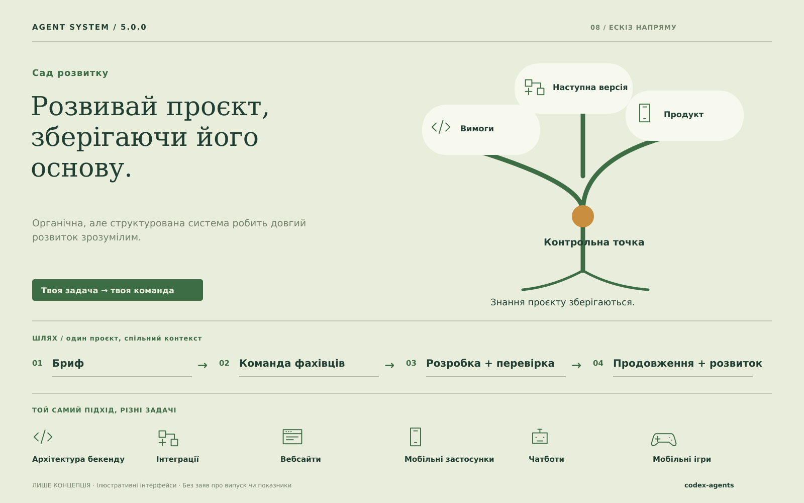

# 08 — Сад розвитку

> Розвивай проєкт, зберігаючи його основу.

Органічна, але структурована система робить довгий розвиток зрозумілим. Коріння — вимоги; гілки — спеціалізовані дисципліни; нові версії зберігають знання проєкту.

## Аудиторія

Довготривалі пет-проєкти, незалежні продукти й власники, що хочуть безперервності під час оновлень.

## Графічний напрям

Шавлієвий папір, лісова зелень розгалуженої геометрії та стримані жовті маркери. Картки продуктів залишаються архітектурними без загальної ботанічної ілюстрації.

## Сценарій

Закласти чітку вимогу. Розвинути потрібні гілки. Випустити перевірений крок. Перенести основу проєкту через наступне оновлення системи й контрольну точку відкату.

## Рух / розкадрування

Гілка зростає лише після рішення. Кільця фіксують етапи; коріння лишається видимим. Без обіцянки автоматичного зростання, користувачів або доходу.

## Ідентичність для збереження

Зберегти зміст коріння й гілок, шавлієво-зелену палітру, криві зв’язки та ясні етапи; під час оновлення не замінювати проєкт новим зерном.

## Палітра й типографіка

| Role | Value |
| --- | --- |
| Background | `#E9EDDC` |
| Foreground | `#203F32` |
| Primary accent | `#3D6D45` |
| Secondary accent | `#C88E3D` |
| Surface | `#F7F8EE` |
| Type | `Georgia, serif` |

## Адаптація

Обкладинка GitHub: кадрувати заголовок і головну графіку до 1600×640, зберегти назву системи та статус концепції. Майданчик продажу: обкладинка 16:9 → життєвий цикл → шість типів задач → докази → перший бриф. Вертикаль 9:16: розділити hero, передачу й приклади на окремі кадри; не зменшувати все полотно до нечитабельного тексту. Соцмережі 1:1: одна обіцянка й одна графіка. Повний PDF, презентація, відео або фінальний бренд-пакет створюється після вибору напряму.

## Твердження й докази

Графіка пояснює задуманий підхід. Ілюстративні екрани не видавати за випущені продукти, а приклади станів — за виміряні результати. Заяви про перевагу, дохід, швидкість, автономність, відповідність стандартам, сертифікацію або підтримку виробника потребують конкретних доказів. Наявність справжніх сабагентів, інструментів, платформ і дозволів на випуск перевіряється в кожному середовищі.

