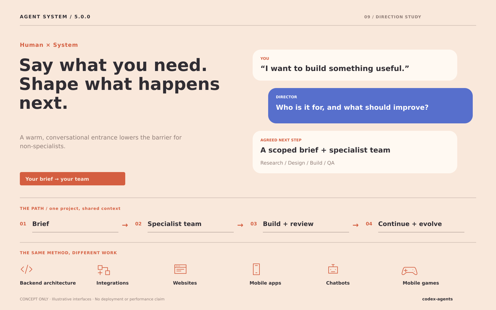

# 09 — Human × System

> Say what you need. Shape what happens next.

A warm, conversational entrance lowers the barrier for non-specialists. Plain speech becomes a scoped plan, while meaningful decisions remain visible to the owner.

## Audience

First-time users, small business owners and creators who do not yet know which specialist they need.

## Graphic direction

Warm peach, large human-readable dialogue, a blue scope card and terracotta decision controls. No robot mascot or anthropomorphic promise.

## Narrative

Open with a realistic vague request. Ask one useful question. Show the plan and owner choice. Reveal the specialist team and concrete next deliverable.

## Motion / storyboard

Dialogue appears at a readable pace; the owner’s choice opens the team panel. Always keep a static complete reading mode.

## Identity to preserve

Preserve large plain-language dialogue, warm neutral background, one visible decision and a concrete resulting artifact.

## Palette and typography

| Role | Value |
| --- | --- |
| Background | `#F9E8DB` |
| Foreground | `#302D33` |
| Primary accent | `#D45E40` |
| Secondary accent | `#576FCC` |
| Surface | `#FFF9F2` |
| Type | `Arial, sans-serif` |

## Adaptation

GitHub hero: crop the headline and primary graphic to 1600×640, retain the system name and concept status. Marketplace: use 16:9 hero → lifecycle → six use cases → evidence → first brief. Vertical 9:16: split the hero, handoff and use-case panels into separate frames; never scale the entire board into unreadable text. Social 1:1: one promise and one graphic. A full PDF/deck, video or final brand kit is made only after a direction is selected.

## Claims and proof

The graphic demonstrates an intended method. Do not present illustrated screens as shipped products or illustrative states as measured results. No superiority, revenue, speed, autonomy, compliance, certification or vendor-endorsement claim without attributable evidence. Real subagent availability, tools, platforms and deployment permissions are checked per environment.

