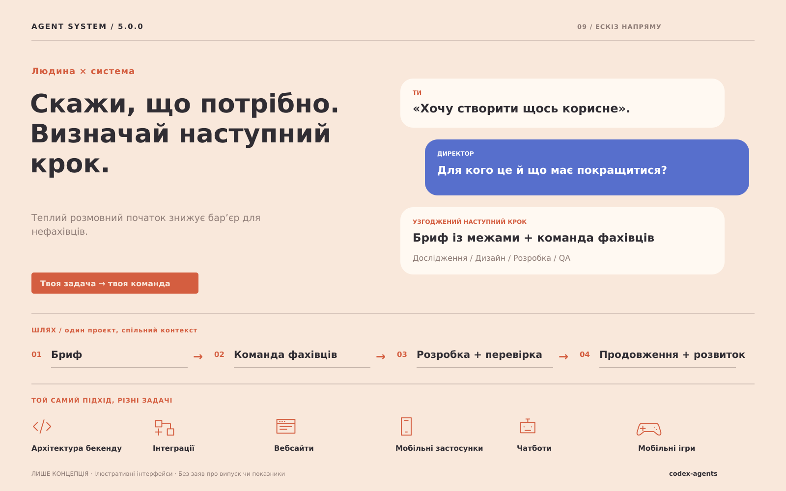

# 09 — Людина × система

> Скажи, що потрібно. Визначай наступний крок.

Теплий розмовний початок знижує бар’єр для нефахівців. Звичайна мова перетворюється на узгоджений план, а важливі рішення лишаються видимими власнику.

## Аудиторія

Нові користувачі, власники малого бізнесу й автори, що ще не знають, який фахівець їм потрібен.

## Графічний напрям

Теплий персиковий, велика розмова людською мовою, синя картка масштабу й теракотові рішення. Без робота-талісмана або обіцянки людської свідомості.

## Сценарій

Почати з реального нечіткого запиту. Поставити одне корисне питання. Показати план і вибір власника. Розкрити команду фахівців та конкретний наступний результат.

## Рух / розкадрування

Діалог з’являється в темпі читання; вибір власника відкриває панель команди. Завжди мати статичний режим повного читання.

## Ідентичність для збереження

Зберегти велику розмову простою мовою, тепле нейтральне тло, одне видиме рішення й конкретний артефакт у результаті.

## Палітра й типографіка

| Role | Value |
| --- | --- |
| Background | `#F9E8DB` |
| Foreground | `#302D33` |
| Primary accent | `#D45E40` |
| Secondary accent | `#576FCC` |
| Surface | `#FFF9F2` |
| Type | `Arial, sans-serif` |

## Адаптація

Обкладинка GitHub: кадрувати заголовок і головну графіку до 1600×640, зберегти назву системи та статус концепції. Майданчик продажу: обкладинка 16:9 → життєвий цикл → шість типів задач → докази → перший бриф. Вертикаль 9:16: розділити hero, передачу й приклади на окремі кадри; не зменшувати все полотно до нечитабельного тексту. Соцмережі 1:1: одна обіцянка й одна графіка. Повний PDF, презентація, відео або фінальний бренд-пакет створюється після вибору напряму.

## Твердження й докази

Графіка пояснює задуманий підхід. Ілюстративні екрани не видавати за випущені продукти, а приклади станів — за виміряні результати. Заяви про перевагу, дохід, швидкість, автономність, відповідність стандартам, сертифікацію або підтримку виробника потребують конкретних доказів. Наявність справжніх сабагентів, інструментів, платформ і дозволів на випуск перевіряється в кожному середовищі.

