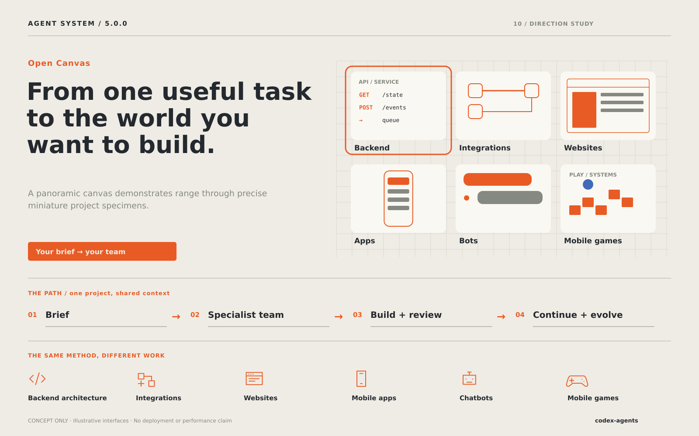

# 10 — Open Canvas

> From one useful task to the world you want to build.

A panoramic canvas demonstrates range through precise miniature project specimens. The camera can travel between backend, integration, website, app, bot and mobile game without changing the method.

## Audience

A broad first encounter: GitHub visitors and marketplace buyers exploring what the system can help them build.

## Graphic direction

A warm infinite-workspace grid, vivid orange focus frame and six disciplined product specimens. Cropping guides preserve legibility at every ratio.

## Narrative

Start on one backend card. Pan into integration, app and game specimens. Zoom out to one shared lifecycle, then focus on the viewer’s first brief.

## Motion / storyboard

Three deliberate pans, one final overview; avoid a dizzying endless zoom. Small-screen cuts use one specimen at a time.

## Identity to preserve

Preserve the six specimen categories, orange focus bracket, warm grid and scale ladder; all tiny product UIs remain labelled illustrations.

## Palette and typography

| Role | Value |
| --- | --- |
| Background | `#EFECE5` |
| Foreground | `#24292F` |
| Primary accent | `#E85B25` |
| Secondary accent | `#3F6BBA` |
| Surface | `#FAF8F2` |
| Type | `Arial, sans-serif` |

## Adaptation

GitHub hero: crop the headline and primary graphic to 1600×640, retain the system name and concept status. Marketplace: use 16:9 hero → lifecycle → six use cases → evidence → first brief. Vertical 9:16: split the hero, handoff and use-case panels into separate frames; never scale the entire board into unreadable text. Social 1:1: one promise and one graphic. A full PDF/deck, video or final brand kit is made only after a direction is selected.

## Claims and proof

The graphic demonstrates an intended method. Do not present illustrated screens as shipped products or illustrative states as measured results. No superiority, revenue, speed, autonomy, compliance, certification or vendor-endorsement claim without attributable evidence. Real subagent availability, tools, platforms and deployment permissions are checked per environment.

