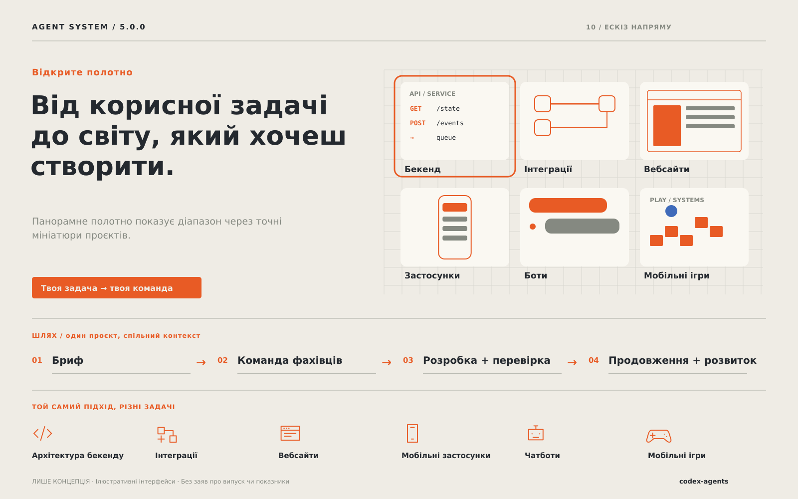

# 10 — Відкрите полотно

> Від корисної задачі до світу, який хочеш створити.

Панорамне полотно показує діапазон через точні мініатюри проєктів. Камера переходить між бекендом, інтеграцією, сайтом, застосунком, ботом і мобільною грою зі спільним підходом.

## Аудиторія

Широке перше знайомство: відвідувачі GitHub і покупці майданчика, що досліджують можливості системи.

## Графічний напрям

Тепла сітка нескінченного робочого простору, виразна помаранчева рамка фокуса й шість впорядкованих зразків продуктів. Напрямні кадрування зберігають читабельність.

## Сценарій

Почати з картки бекенду. Перейти до інтеграції, застосунку та гри. Віддалити до спільного життєвого циклу й зосередитися на першому запиті глядача.

## Рух / розкадрування

Три продумані переміщення й один фінальний загальний план; без запаморочливого нескінченного зуму. Для малих екранів — один зразок за раз.

## Ідентичність для збереження

Зберегти шість категорій зразків, помаранчеву рамку фокуса, теплу сітку й шкалу масштабу; усі мініінтерфейси позначати як ілюстрації.

## Палітра й типографіка

| Role | Value |
| --- | --- |
| Background | `#EFECE5` |
| Foreground | `#24292F` |
| Primary accent | `#E85B25` |
| Secondary accent | `#3F6BBA` |
| Surface | `#FAF8F2` |
| Type | `Arial, sans-serif` |

## Адаптація

Обкладинка GitHub: кадрувати заголовок і головну графіку до 1600×640, зберегти назву системи та статус концепції. Майданчик продажу: обкладинка 16:9 → життєвий цикл → шість типів задач → докази → перший бриф. Вертикаль 9:16: розділити hero, передачу й приклади на окремі кадри; не зменшувати все полотно до нечитабельного тексту. Соцмережі 1:1: одна обіцянка й одна графіка. Повний PDF, презентація, відео або фінальний бренд-пакет створюється після вибору напряму.

## Твердження й докази

Графіка пояснює задуманий підхід. Ілюстративні екрани не видавати за випущені продукти, а приклади станів — за виміряні результати. Заяви про перевагу, дохід, швидкість, автономність, відповідність стандартам, сертифікацію або підтримку виробника потребують конкретних доказів. Наявність справжніх сабагентів, інструментів, платформ і дозволів на випуск перевіряється в кожному середовищі.

