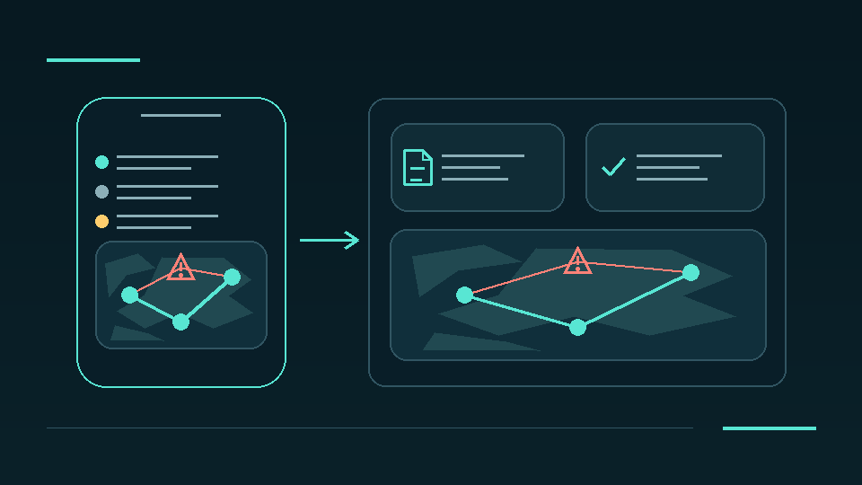

# Was lässt sich mit Codex entwickeln?

[English](../en/README.md) · [Українська](../uk/README.md) · [Deutsch](../de/README.md) · [Italiano](../it/README.md) · [Español](../es/README.md) · [Français](../fr/README.md) · [简体中文](../zh-CN/README.md)

Beginnen Sie mit einer konkreten Aufgabe oder entwickeln Sie ein bestehendes Produkt weiter. Die Illustrationen zeigen Eingaben, Entscheidungen und Ergebnisse für typische Arbeitsabläufe.

[Leitfaden öffnen](../../docs/de/GUIDE.md#install) · [Illustriertes PDF](../campaign/Showcase.pdf) · [Offline-Galerie](https://github.com/alex-hohaizel/codex-agents/actions/workflows/validate.yml?query=branch%3Amain)

Melden Sie sich bei GitHub an und öffnen Sie einen erfolgreichen Validierungslauf für main. Laden Sie unter Artifacts product-showcase herunter, entpacken Sie Showcase.zip und öffnen Sie index.html.

[Ein gemeinsamer Arbeitsbereich](#showcase-overview) · [My Day](#showcase-product) · [Sunridge Studio](#showcase-game) · [Assistent](#showcase-conversation) · [Global Logistics](#showcase-operations) · [Von der Tabelle zum Dokument](#showcase-documents) · [Ein Spezialist für wiederkehrende Aufgaben](#showcase-specialists) · [Informationsabruf mit Belegen](#showcase-retrieval) · [Evaluation eines Arbeitsablaufs](#showcase-evaluation) · [Agent Atelier](#showcase-workbench)

## Ein gemeinsamer Arbeitsbereich

Von einer einzelnen Korrektur zum wiederverwendbaren Ablauf bleiben Quellen und Prüfschritte nachvollziehbar.

[Diesen Ablauf im Leitfaden öffnen](../../docs/de/GUIDE.md#first-task)

## My Day

Ändern Sie eine Tagesplanung und prüfen Sie die Änderung auf den relevanten Oberflächen. Termine und bisherige Entscheidungen bleiben erhalten.

[Diesen Ablauf im Leitfaden öffnen](../../docs/de/GUIDE.md#workflow)

## Sunridge Studio

Übernehmen Sie Figur und Gestaltungsidentität in die Produktion. Aussagen über Geräte folgen erst nach Prüfung des tatsächlichen Builds.

[Diesen Ablauf im Leitfaden öffnen](../../docs/de/GUIDE.md#catalog)

## Assistent

Bereiten Sie eine Beispielbestellung vor und prüfen Sie Ziel und Berechtigung. Schließen Sie den Vorgang erst mit bestätigtem Beleg.

[Diesen Ablauf im Leitfaden öffnen](../../docs/de/GUIDE.md#operations)

## Global Logistics

Untersuchen Sie die Transportstörung und vergleichen Sie verfügbare Routen. Erfassen Sie das Ergebnis nach Abgleich des Betriebsstatus.

[Diesen Ablauf im Leitfaden öffnen](../../docs/de/GUIDE.md#operations)

## Von der Tabelle zum Dokument

Erzeugen Sie Dokumente für gültige Zeilen. Klären Sie die fehlende Adresse und verarbeiten Sie die Zeile ohne doppelte Ausgabe.

[Diesen Ablauf im Leitfaden öffnen](../../docs/de/GUIDE.md#operations)

## Ein Spezialist für wiederkehrende Aufgaben

Übergeben Sie Vertrag, Belege und Rückgabekriterien. Lassen Sie die Typabweichung und den vorgeschlagenen Fix unabhängig prüfen.

[Diesen Ablauf im Leitfaden öffnen](../../docs/de/GUIDE.md#catalog)

## Informationsabruf mit Belegen

Beginnen Sie mit Pfaden und exakten IDs. Vergleichen Sie bei nachgewiesenen Lücken lexikalische, semantische und hybride Suche. Zitieren Sie die aktuelle Quelle oder lassen Sie die Frage offen.

[Diesen Ablauf im Leitfaden öffnen](../../docs/de/GUIDE.md#retrieval)

## Evaluation eines Arbeitsablaufs

Definieren Sie das erwartete Ergebnis je Fall und prüfen Sie das tatsächliche Artefakt oder die Werkzeugwirkung. Vergleichen Sie vor der Einführung dieselben Fälle.

[Diesen Ablauf im Leitfaden öffnen](../../docs/de/GUIDE.md#evals)

## Agent Atelier

Öffnen Sie ein lokales Projekt, prüfen Sie den nächsten Schritt und den Entwurf, und nutzen Sie den Orchestrator. Bestätigen Sie die Wirkung anhand der tatsächlichen Ausgabe.

[Diesen Ablauf im Leitfaden öffnen](../../docs/de/GUIDE.md#workbench)
