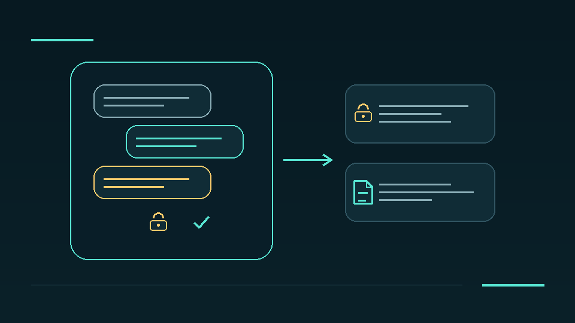
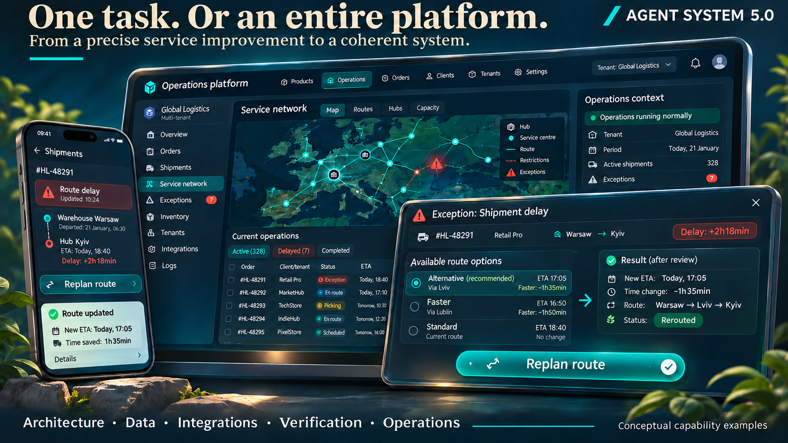
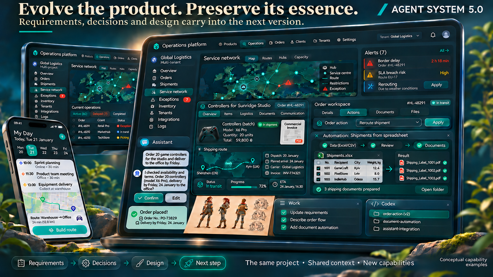

# Was lässt sich mit Codex entwickeln?

[English](../en/README.md) · [Українська](../uk/README.md) · [Deutsch](../de/README.md) · [Italiano](../it/README.md) · [Español](../es/README.md) · [Français](../fr/README.md) · [简体中文](../zh-CN/README.md)

Beginnen Sie mit einer konkreten Aufgabe oder entwickeln Sie ein bestehendes Produkt weiter. Die Illustrationen zeigen Eingaben, Entscheidungen und Ergebnisse für typische Arbeitsabläufe.

[Leitfaden öffnen](../../docs/de/GUIDE.md#install) · [Technische Diagramme als PDF](../campaign/Showcase.pdf) · [Offline-Galerie](https://github.com/alex-hohaizel/codex-agents/actions/workflows/validate.yml?query=branch%3Amain)

Melden Sie sich bei GitHub an und öffnen Sie einen erfolgreichen Validierungslauf für main. Laden Sie unter Artifacts product-showcase herunter, entpacken Sie Showcase.zip und öffnen Sie index.html.

[RAG](../../docs/OPERATING_MODEL.md#retrieval-and-rag) · [Evals](../../docs/OPERATING_MODEL.md#evals-and-evidence) · [Startseite des Repositorys](../../README.md)

[Ein gemeinsamer Arbeitsbereich](#showcase-overview) · [My Day](#showcase-product) · [Sunridge Studio](#showcase-game) · [Assistent](#showcase-conversation) · [Global Logistics](#showcase-operations) · [Von der Tabelle zum Dokument](#showcase-documents) · [Ein Spezialist für wiederkehrende Aufgaben](#showcase-specialists) · [Informationsabruf mit Belegen](#showcase-retrieval) · [Evaluation eines Arbeitsablaufs](#showcase-evaluation) · [Agent Atelier](#showcase-workbench)

Diese Produktkonzepte zeigen einige Einsatzmöglichkeiten. Die Beschriftung der Originale ist erhalten. Die aktuellen Release-Versionen stehen auf der Startseite des Repositorys.

## Ein gemeinsamer Arbeitsbereich

**Originales Produktkonzept** · englische Bildfassung

Eine Logistikkarte, ein Kalender, eine Spielwelt und geprüfte Dokumente auf einem Schreibtisch.

[Bild in voller Größe öffnen](https://github.com/alex-hohaizel/codex-agents/blob/1ccee85edd66a44d76724b50387cac6b0afce23c/assets/marketing/campaign/en/01-original.png)

Ergänzendes Titelbild

Von einer einzelnen Korrektur zum wiederverwendbaren Ablauf bleiben Quellen und Prüfschritte nachvollziehbar.

[Diesen Ablauf im Leitfaden öffnen](../../docs/de/GUIDE.md#first-task)

## My Day

**Originales Produktkonzept** · englische Bildfassung

Termine und Route wechseln vom Telefon in einen größeren Arbeitsbereich.

[Bild in voller Größe öffnen](https://github.com/alex-hohaizel/codex-agents/blob/1ccee85edd66a44d76724b50387cac6b0afce23c/assets/marketing/campaign/en/02-app.png)

Technischer Ablauf

Ändern Sie eine Tagesplanung und prüfen Sie die Änderung auf den relevanten Oberflächen. Termine und bisherige Entscheidungen bleiben erhalten.

[Diesen Ablauf im Leitfaden öffnen](../../docs/de/GUIDE.md#workflow)

## Sunridge Studio

**Originales Produktkonzept** · englische Bildfassung

Eine Küstenwelt, eine Figurenreferenz und ein spielbarer Prüfstand.

[Bild in voller Größe öffnen](https://github.com/alex-hohaizel/codex-agents/blob/1ccee85edd66a44d76724b50387cac6b0afce23c/assets/marketing/campaign/en/03-game.png)

Technischer Ablauf

Übernehmen Sie Figur und Gestaltungsidentität in die Produktion. Aussagen über Geräte folgen erst nach Prüfung des tatsächlichen Builds.

[Diesen Ablauf im Leitfaden öffnen](../../docs/de/GUIDE.md#catalog)

## Assistent

**Originales Produktkonzept** · englische Bildfassung

Der Dialog fordert eine ausdrückliche Bestätigung und zeigt dann einen Beleg.

[Bild in voller Größe öffnen](https://github.com/alex-hohaizel/codex-agents/blob/1ccee85edd66a44d76724b50387cac6b0afce23c/assets/marketing/campaign/en/04-bot.png)

Technischer Ablauf

Bereiten Sie eine Beispielbestellung vor und prüfen Sie Ziel und Berechtigung. Schließen Sie den Vorgang erst mit bestätigtem Beleg.

[Diesen Ablauf im Leitfaden öffnen](../../docs/de/GUIDE.md#operations)

## Global Logistics

**Originales Produktkonzept** · englische Bildfassung

Eine gesperrte Route, eine Alternative und ein geprüftes Ergebnis.

[Bild in voller Größe öffnen](https://github.com/alex-hohaizel/codex-agents/blob/1ccee85edd66a44d76724b50387cac6b0afce23c/assets/marketing/campaign/en/05-platform.png)

Technischer Ablauf

Untersuchen Sie die Transportstörung und vergleichen Sie verfügbare Routen. Erfassen Sie das Ergebnis nach Abgleich des Betriebsstatus.

[Diesen Ablauf im Leitfaden öffnen](../../docs/de/GUIDE.md#operations) · [Technischer Leitfaden](../../docs/OPERATING_MODEL.md#tools-evidence-and-recovery)

## Von der Tabelle zum Dokument

**Originales Produktkonzept** · englische Bildfassung

Geprüfte Tabellenzeilen werden zu Dateien. Ein offener Datensatz bleibt zurück.

[Bild in voller Größe öffnen](https://github.com/alex-hohaizel/codex-agents/blob/1ccee85edd66a44d76724b50387cac6b0afce23c/assets/marketing/campaign/en/06-automation.png)

Technischer Ablauf

Erzeugen Sie Dokumente für gültige Zeilen. Klären Sie die fehlende Adresse und verarbeiten Sie die Zeile ohne doppelte Ausgabe.

[Diesen Ablauf im Leitfaden öffnen](../../docs/de/GUIDE.md#operations)

## Ein Spezialist für wiederkehrende Aufgaben

**Originales Produktkonzept** · englische Bildfassung

Ein eingegrenzter API-Vertrag geht an einen Spezialisten und eine unabhängige Prüfung.

[Bild in voller Größe öffnen](https://github.com/alex-hohaizel/codex-agents/blob/1ccee85edd66a44d76724b50387cac6b0afce23c/assets/marketing/campaign/en/07-constructors.png)

Technischer Ablauf

Übergeben Sie Vertrag, Belege und Rückgabekriterien. Lassen Sie die Typabweichung und den vorgeschlagenen Fix unabhängig prüfen.

[Diesen Ablauf im Leitfaden öffnen](../../docs/de/GUIDE.md#catalog)

## Informationsabruf mit Belegen

Beginnen Sie mit Pfaden und exakten IDs. Vergleichen Sie bei nachgewiesenen Lücken lexikalische, semantische und hybride Suche. Zitieren Sie die aktuelle Quelle oder lassen Sie die Frage offen.

[Diesen Ablauf im Leitfaden öffnen](../../docs/de/GUIDE.md#retrieval) · [RAG-Praxisbeispiel](../../docs/technical/RETRIEVAL.md)

## Evaluation eines Arbeitsablaufs

Definieren Sie das erwartete Ergebnis je Fall und prüfen Sie das tatsächliche Artefakt oder die Werkzeugwirkung. Vergleichen Sie vor der Einführung dieselben Fälle.

[Diesen Ablauf im Leitfaden öffnen](../../docs/de/GUIDE.md#evals) · [Technischer Leitfaden](../../docs/OPERATING_MODEL.md#evals-and-evidence)

## Agent Atelier

Öffnen Sie ein lokales Projekt, prüfen Sie den nächsten Schritt und den Entwurf, und nutzen Sie den Orchestrator. Bestätigen Sie die Wirkung anhand der tatsächlichen Ausgabe.

[Diesen Ablauf im Leitfaden öffnen](../../docs/de/GUIDE.md#workbench) · [Technischer Leitfaden](../../apps/agent-atelier/README.md)

## Weitere Konzepte

### Produktlebenszyklus

**Originales Produktkonzept** · englische Bildfassung

Auf Recherche und Entwurf folgen Entwicklung, Prüfung, Veröffentlichung und Weiterentwicklung.

[Bild in voller Größe öffnen](https://github.com/alex-hohaizel/codex-agents/blob/1ccee85edd66a44d76724b50387cac6b0afce23c/assets/marketing/campaign/en/08-lifecycle.png)

[Diesen Ablauf im Leitfaden öffnen](../../docs/de/GUIDE.md#workflow)

### Dasselbe Projekt fortsetzen

**Originales Produktkonzept** · englische Bildfassung

Anforderungen, Entscheidungen und Produktidentität bleiben bei der nächsten Aufgabe erhalten.

[Bild in voller Größe öffnen](https://github.com/alex-hohaizel/codex-agents/blob/1ccee85edd66a44d76724b50387cac6b0afce23c/assets/marketing/campaign/en/09-continuity.png)

[Diesen Ablauf im Leitfaden öffnen](../../docs/de/GUIDE.md#workflow) · [Technischer Leitfaden](../../docs/OPERATING_MODEL.md#project-context-and-handoffs)

### Ihre nächste Aufgabe

**Originales Produktkonzept** · englische Bildfassung

Beginnen Sie mit einer konkreten Korrektur, einem bestehenden Projekt oder einem neuen Produkt.

[Bild in voller Größe öffnen](https://github.com/alex-hohaizel/codex-agents/blob/1ccee85edd66a44d76724b50387cac6b0afce23c/assets/marketing/campaign/en/10-next-task.png)

[Diesen Ablauf im Leitfaden öffnen](../../docs/de/GUIDE.md#first-task)
