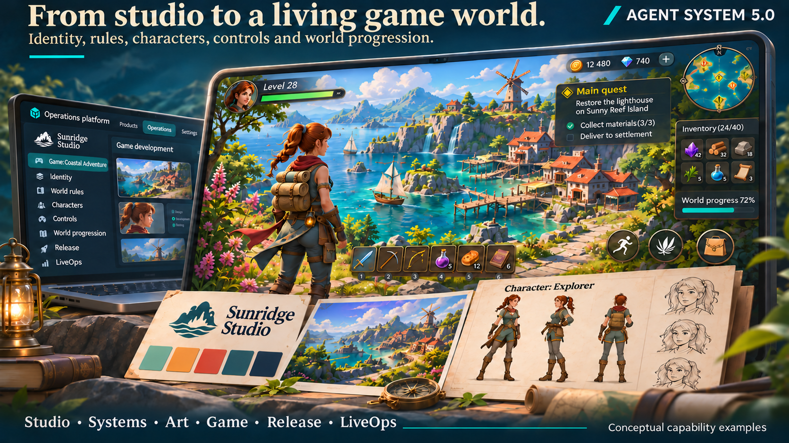
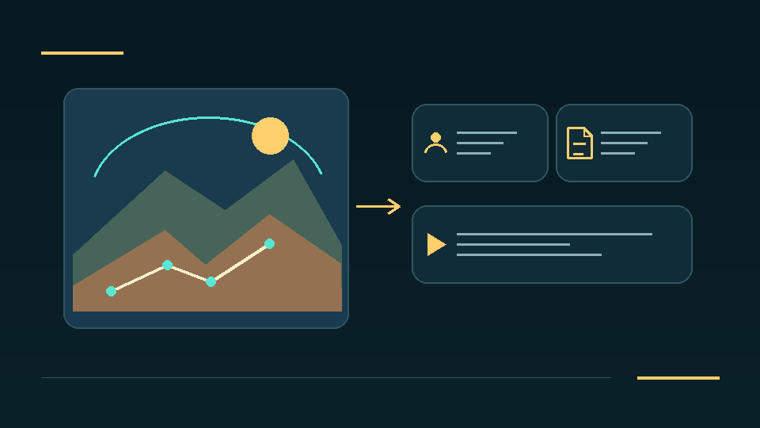
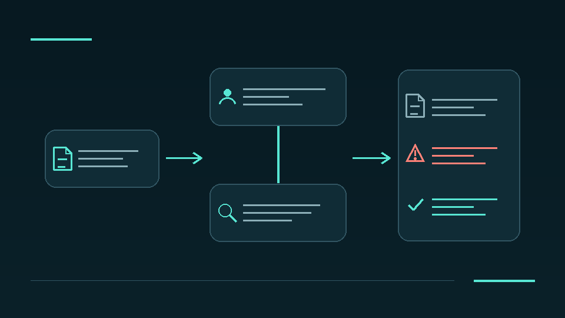

# What can you build with Codex?

[English](../en/README.md) · [Українська](../uk/README.md) · [Deutsch](../de/README.md) · [Italiano](../it/README.md) · [Español](../es/README.md) · [Français](../fr/README.md) · [简体中文](../zh-CN/README.md)

Start with a useful task or carry an existing product forward. These illustrated scenarios show decisions, inputs and outcomes you can work through with the suite.

[Start the guide](../../docs/en/GUIDE.md#install) · [Technical diagrams PDF](../campaign/Showcase.pdf) · [Offline gallery](https://github.com/alex-hohaizel/codex-agents/actions/workflows/validate.yml?query=branch%3Amain)

To download the offline gallery, sign in to GitHub and open a successful validation run for main. Under Artifacts, download product-showcase, then extract Showcase.zip and open index.html.

[RAG](../../docs/OPERATING_MODEL.md#retrieval-and-rag) · [Evals](../../docs/OPERATING_MODEL.md#evals-and-evidence) · [Repository home](../../README.md)

[A connected workspace](#showcase-overview) · [My Day](#showcase-product) · [Sunridge Studio](#showcase-game) · [Assistant](#showcase-conversation) · [Global Logistics](#showcase-operations) · [Spreadsheet to documents](#showcase-documents) · [A specialist for a recurring task](#showcase-specialists) · [Retrieval with evidence](#showcase-retrieval) · [Evaluations for a real workflow](#showcase-evaluation) · [Agent Atelier workbench](#showcase-workbench)

These product concepts show a few possible uses for the suite. Each concept retains the lettering printed in the original artwork. Release versions are listed on the repository home page.

## A connected workspace

**Original product concept** · English artwork

The campaign brings together a desktop operations map, a personal agenda and a coastal game world.

[Open full-size artwork](https://github.com/alex-hohaizel/codex-agents/blob/1ccee85edd66a44d76724b50387cac6b0afce23c/assets/marketing/campaign/en/01-original.png)

Companion cover

A developer can move from a focused repair to a reusable project workflow with the same source and review controls.

[Open this workflow in the guide](../../docs/en/GUIDE.md#first-task)

## My Day

**Original product concept** · English artwork

A laptop and three phones show My Day’s daily agenda, route options, confirmation and the updated plan.

[Open full-size artwork](https://github.com/alex-hohaizel/codex-agents/blob/1ccee85edd66a44d76724b50387cac6b0afce23c/assets/marketing/campaign/en/02-app.png)

Technical workflow

Start with a daily planning task. Preserve appointments and route decisions while adding a reviewed change that works across product surfaces.

[Open this workflow in the guide](../../docs/en/GUIDE.md#workflow)

## Sunridge Studio

**Original product concept** · English artwork

Sunridge Studio combines a coastal game world, its explorer and the matching character development art.

[Open full-size artwork](https://github.com/alex-hohaizel/codex-agents/blob/1ccee85edd66a44d76724b50387cac6b0afce23c/assets/marketing/campaign/en/03-game.png)

Technical workflow

Carry the original explorer and coastal setting through game design, asset production and a playable review. Record a device claim only after observing the actual build.

[Open this workflow in the guide](../../docs/en/GUIDE.md#catalog)

## Assistant

**Original product concept** · English artwork

The assistant compares a game controller and shows a separate confirmation before surfacing the order.

[Open full-size artwork](https://github.com/alex-hohaizel/codex-agents/blob/1ccee85edd66a44d76724b50387cac6b0afce23c/assets/marketing/campaign/en/04-bot.png)

Technical workflow

Check product details, stage the purchase as an example, then specify the exact authorized target and confirmation. Keep a pending effect open until a verified receipt arrives.

[Open this workflow in the guide](../../docs/en/GUIDE.md#operations)

## Global Logistics

**Original product concept** · English artwork

Global Logistics shows a European hub network and a shipment exception, with route options, estimated arrivals and a reviewed outcome.

[Open full-size artwork](https://github.com/alex-hohaizel/codex-agents/blob/1ccee85edd66a44d76724b50387cac6b0afce23c/assets/marketing/campaign/en/05-platform.png)

Technical workflow

Inspect a shipment exception, compare feasible routes, review the affected account and record the outcome once the operational state confirms it.

[Open this workflow in the guide](../../docs/en/GUIDE.md#operations) · [Engineering guide](../../docs/OPERATING_MODEL.md#tools-evidence-and-recovery)

## Spreadsheet to documents

**Original product concept** · English artwork

A shipment spreadsheet sits beside prepared documents and a highlighted row with a missing delivery address.

[Open full-size artwork](https://github.com/alex-hohaizel/codex-agents/blob/1ccee85edd66a44d76724b50387cac6b0afce23c/assets/marketing/campaign/en/06-automation.png)

Technical workflow

Validate three shipment rows and hold the fourth, which has no address. After clarification, verify the corrected row and generate its document without duplicating the earlier output.

[Open this workflow in the guide](../../docs/en/GUIDE.md#operations)

## A specialist for a recurring task

**Original product concept** · English artwork

A custom specialist checks an API contract, identifies a type mismatch and hands the change off for review.

[Open full-size artwork](https://github.com/alex-hohaizel/codex-agents/blob/1ccee85edd66a44d76724b50387cac6b0afce23c/assets/marketing/campaign/en/07-constructors.png)

Technical workflow

Start with an API contract audit. Give a named specialist the exact contract, evidence and return condition, then use an independent check to verify the type mismatch and proposed change.

[Open this workflow in the guide](../../docs/en/GUIDE.md#catalog)

## Retrieval with evidence

Begin with file paths and exact IDs. When measured misses justify retrieval, compare lexical, semantic and hybrid approaches over the same authorized corpus. Cite the current source or abstain.

[Open this workflow in the guide](../../docs/en/GUIDE.md#retrieval) · [Worked RAG example](../../docs/technical/RETRIEVAL.md)

## Evaluations for a real workflow

Give each case an expected outcome, run it against a fixed source and inspect the actual artifact or tool effect. Keep a pending result visible and compare the same cases before broad adoption.

[Open this workflow in the guide](../../docs/en/GUIDE.md#evals) · [Engineering guide](../../docs/OPERATING_MODEL.md#evals-and-evidence)

## Agent Atelier workbench

Open a local project, inspect its pinned next action, preview a draft and use the Orchestrator route. Confirm a runtime effect from the observed output and its evidence.

[Open this workflow in the guide](../../docs/en/GUIDE.md#workbench) · [Engineering guide](../../apps/agent-atelier/README.md)

## More concept artwork

### Product lifecycle

**Original product concept** · English artwork

Research and design flow through build, verification, release and later improvement.

[Open full-size artwork](https://github.com/alex-hohaizel/codex-agents/blob/1ccee85edd66a44d76724b50387cac6b0afce23c/assets/marketing/campaign/en/08-lifecycle.png)

[Open this workflow in the guide](../../docs/en/GUIDE.md#workflow)

### The same project continues

**Original product concept** · English artwork

Requirements, decisions and product identity carry forward into the next piece of work.

[Open full-size artwork](https://github.com/alex-hohaizel/codex-agents/blob/1ccee85edd66a44d76724b50387cac6b0afce23c/assets/marketing/campaign/en/09-continuity.png)

[Open this workflow in the guide](../../docs/en/GUIDE.md#workflow) · [Engineering guide](../../docs/OPERATING_MODEL.md#project-context-and-handoffs)

### Your next task

**Original product concept** · English artwork

Bring a focused fix, an existing project or a new product to the same starting point.

[Open full-size artwork](https://github.com/alex-hohaizel/codex-agents/blob/1ccee85edd66a44d76724b50387cac6b0afce23c/assets/marketing/campaign/en/10-next-task.png)

[Open this workflow in the guide](../../docs/en/GUIDE.md#first-task)
