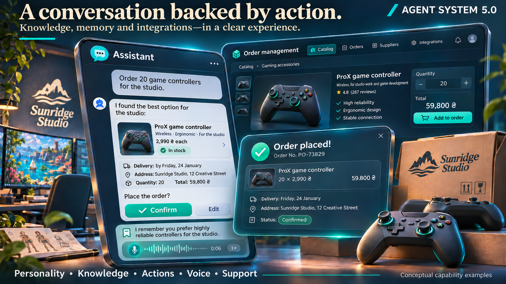
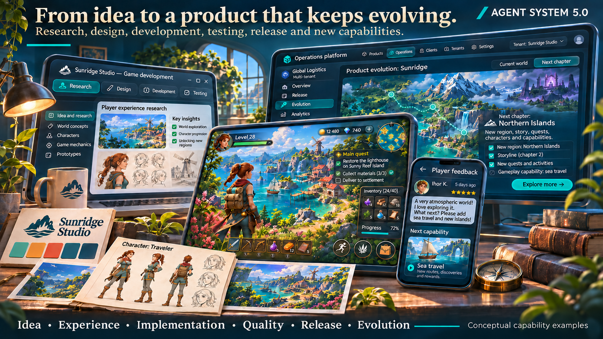

# ¿Qué puedes crear con Codex?

[English](../en/README.md) · [Українська](../uk/README.md) · [Deutsch](../de/README.md) · [Italiano](../it/README.md) · [Español](../es/README.md) · [Français](../fr/README.md) · [简体中文](../zh-CN/README.md)

Empieza por una tarea concreta o continúa un producto existente. Las ilustraciones muestran entradas, decisiones y resultados de flujos de trabajo representativos.

[Abrir la guía](../../docs/es/GUIDE.md#install) · [PDF de diagramas técnicos](../campaign/Showcase.pdf) · [Galería sin conexión](https://github.com/alex-hohaizel/codex-agents/actions/workflows/validate.yml?query=branch%3Amain)

Inicia sesión en GitHub y abre una validación completada con éxito para main. En Artifacts, descarga product-showcase, extrae Showcase.zip y abre index.html.

[RAG](../../docs/OPERATING_MODEL.md#retrieval-and-rag) · [Evals](../../docs/OPERATING_MODEL.md#evals-and-evidence) · [Portada del repositorio](../../README.md)

[Un espacio de trabajo conectado](#showcase-overview) · [My Day](#showcase-product) · [Sunridge Studio](#showcase-game) · [Asistente](#showcase-conversation) · [Global Logistics](#showcase-operations) · [De la hoja de cálculo a los documentos](#showcase-documents) · [Un especialista para una tarea recurrente](#showcase-specialists) · [Recuperación de información con evidencias](#showcase-retrieval) · [Evaluaciones de un flujo real](#showcase-evaluation) · [Panel Agent Atelier](#showcase-workbench)

Estos conceptos de producto muestran algunos usos posibles del sistema. Se conservan los textos impresos en las ilustraciones originales. Las versiones actuales figuran en la portada del repositorio.

## Un espacio de trabajo conectado

**Concepto original del producto** · ilustración en inglés

Un mapa logístico, una agenda, un juego y documentos validados en una misma mesa.

[Abrir imagen a tamaño completo](https://github.com/alex-hohaizel/codex-agents/blob/1ccee85edd66a44d76724b50387cac6b0afce23c/assets/marketing/campaign/en/01-original.png)

Portada complementaria

Pasa de una corrección puntual a un proceso reutilizable y conserva las fuentes y comprobaciones.

[Abrir este flujo en la guía](../../docs/es/GUIDE.md#first-task)

## My Day

**Concepto original del producto** · ilustración en inglés

La agenda y la ruta continúan del teléfono a un espacio de trabajo más amplio.

[Abrir imagen a tamaño completo](https://github.com/alex-hohaizel/codex-agents/blob/1ccee85edd66a44d76724b50387cac6b0afce23c/assets/marketing/campaign/en/02-app.png)

Flujo técnico

Revisa un cambio del plan diario en las interfaces correspondientes sin perder las citas y decisiones de ruta.

[Abrir este flujo en la guía](../../docs/es/GUIDE.md#workflow)

## Sunridge Studio

**Concepto original del producto** · ilustración en inglés

Un mundo costero, una referencia del personaje y un punto de verificación jugable.

[Abrir imagen a tamaño completo](https://github.com/alex-hohaizel/codex-agents/blob/1ccee85edd66a44d76724b50387cac6b0afce23c/assets/marketing/campaign/en/03-game.png)

Flujo técnico

Conserva el personaje y la identidad del mundo durante la producción. Verifica la compilación real antes de describir su comportamiento en un dispositivo.

[Abrir este flujo en la guía](../../docs/es/GUIDE.md#catalog)

## Asistente

**Concepto original del producto** · ilustración en inglés

La conversación separa la confirmación explícita del comprobante final.

[Abrir imagen a tamaño completo](https://github.com/alex-hohaizel/codex-agents/blob/1ccee85edd66a44d76724b50387cac6b0afce23c/assets/marketing/campaign/en/04-bot.png)

Flujo técnico

Prepara un pedido de ejemplo, verifica el objetivo y la autorización, y confirma el resultado mediante el comprobante.

[Abrir este flujo en la guía](../../docs/es/GUIDE.md#operations)

## Global Logistics

**Concepto original del producto** · ilustración en inglés

Una ruta interrumpida, una alternativa viable y un resultado revisado.

[Abrir imagen a tamaño completo](https://github.com/alex-hohaizel/codex-agents/blob/1ccee85edd66a44d76724b50387cac6b0afce23c/assets/marketing/campaign/en/05-platform.png)

Flujo técnico

Investiga la incidencia, compara las rutas disponibles y registra el resultado después de verificar el estado operativo.

[Abrir este flujo en la guía](../../docs/es/GUIDE.md#operations) · [Guía técnica](../../docs/OPERATING_MODEL.md#tools-evidence-and-recovery)

## De la hoja de cálculo a los documentos

**Concepto original del producto** · ilustración en inglés

Las filas validadas se convierten en documentos y se retiene una excepción.

[Abrir imagen a tamaño completo](https://github.com/alex-hohaizel/codex-agents/blob/1ccee85edd66a44d76724b50387cac6b0afce23c/assets/marketing/campaign/en/06-automation.png)

Flujo técnico

Procesa las filas válidas y aclara la dirección ausente. Genera el documento de esa fila sin duplicar los anteriores.

[Abrir este flujo en la guía](../../docs/es/GUIDE.md#operations)

## Un especialista para una tarea recurrente

**Concepto original del producto** · ilustración en inglés

Un contrato de API acotado pasa a un especialista y a una revisión independiente.

[Abrir imagen a tamaño completo](https://github.com/alex-hohaizel/codex-agents/blob/1ccee85edd66a44d76724b50387cac6b0afce23c/assets/marketing/campaign/en/07-constructors.png)

Flujo técnico

Entrega el contrato exacto, la evidencia y las condiciones de entrega. Verifica el conflicto de tipos y la propuesta mediante una revisión independiente.

[Abrir este flujo en la guía](../../docs/es/GUIDE.md#catalog)

## Recuperación de información con evidencias

Empieza por rutas e identificadores exactos. Si hay carencias medibles, compara búsqueda léxica, semántica e híbrida. Cita la fuente vigente o abstente.

[Abrir este flujo en la guía](../../docs/es/GUIDE.md#retrieval) · [Ejemplo práctico de RAG](../../docs/technical/RETRIEVAL.md)

## Evaluaciones de un flujo real

Define un resultado esperado por caso, inspecciona el artefacto o efecto real y compara los mismos casos antes de ampliar la adopción.

[Abrir este flujo en la guía](../../docs/es/GUIDE.md#evals) · [Guía técnica](../../docs/OPERATING_MODEL.md#evals-and-evidence)

## Panel Agent Atelier

Abre el proyecto, revisa su siguiente acción y la propuesta, y usa la ruta de Orchestrator. Confirma el efecto a partir del resultado observado.

[Abrir este flujo en la guía](../../docs/es/GUIDE.md#workbench) · [Guía técnica](../../apps/agent-atelier/README.md)

## Más conceptos

### Ciclo de vida del producto

**Concepto original del producto** · ilustración en inglés

La investigación y el diseño dan paso al desarrollo, la verificación, el lanzamiento y la mejora continua.

[Abrir imagen a tamaño completo](https://github.com/alex-hohaizel/codex-agents/blob/1ccee85edd66a44d76724b50387cac6b0afce23c/assets/marketing/campaign/en/08-lifecycle.png)

[Abrir este flujo en la guía](../../docs/es/GUIDE.md#workflow)

### El mismo proyecto continúa

**Concepto original del producto** · ilustración en inglés

Los requisitos, las decisiones y la identidad del producto se conservan en la tarea siguiente.

[Abrir imagen a tamaño completo](https://github.com/alex-hohaizel/codex-agents/blob/1ccee85edd66a44d76724b50387cac6b0afce23c/assets/marketing/campaign/en/09-continuity.png)

[Abrir este flujo en la guía](../../docs/es/GUIDE.md#workflow) · [Guía técnica](../../docs/OPERATING_MODEL.md#project-context-and-handoffs)

### Tu próxima tarea

**Concepto original del producto** · ilustración en inglés

Empieza con una corrección concreta, un proyecto existente o un producto nuevo.

[Abrir imagen a tamaño completo](https://github.com/alex-hohaizel/codex-agents/blob/1ccee85edd66a44d76724b50387cac6b0afce23c/assets/marketing/campaign/en/10-next-task.png)

[Abrir este flujo en la guía](../../docs/es/GUIDE.md#first-task)
