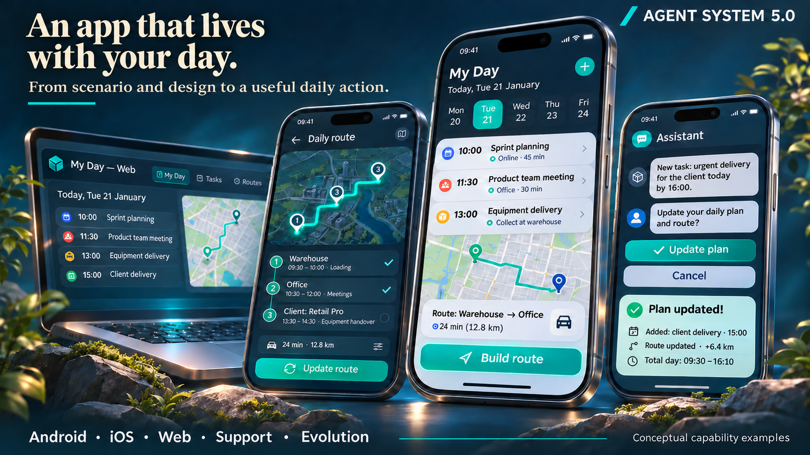
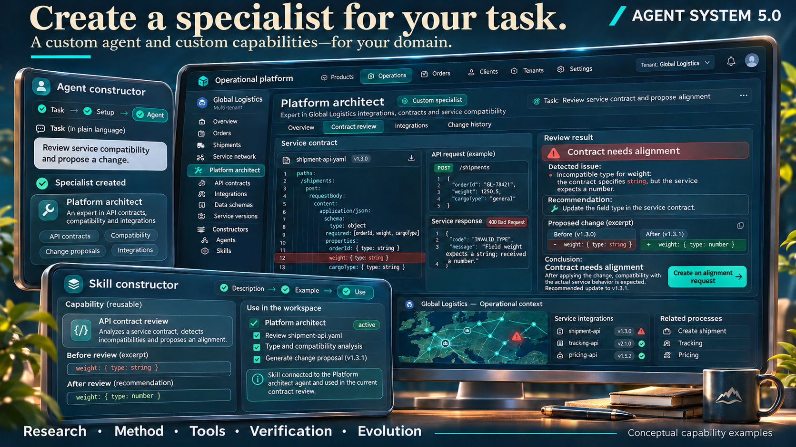

# Que pouvez-vous créer avec Codex?

[English](../en/README.md) · [Українська](../uk/README.md) · [Deutsch](../de/README.md) · [Italiano](../it/README.md) · [Español](../es/README.md) · [Français](../fr/README.md) · [简体中文](../zh-CN/README.md)

Partez d’une tâche concrète ou reprenez un produit existant. Ces illustrations présentent les entrées, les décisions et les résultats de parcours représentatifs.

[Ouvrir le guide](../../docs/fr/GUIDE.md#install) · [PDF des schémas techniques](../campaign/Showcase.pdf) · [Galerie hors ligne](https://github.com/alex-hohaizel/codex-agents/actions/workflows/validate.yml?query=branch%3Amain)

Connectez-vous à GitHub et ouvrez une validation réussie pour main. Dans Artifacts, téléchargez product-showcase, extrayez Showcase.zip et ouvrez index.html.

[RAG](../../docs/OPERATING_MODEL.md#retrieval-and-rag) · [Evals](../../docs/OPERATING_MODEL.md#evals-and-evidence) · [Accueil du dépôt](../../README.md)

[Un espace de travail connecté](#showcase-overview) · [My Day](#showcase-product) · [Sunridge Studio](#showcase-game) · [Assistant](#showcase-conversation) · [Global Logistics](#showcase-operations) · [Du tableur aux documents](#showcase-documents) · [Un spécialiste pour une tâche récurrente](#showcase-specialists) · [Recherche avec sources](#showcase-retrieval) · [Évaluer un parcours réel](#showcase-evaluation) · [Panneau Agent Atelier](#showcase-workbench)

Ces concepts illustrent quelques usages possibles du système. Les inscriptions d’origine ont été conservées. Les versions actuelles figurent sur la page d’accueil du dépôt.

## Un espace de travail connecté

**Concept de produit original** · illustration en anglais

Carte logistique, agenda, univers de jeu et documents contrôlés sur un même bureau.

[Ouvrir l’image en taille réelle](https://github.com/alex-hohaizel/codex-agents/blob/1ccee85edd66a44d76724b50387cac6b0afce23c/assets/marketing/campaign/en/01-original.png)

Couverture complémentaire

Passez d’une correction ciblée à un processus réutilisable en gardant les sources et les contrôles vérifiables.

[Ouvrir ce parcours dans le guide](../../docs/fr/GUIDE.md#first-task)

## My Day

**Concept de produit original** · illustration en anglais

L’agenda et le trajet passent du téléphone à un espace de travail plus complet.

[Ouvrir l’image en taille réelle](https://github.com/alex-hohaizel/codex-agents/blob/1ccee85edd66a44d76724b50387cac6b0afce23c/assets/marketing/campaign/en/02-app.png)

Déroulement technique

Modifiez le programme de la journée, conservez les rendez-vous et vérifiez la mise à jour sur les interfaces concernées.

[Ouvrir ce parcours dans le guide](../../docs/fr/GUIDE.md#workflow)

## Sunridge Studio

**Concept de produit original** · illustration en anglais

Une carte du littoral, une référence du personnage et une étape de contrôle jouable.

[Ouvrir l’image en taille réelle](https://github.com/alex-hohaizel/codex-agents/blob/1ccee85edd66a44d76724b50387cac6b0afce23c/assets/marketing/campaign/en/03-game.png)

Déroulement technique

Préservez le personnage et l’identité du décor jusqu’à la production. Vérifiez la version réelle sur l’appareil avant d’en affirmer le comportement.

[Ouvrir ce parcours dans le guide](../../docs/fr/GUIDE.md#catalog)

## Assistant

**Concept de produit original** · illustration en anglais

La conversation distingue la confirmation explicite et le reçu final.

[Ouvrir l’image en taille réelle](https://github.com/alex-hohaizel/codex-agents/blob/1ccee85edd66a44d76724b50387cac6b0afce23c/assets/marketing/campaign/en/04-bot.png)

Déroulement technique

Préparez une commande de démonstration, vérifiez la cible et l’autorisation, puis confirmez l’effet à partir du reçu.

[Ouvrir ce parcours dans le guide](../../docs/fr/GUIDE.md#operations)

## Global Logistics

**Concept de produit original** · illustration en anglais

Un itinéraire perturbé, une solution de rechange et un résultat vérifié.

[Ouvrir l’image en taille réelle](https://github.com/alex-hohaizel/codex-agents/blob/1ccee85edd66a44d76724b50387cac6b0afce23c/assets/marketing/campaign/en/05-platform.png)

Déroulement technique

Analysez l’incident, comparez les trajets disponibles et enregistrez le résultat après contrôle de l’état opérationnel.

[Ouvrir ce parcours dans le guide](../../docs/fr/GUIDE.md#operations) · [Guide technique](../../docs/OPERATING_MODEL.md#tools-evidence-and-recovery)

## Du tableur aux documents

**Concept de produit original** · illustration en anglais

Les lignes validées deviennent des documents. Une ligne incomplète reste en attente.

[Ouvrir l’image en taille réelle](https://github.com/alex-hohaizel/codex-agents/blob/1ccee85edd66a44d76724b50387cac6b0afce23c/assets/marketing/campaign/en/06-automation.png)

Déroulement technique

Traitez les lignes conformes, clarifiez l’adresse manquante, puis générez le document corrigé sans reproduire les précédents.

[Ouvrir ce parcours dans le guide](../../docs/fr/GUIDE.md#operations)

## Un spécialiste pour une tâche récurrente

**Concept de produit original** · illustration en anglais

Un contrat d’API circonscrit est confié à un spécialiste et à une vérification indépendante.

[Ouvrir l’image en taille réelle](https://github.com/alex-hohaizel/codex-agents/blob/1ccee85edd66a44d76724b50387cac6b0afce23c/assets/marketing/campaign/en/07-constructors.png)

Déroulement technique

Transmettez le contrat exact, les éléments probants et les critères attendus. Vérifiez séparément la divergence de type et la correction.

[Ouvrir ce parcours dans le guide](../../docs/fr/GUIDE.md#catalog)

## Recherche avec sources

Commencez avec les chemins et identifiants exacts. En cas d’échecs mesurés, comparez les recherches lexicale, sémantique et hybride. Citez la source actuelle ou abstenez-vous.

[Ouvrir ce parcours dans le guide](../../docs/fr/GUIDE.md#retrieval) · [Exemple pratique de RAG](../../docs/technical/RETRIEVAL.md)

## Évaluer un parcours réel

Fixez un résultat attendu pour chaque cas, vérifiez l’artefact ou l’effet réel, puis comparez les mêmes cas avant une adoption plus large.

[Ouvrir ce parcours dans le guide](../../docs/fr/GUIDE.md#evals) · [Guide technique](../../docs/OPERATING_MODEL.md#evals-and-evidence)

## Panneau Agent Atelier

Ouvrez un projet local, examinez la prochaine action et le brouillon, puis utilisez Orchestrator. Confirmez l’effet d’après le résultat observé.

[Ouvrir ce parcours dans le guide](../../docs/fr/GUIDE.md#workbench) · [Guide technique](../../apps/agent-atelier/README.md)

## Autres concepts

### Cycle de vie du produit

**Concept de produit original** · illustration en anglais

La recherche et la conception précèdent le développement, la vérification, la publication et les améliorations.

[Ouvrir l’image en taille réelle](https://github.com/alex-hohaizel/codex-agents/blob/1ccee85edd66a44d76724b50387cac6b0afce23c/assets/marketing/campaign/en/08-lifecycle.png)

[Ouvrir ce parcours dans le guide](../../docs/fr/GUIDE.md#workflow)

### Le même projet se poursuit

**Concept de produit original** · illustration en anglais

Les exigences, les décisions et l’identité du produit accompagnent la prochaine tâche.

[Ouvrir l’image en taille réelle](https://github.com/alex-hohaizel/codex-agents/blob/1ccee85edd66a44d76724b50387cac6b0afce23c/assets/marketing/campaign/en/09-continuity.png)

[Ouvrir ce parcours dans le guide](../../docs/fr/GUIDE.md#workflow) · [Guide technique](../../docs/OPERATING_MODEL.md#project-context-and-handoffs)

### Votre prochaine tâche

**Concept de produit original** · illustration en anglais

Commencez par une correction ciblée, un projet existant ou un nouveau produit.

[Ouvrir l’image en taille réelle](https://github.com/alex-hohaizel/codex-agents/blob/1ccee85edd66a44d76724b50387cac6b0afce23c/assets/marketing/campaign/en/10-next-task.png)

[Ouvrir ce parcours dans le guide](../../docs/fr/GUIDE.md#first-task)
