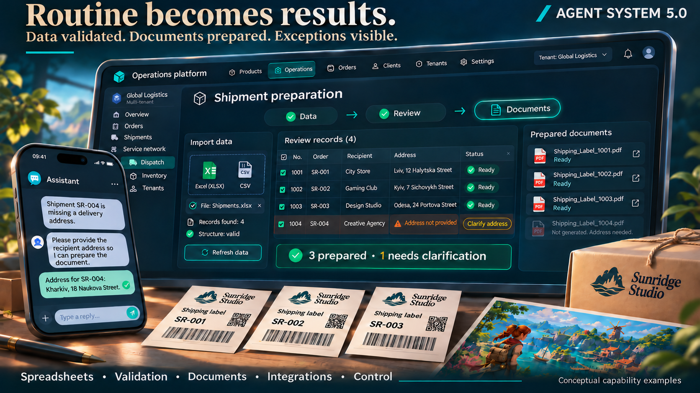
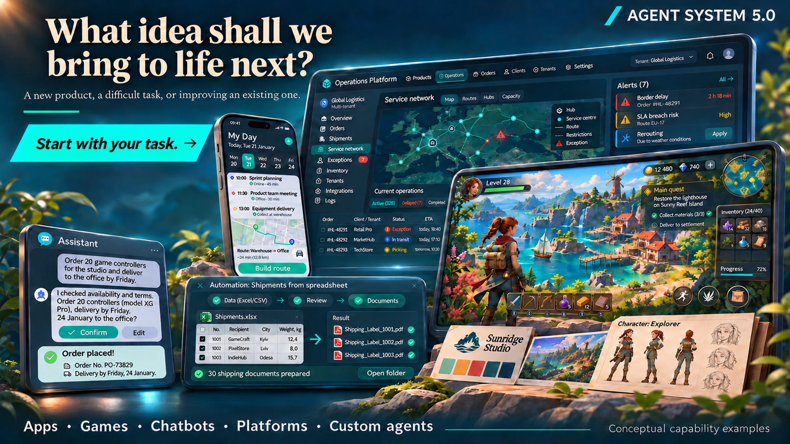

# Che cosa puoi creare con Codex?

[English](../en/README.md) · [Українська](../uk/README.md) · [Deutsch](../de/README.md) · [Italiano](../it/README.md) · [Español](../es/README.md) · [Français](../fr/README.md) · [简体中文](../zh-CN/README.md)

Parti da un compito preciso o prosegui su un prodotto esistente. Questi esempi illustrano dati di ingresso, decisioni e risultati dei flussi di lavoro.

[Apri la guida](../../docs/it/GUIDE.md#install) · [PDF dei diagrammi tecnici](../campaign/Showcase.pdf) · [Galleria offline](https://github.com/alex-hohaizel/codex-agents/actions/workflows/validate.yml?query=branch%3Amain)

Accedi a GitHub e apri una convalida riuscita per main. In Artifacts scarica product-showcase, estrai Showcase.zip e apri index.html.

[RAG](../../docs/OPERATING_MODEL.md#retrieval-and-rag) · [Evals](../../docs/OPERATING_MODEL.md#evals-and-evidence) · [Pagina iniziale del repository](../../README.md)

[Uno spazio di lavoro condiviso](#showcase-overview) · [My Day](#showcase-product) · [Sunridge Studio](#showcase-game) · [Assistente](#showcase-conversation) · [Global Logistics](#showcase-operations) · [Dal foglio di calcolo ai documenti](#showcase-documents) · [Uno specialista per un’attività ricorrente](#showcase-specialists) · [Recupero di informazioni con fonti](#showcase-retrieval) · [Valutazioni di un flusso reale](#showcase-evaluation) · [Pannello Agent Atelier](#showcase-workbench)

Questi concept di prodotto illustrano alcuni possibili usi del sistema. Le scritte originali rimangono visibili. Le versioni correnti sono indicate nella pagina iniziale del repository.

## Uno spazio di lavoro condiviso

**Concept originale del prodotto** · illustrazione in inglese

Una mappa logistica, un’agenda, un gioco e documenti verificati sulla stessa scrivania.

[Apri l’immagine a grandezza intera](https://github.com/alex-hohaizel/codex-agents/blob/1ccee85edd66a44d76724b50387cac6b0afce23c/assets/marketing/campaign/en/01-original.png)

Copertina aggiuntiva

Passa da una correzione mirata a un processo riutilizzabile mantenendo fonti e verifiche tracciabili.

[Apri questo flusso nella guida](../../docs/it/GUIDE.md#first-task)

## My Day

**Concept originale del prodotto** · illustrazione in inglese

Agenda e itinerario proseguono dal telefono a uno spazio di lavoro più ampio.

[Apri l’immagine a grandezza intera](https://github.com/alex-hohaizel/codex-agents/blob/1ccee85edd66a44d76724b50387cac6b0afce23c/assets/marketing/campaign/en/02-app.png)

Flusso tecnico

Modifica il piano della giornata e verifica l’aggiornamento sulle interfacce interessate, preservando gli appuntamenti e le decisioni.

[Apri questo flusso nella guida](../../docs/it/GUIDE.md#workflow)

## Sunridge Studio

**Concept originale del prodotto** · illustrazione in inglese

Una costa di gioco, riferimenti del personaggio e un punto di verifica giocabile.

[Apri l’immagine a grandezza intera](https://github.com/alex-hohaizel/codex-agents/blob/1ccee85edd66a44d76724b50387cac6b0afce23c/assets/marketing/campaign/en/03-game.png)

Flusso tecnico

Mantieni il personaggio e l’identità della costa durante la produzione. Conferma il comportamento sul dispositivo dopo aver verificato la build effettiva.

[Apri questo flusso nella guida](../../docs/it/GUIDE.md#catalog)

## Assistente

**Concept originale del prodotto** · illustrazione in inglese

La conversazione separa la conferma esplicita dalla ricevuta finale.

[Apri l’immagine a grandezza intera](https://github.com/alex-hohaizel/codex-agents/blob/1ccee85edd66a44d76724b50387cac6b0afce23c/assets/marketing/campaign/en/04-bot.png)

Flusso tecnico

Prepara un ordine di esempio e verifica il destinatario e l’autorizzazione. Chiudi l’operazione dopo aver osservato la ricevuta.

[Apri questo flusso nella guida](../../docs/it/GUIDE.md#operations)

## Global Logistics

**Concept originale del prodotto** · illustrazione in inglese

Una tratta interrotta, una via alternativa e un esito verificato.

[Apri l’immagine a grandezza intera](https://github.com/alex-hohaizel/codex-agents/blob/1ccee85edd66a44d76724b50387cac6b0afce23c/assets/marketing/campaign/en/05-platform.png)

Flusso tecnico

Esamina l’eccezione e compara gli itinerari disponibili. Registra l’esito dopo aver verificato lo stato operativo.

[Apri questo flusso nella guida](../../docs/it/GUIDE.md#operations) · [Guida tecnica](../../docs/OPERATING_MODEL.md#tools-evidence-and-recovery)

## Dal foglio di calcolo ai documenti

**Concept originale del prodotto** · illustrazione in inglese

Le righe convalidate diventano documenti e un’eccezione resta in sospeso.

[Apri l’immagine a grandezza intera](https://github.com/alex-hohaizel/codex-agents/blob/1ccee85edd66a44d76724b50387cac6b0afce23c/assets/marketing/campaign/en/06-automation.png)

Flusso tecnico

Elabora le righe valide e chiarisci l’indirizzo mancante. Genera il documento corretto senza duplicare quelli già prodotti.

[Apri questo flusso nella guida](../../docs/it/GUIDE.md#operations)

## Uno specialista per un’attività ricorrente

**Concept originale del prodotto** · illustrazione in inglese

Un contratto API delimitato passa a uno specialista e a una verifica indipendente.

[Apri l’immagine a grandezza intera](https://github.com/alex-hohaizel/codex-agents/blob/1ccee85edd66a44d76724b50387cac6b0afce23c/assets/marketing/campaign/en/07-constructors.png)

Flusso tecnico

Consegna il contratto esatto, i riscontri e i criteri attesi. Verifica in modo indipendente il conflitto di tipi e la correzione proposta.

[Apri questo flusso nella guida](../../docs/it/GUIDE.md#catalog)

## Recupero di informazioni con fonti

Parti da percorsi di file e identificativi esatti. Se osservi lacune, confronta metodi lessicali, semantici e ibridi. Cita la fonte attuale oppure astieniti.

[Apri questo flusso nella guida](../../docs/it/GUIDE.md#retrieval) · [Esempio pratico di RAG](../../docs/technical/RETRIEVAL.md)

## Valutazioni di un flusso reale

Definisci l’esito atteso per ogni caso, verifica il risultato effettivo e confronta gli stessi casi prima di ampliare l’adozione.

[Apri questo flusso nella guida](../../docs/it/GUIDE.md#evals) · [Guida tecnica](../../docs/OPERATING_MODEL.md#evals-and-evidence)

## Pannello Agent Atelier

Apri il progetto locale, controlla la prossima azione e la bozza, poi usa il percorso Orchestrator. Conferma l’effetto osservando il risultato effettivo.

[Apri questo flusso nella guida](../../docs/it/GUIDE.md#workbench) · [Guida tecnica](../../apps/agent-atelier/README.md)

## Altri concept

### Ciclo di vita del prodotto

**Concept originale del prodotto** · illustrazione in inglese

Dalla ricerca e dal design allo sviluppo, alle verifiche, al rilascio e alle evoluzioni successive.

[Apri l’immagine a grandezza intera](https://github.com/alex-hohaizel/codex-agents/blob/1ccee85edd66a44d76724b50387cac6b0afce23c/assets/marketing/campaign/en/08-lifecycle.png)

[Apri questo flusso nella guida](../../docs/it/GUIDE.md#workflow)

### Lo stesso progetto continua

**Concept originale del prodotto** · illustrazione in inglese

Requisiti, decisioni e identità del prodotto accompagnano il lavoro successivo.

[Apri l’immagine a grandezza intera](https://github.com/alex-hohaizel/codex-agents/blob/1ccee85edd66a44d76724b50387cac6b0afce23c/assets/marketing/campaign/en/09-continuity.png)

[Apri questo flusso nella guida](../../docs/it/GUIDE.md#workflow) · [Guida tecnica](../../docs/OPERATING_MODEL.md#project-context-and-handoffs)

### Il prossimo compito

**Concept originale del prodotto** · illustrazione in inglese

Inizia con una correzione mirata, un progetto esistente o un nuovo prodotto.

[Apri l’immagine a grandezza intera](https://github.com/alex-hohaizel/codex-agents/blob/1ccee85edd66a44d76724b50387cac6b0afce23c/assets/marketing/campaign/en/10-next-task.png)

[Apri questo flusso nella guida](../../docs/it/GUIDE.md#first-task)
