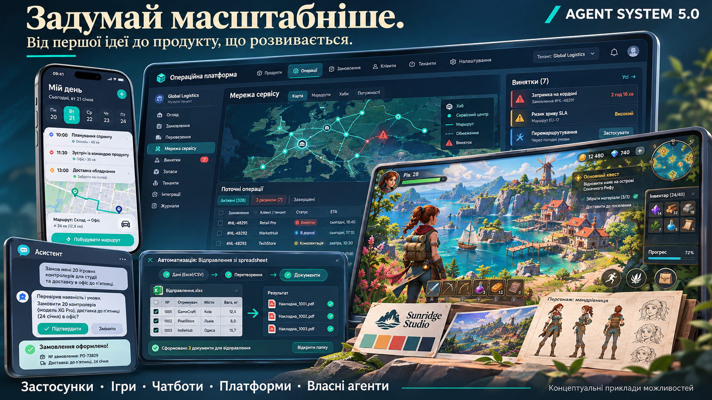
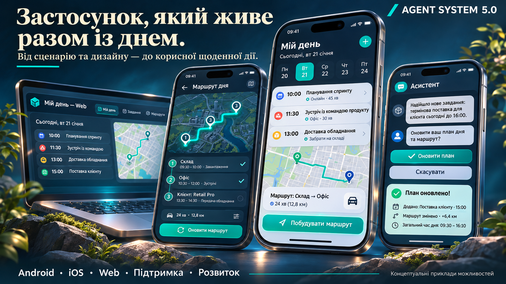
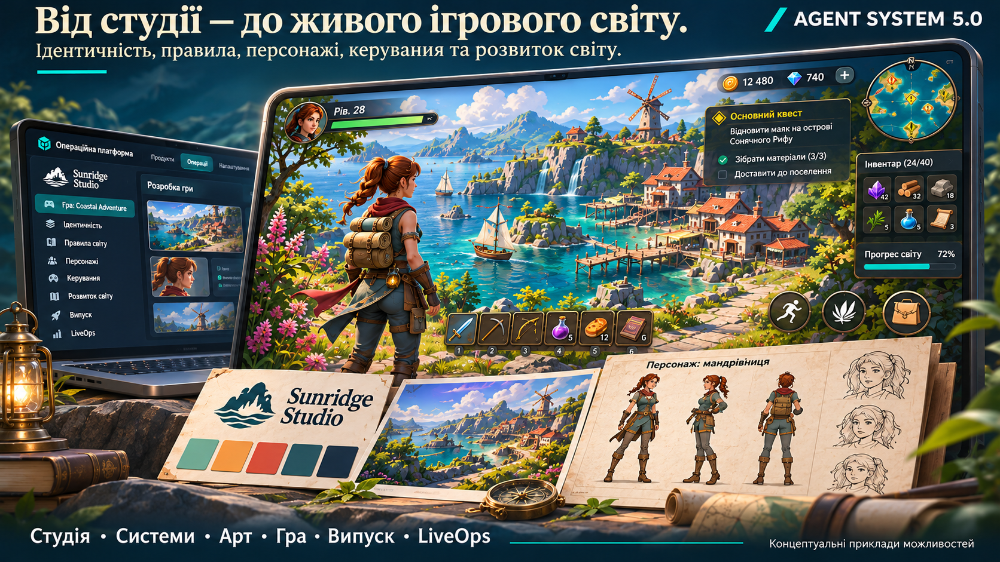
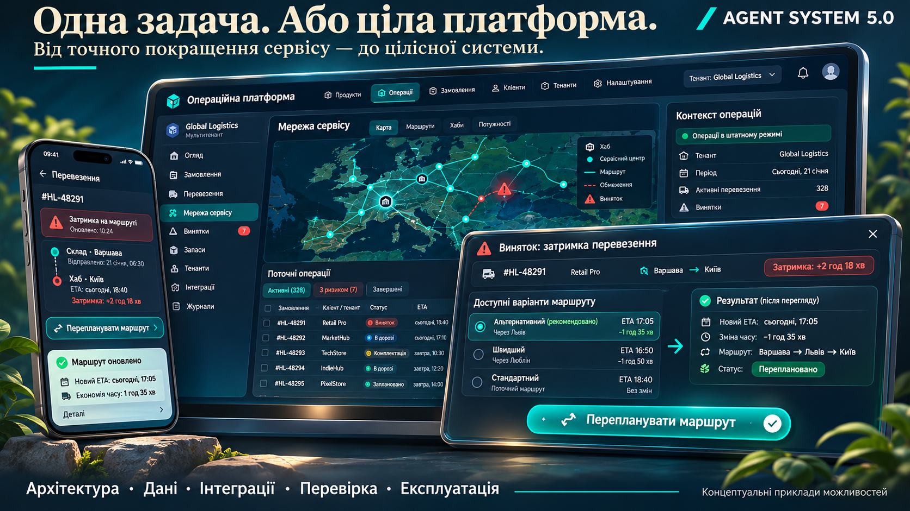
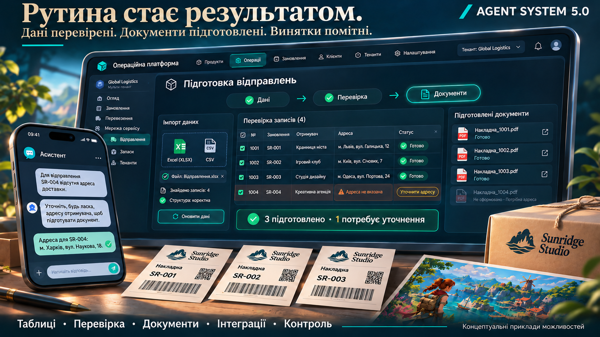
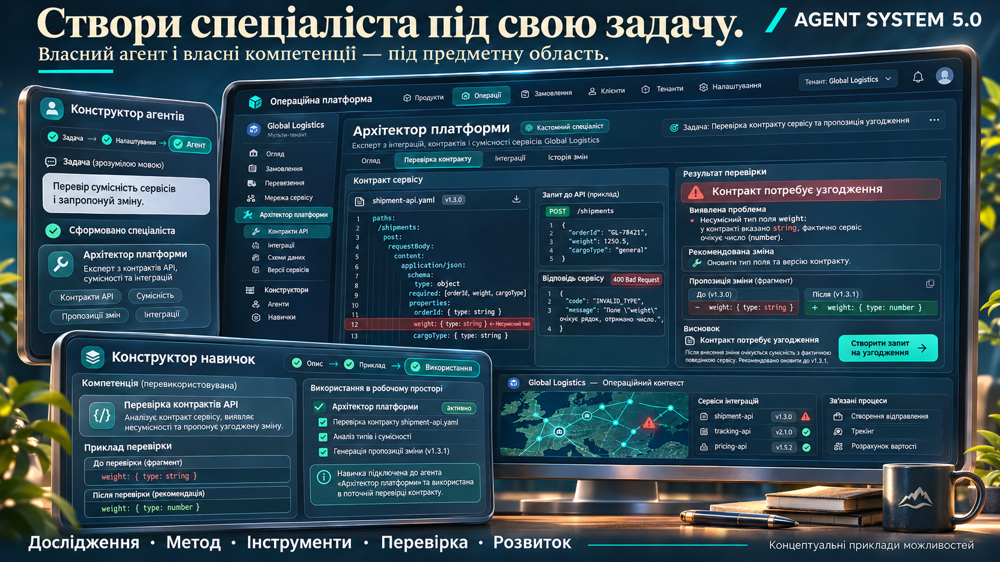
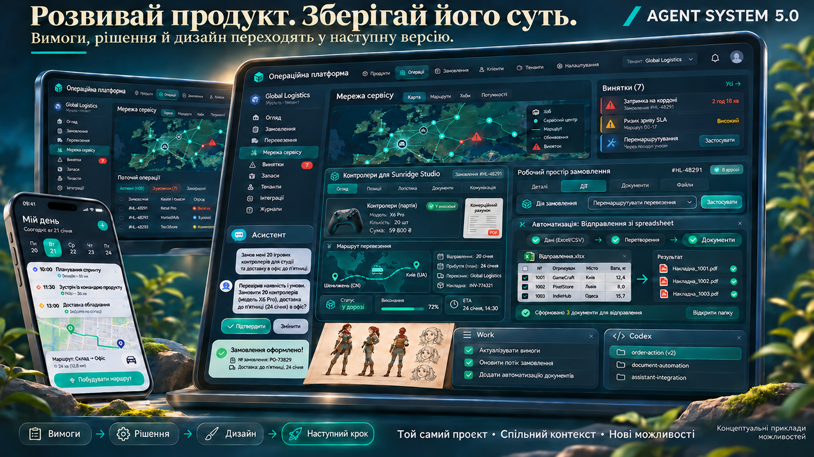
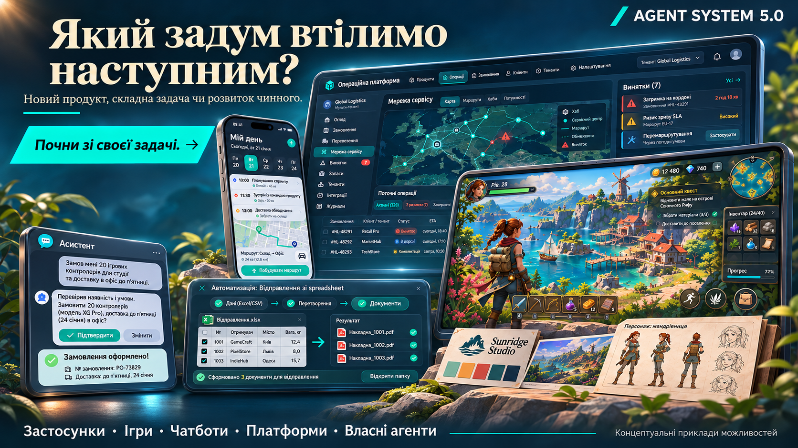

# Що можна створити з Codex?

[English](../en/README.md) · [Українська](../uk/README.md) · [Deutsch](../de/README.md) · [Italiano](../it/README.md) · [Español](../es/README.md) · [Français](../fr/README.md) · [简体中文](../zh-CN/README.md)

Почніть із конкретної задачі або продовжте наявний продукт. Ілюстрації показують вхідні дані, рішення й результати, з якими можна працювати за допомогою набору навичок.

[Відкрити посібник](../../docs/uk/GUIDE.md#install) · [PDF із технічними схемами](../campaign/Showcase.pdf) · [Офлайн-галерея](https://github.com/alex-hohaizel/codex-agents/actions/workflows/validate.yml?query=branch%3Amain)

Щоб завантажити офлайн-галерею, увійдіть до GitHub і відкрийте успішний запуск перевірки для main. У розділі Artifacts завантажте product-showcase, розпакуйте Showcase.zip і відкрийте index.html.

[RAG](../../docs/OPERATING_MODEL.md#retrieval-and-rag) · [Evals](../../docs/OPERATING_MODEL.md#evals-and-evidence) · [Головна сторінка репозиторію](../../README.md)

[Єдиний робочий простір](#showcase-overview) · [Мій день](#showcase-product) · [Sunridge Studio](#showcase-game) · [Асистент](#showcase-conversation) · [Global Logistics](#showcase-operations) · [З таблиці до документів](#showcase-documents) · [Спеціаліст для повторюваної задачі](#showcase-specialists) · [Пошук із перевірними джерелами](#showcase-retrieval) · [Оцінювання робочого процесу](#showcase-evaluation) · [Панель Agent Atelier](#showcase-workbench)

Ці концепції показують кілька можливих застосувань системи. Написи на оригінальних ілюстраціях збережено. Актуальні версії продукту вказані на головній сторінці репозиторію.

## Єдиний робочий простір

**Оригінальна концепція продукту** · ілюстрація українською

Обкладинка кампанії поєднує операційну мапу на великому екрані, особистий розклад та ігровий світ на узбережжі.

[Відкрити зображення в повному розмірі](https://github.com/alex-hohaizel/codex-agents/blob/1ccee85edd66a44d76724b50387cac6b0afce23c/assets/marketing/campaign/uk/01-original.png)

Додаткова обкладинка

Розробник може перейти від локального виправлення до відтворюваного процесу з тими самими правилами перевірки джерел і результатів.

[Відкрити цей сценарій у посібнику](../../docs/uk/GUIDE.md#first-task)

## Мій день

**Оригінальна концепція продукту** · ілюстрація українською

Ноутбук і три телефони показують розклад, варіанти маршруту, підтвердження та оновлений план у «Моєму дні».

[Відкрити зображення в повному розмірі](https://github.com/alex-hohaizel/codex-agents/blob/1ccee85edd66a44d76724b50387cac6b0afce23c/assets/marketing/campaign/uk/02-app.png)

Технічна схема

Почніть із планування дня. Збережіть наявні зустрічі й рішення щодо маршруту та перевірте, що зміна коректно працює на різних екранах.

[Відкрити цей сценарій у посібнику](../../docs/uk/GUIDE.md#workflow)

## Sunridge Studio

**Оригінальна концепція продукту** · ілюстрація українською

Sunridge Studio поєднує ігровий світ на узбережжі, персонажа-дослідника та ескізи його дизайну.

[Відкрити зображення в повному розмірі](https://github.com/alex-hohaizel/codex-agents/blob/1ccee85edd66a44d76724b50387cac6b0afce23c/assets/marketing/campaign/uk/03-game.png)

Технічна схема

Збережіть мандрівницю й прибережний світ від проєктування до підготовки матеріалів та огляду ігрової збірки. Підтверджуйте поведінку пристрою після фактичного спостереження.

[Відкрити цей сценарій у посібнику](../../docs/uk/GUIDE.md#catalog)

## Асистент

**Оригінальна концепція продукту** · ілюстрація українською

Асистент порівнює ігровий контролер, запитує окреме підтвердження й показує результат замовлення.

[Відкрити зображення в повному розмірі](https://github.com/alex-hohaizel/codex-agents/blob/1ccee85edd66a44d76724b50387cac6b0afce23c/assets/marketing/campaign/uk/04-bot.png)

Технічна схема

Перевірте дані товару, підготуйте тестове замовлення й уточніть дозволений об’єкт та спосіб підтвердження. Залиште дію відкритою, доки не отримаєте перевірену квитанцію.

[Відкрити цей сценарій у посібнику](../../docs/uk/GUIDE.md#operations)

## Global Logistics

**Оригінальна концепція продукту** · ілюстрація українською

Global Logistics показує європейську мережу хабів, затримку перевезення, альтернативні маршрути, час прибуття та результат після перевірки.

[Відкрити зображення в повному розмірі](https://github.com/alex-hohaizel/codex-agents/blob/1ccee85edd66a44d76724b50387cac6b0afce23c/assets/marketing/campaign/uk/05-platform.png)

Технічна схема

Дослідіть виняток у перевезенні, порівняйте доступні маршрути, перевірте обліковий запис і зафіксуйте підсумок після звірки фактичного стану.

[Відкрити цей сценарій у посібнику](../../docs/uk/GUIDE.md#operations) · [Інженерний посібник](../../docs/OPERATING_MODEL.md#tools-evidence-and-recovery)

## З таблиці до документів

**Оригінальна концепція продукту** · ілюстрація українською

Поруч із таблицею перевезень видно готові документи й виділений рядок без адреси доставки.

[Відкрити зображення в повному розмірі](https://github.com/alex-hohaizel/codex-agents/blob/1ccee85edd66a44d76724b50387cac6b0afce23c/assets/marketing/campaign/uk/06-automation.png)

Технічна схема

Перевірте три рядки відправлень і утримайте четвертий без адреси. Після уточнення перевірте його та згенеруйте документ без дублювання попередніх результатів.

[Відкрити цей сценарій у посібнику](../../docs/uk/GUIDE.md#operations)

## Спеціаліст для повторюваної задачі

**Оригінальна концепція продукту** · ілюстрація українською

Спеціаліст перевіряє контракт API, знаходить невідповідність типів і передає зміну на перевірку.

[Відкрити зображення в повному розмірі](https://github.com/alex-hohaizel/codex-agents/blob/1ccee85edd66a44d76724b50387cac6b0afce23c/assets/marketing/campaign/uk/07-constructors.png)

Технічна схема

Почніть з аудиту контракту API. Передайте точний контракт, докази й умови повернення, а потім незалежно перевірте розбіжність типів і запропоновану зміну.

[Відкрити цей сценарій у посібнику](../../docs/uk/GUIDE.md#catalog)

## Пошук із перевірними джерелами

Почніть із шляхів до файлів і точних ідентифікаторів. Якщо зафіксовані пропуски виправдовують retrieval, порівняйте лексичний, семантичний і гібридний пошук на тому самому дозволеному корпусі. Посилайтеся на актуальне джерело або утримайтеся від відповіді.

[Відкрити цей сценарій у посібнику](../../docs/uk/GUIDE.md#retrieval) · [Практичний приклад RAG](../../docs/technical/RETRIEVAL.md)

## Оцінювання робочого процесу

Задайте очікування, зафіксуйте джерело й перевірте реальний артефакт або дію інструмента. Порівнюйте ті самі випадки перед ширшим впровадженням і фіксуйте незавершені результати.

[Відкрити цей сценарій у посібнику](../../docs/uk/GUIDE.md#evals) · [Інженерний посібник](../../docs/OPERATING_MODEL.md#evals-and-evidence)

## Панель Agent Atelier

Відкрийте локальний проєкт, перегляньте прив’язану наступну дію й чернетку та використайте маршрут Orchestrator. Підтвердьте виконання за фактичним результатом і доказами.

[Відкрити цей сценарій у посібнику](../../docs/uk/GUIDE.md#workbench) · [Інженерний посібник](../../apps/agent-atelier/README.md)

## Більше концепцій

### Життєвий цикл продукту

**Оригінальна концепція продукту** · ілюстрація українською

Дослідження й дизайн переходять у розробку, перевірку, випуск і подальший розвиток.

[Відкрити зображення в повному розмірі](https://github.com/alex-hohaizel/codex-agents/blob/1ccee85edd66a44d76724b50387cac6b0afce23c/assets/marketing/campaign/uk/08-lifecycle.png)

[Відкрити цей сценарій у посібнику](../../docs/uk/GUIDE.md#workflow)

### Той самий проєкт триває

**Оригінальна концепція продукту** · ілюстрація українською

Вимоги, рішення й ідентичність продукту переходять у наступне завдання.

[Відкрити зображення в повному розмірі](https://github.com/alex-hohaizel/codex-agents/blob/1ccee85edd66a44d76724b50387cac6b0afce23c/assets/marketing/campaign/uk/09-continuity.png)

[Відкрити цей сценарій у посібнику](../../docs/uk/GUIDE.md#workflow) · [Інженерний посібник](../../docs/OPERATING_MODEL.md#project-context-and-handoffs)

### Ваше наступне завдання

**Оригінальна концепція продукту** · ілюстрація українською

Почніть із конкретного виправлення, наявного проєкту чи нового продукту.

[Відкрити зображення в повному розмірі](https://github.com/alex-hohaizel/codex-agents/blob/1ccee85edd66a44d76724b50387cac6b0afce23c/assets/marketing/campaign/uk/10-next-task.png)

[Відкрити цей сценарій у посібнику](../../docs/uk/GUIDE.md#first-task)
