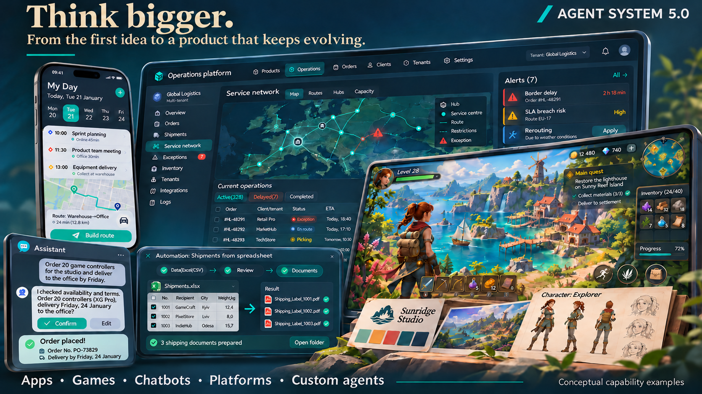

# 使用 Codex 可以构建什么？

[English](../en/README.md) · [Українська](../uk/README.md) · [Deutsch](../de/README.md) · [Italiano](../it/README.md) · [Español](../es/README.md) · [Français](../fr/README.md) · [简体中文](../zh-CN/README.md)

从具体任务开始，或继续开发已有产品。以下示例展示典型工作流程的输入、决策与结果。

[打开指南](../../docs/zh-CN/GUIDE.md#install) · [技术流程图 PDF](../campaign/Showcase.pdf) · [离线图库](https://github.com/alex-hohaizel/codex-agents/actions/workflows/validate.yml?query=branch%3Amain)

登录 GitHub 并打开 main 分支的一次成功验证。在 Artifacts 中下载 product-showcase，再解压 Showcase.zip 并打开 index.html。

[RAG](../../docs/OPERATING_MODEL.md#retrieval-and-rag) · [Evals](../../docs/OPERATING_MODEL.md#evals-and-evidence) · [仓库首页](../../README.md)

[关联的工作区](#showcase-overview) · [My Day](#showcase-product) · [Sunridge Studio](#showcase-game) · [对话助手](#showcase-conversation) · [Global Logistics](#showcase-operations) · [从表格到文档](#showcase-documents) · [用于重复任务的专员](#showcase-specialists) · [有证据的信息检索](#showcase-retrieval) · [评估实际工作流程](#showcase-evaluation) · [Agent Atelier 工作台](#showcase-workbench)

这些产品概念展示了系统的一部分用途。我们保留了原画中的文字。请在仓库首页查看当前发布版本。

## 关联的工作区

**原版产品概念图** · 英文原画

同一个工作台上展示物流地图、日程、游戏世界和已校验的文档。

[打开全尺寸图片](https://github.com/alex-hohaizel/codex-agents/blob/1ccee85edd66a44d76724b50387cac6b0afce23c/assets/marketing/campaign/en/01-original.png)

补充封面

从局部修复逐步建立可复用流程，并保留可追溯的来源和验证步骤。

[在指南中查看此流程](../../docs/zh-CN/GUIDE.md#first-task)

## My Day

**原版产品概念图** · 英文原画

日程和路线从手机延续到更大的工作界面。

[打开全尺寸图片](https://github.com/alex-hohaizel/codex-agents/blob/1ccee85edd66a44d76724b50387cac6b0afce23c/assets/marketing/campaign/en/02-app.png)

技术流程

调整当天的安排，保留已有预约和路线决策，并核查相关界面的更新。

[在指南中查看此流程](../../docs/zh-CN/GUIDE.md#workflow)

## Sunridge Studio

**原版产品概念图** · 英文原画

海岸世界地图、角色参考图和可运行版本的检查点。

[打开全尺寸图片](https://github.com/alex-hohaizel/codex-agents/blob/1ccee85edd66a44d76724b50387cac6b0afce23c/assets/marketing/campaign/en/03-game.png)

技术流程

从设计到制作保留角色与海岸场景的辨识度。通过实际版本验证后，再说明设备上的行为。

[在指南中查看此流程](../../docs/zh-CN/GUIDE.md#catalog)

## 对话助手

**原版产品概念图** · 英文原画

对话明确区分确认步骤和最终凭证。

[打开全尺寸图片](https://github.com/alex-hohaizel/codex-agents/blob/1ccee85edd66a44d76724b50387cac6b0afce23c/assets/marketing/campaign/en/04-bot.png)

技术流程

准备示例订单，核查具体对象和授权。取得已验证的凭证后，才确认操作结果。

[在指南中查看此流程](../../docs/zh-CN/GUIDE.md#operations)

## Global Logistics

**原版产品概念图** · 英文原画

受阻的路线、可行的替代路线和已经核查的结果。

[打开全尺寸图片](https://github.com/alex-hohaizel/codex-agents/blob/1ccee85edd66a44d76724b50387cac6b0afce23c/assets/marketing/campaign/en/05-platform.png)

技术流程

分析运输异常并比较可用路线。确认实际运行状态后记录结果。

[在指南中查看此流程](../../docs/zh-CN/GUIDE.md#operations) · [工程指南](../../docs/OPERATING_MODEL.md#tools-evidence-and-recovery)

## 从表格到文档

**原版产品概念图** · 英文原画

已校验的数据行生成文档，缺少信息的一行暂缓处理。

[打开全尺寸图片](https://github.com/alex-hohaizel/codex-agents/blob/1ccee85edd66a44d76724b50387cac6b0afce23c/assets/marketing/campaign/en/06-automation.png)

技术流程

处理有效的行，补齐缺失地址，再生成该行的文档，避免重复生成已有结果。

[在指南中查看此流程](../../docs/zh-CN/GUIDE.md#operations)

## 用于重复任务的专员

**原版产品概念图** · 英文原画

限定范围的 API 契约交给专员和独立核查人员。

[打开全尺寸图片](https://github.com/alex-hohaizel/codex-agents/blob/1ccee85edd66a44d76724b50387cac6b0afce23c/assets/marketing/campaign/en/07-constructors.png)

技术流程

提供确切契约、证据和验收条件，独立核实类型差异和拟议修改。

[在指南中查看此流程](../../docs/zh-CN/GUIDE.md#catalog)

## 有证据的信息检索

先用文件路径和精确标识。如果发现可测量的遗漏，在同一授权语料上比较词法、语义和混合检索。引用当前有效来源，或暂不作答。

[在指南中查看此流程](../../docs/zh-CN/GUIDE.md#retrieval) · [RAG 实例](../../docs/technical/RETRIEVAL.md)

## 评估实际工作流程

为每个用例确定预期结果，验证实际产物或工具效果，并在扩大采用前比较同一组用例。

[在指南中查看此流程](../../docs/zh-CN/GUIDE.md#evals) · [工程指南](../../docs/OPERATING_MODEL.md#evals-and-evidence)

## Agent Atelier 工作台

打开本地项目，检查下一步操作与草稿，再使用 Orchestrator 路由。根据实际输出和证据确认操作结果。

[在指南中查看此流程](../../docs/zh-CN/GUIDE.md#workbench) · [工程指南](../../apps/agent-atelier/README.md)

## 更多概念图

### 产品生命周期

**原版产品概念图** · 英文原画

从研究和设计进入开发、验证、发布和后续改进。

[打开全尺寸图片](https://github.com/alex-hohaizel/codex-agents/blob/1ccee85edd66a44d76724b50387cac6b0afce23c/assets/marketing/campaign/en/08-lifecycle.png)

[在指南中查看此流程](../../docs/zh-CN/GUIDE.md#workflow)

### 延续同一个项目

**原版产品概念图** · 英文原画

在下一项任务中保留既有的需求、决策和产品特色。

[打开全尺寸图片](https://github.com/alex-hohaizel/codex-agents/blob/1ccee85edd66a44d76724b50387cac6b0afce23c/assets/marketing/campaign/en/09-continuity.png)

[在指南中查看此流程](../../docs/zh-CN/GUIDE.md#workflow) · [工程指南](../../docs/OPERATING_MODEL.md#project-context-and-handoffs)

### 你的下一项任务

**原版产品概念图** · 英文原画

从一个小修复、一个现有项目或一个新产品开始。

[打开全尺寸图片](https://github.com/alex-hohaizel/codex-agents/blob/1ccee85edd66a44d76724b50387cac6b0afce23c/assets/marketing/campaign/en/10-next-task.png)

[在指南中查看此流程](../../docs/zh-CN/GUIDE.md#first-task)
