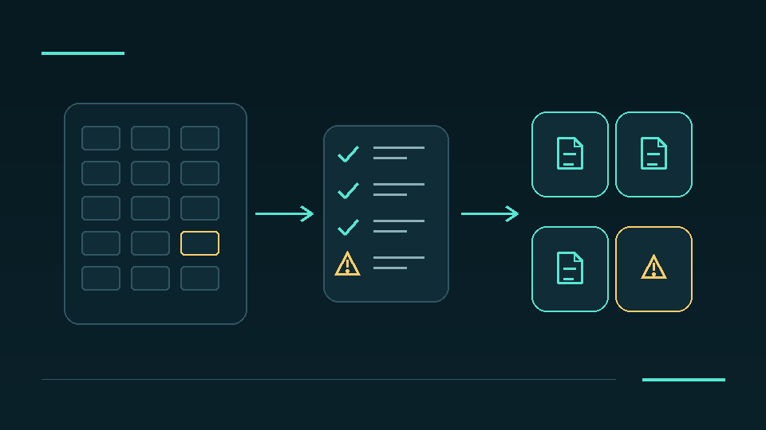

# 使用 Codex 可以构建什么？

[English](../en/README.md) · [Українська](../uk/README.md) · [Deutsch](../de/README.md) · [Italiano](../it/README.md) · [Español](../es/README.md) · [Français](../fr/README.md) · [简体中文](../zh-CN/README.md)

从具体任务开始，或继续开发已有产品。以下示例展示典型工作流程的输入、决策与结果。

[打开指南](../../docs/zh-CN/GUIDE.md#install) · [图解 PDF](../campaign/Showcase.pdf) · [离线图库](https://github.com/alex-hohaizel/codex-agents/actions/workflows/validate.yml?query=branch%3Amain)

登录 GitHub 并打开 main 分支的一次成功验证。在 Artifacts 中下载 product-showcase，再解压 Showcase.zip 并打开 index.html。

[关联的工作区](#showcase-overview) · [My Day](#showcase-product) · [Sunridge Studio](#showcase-game) · [对话助手](#showcase-conversation) · [Global Logistics](#showcase-operations) · [从表格到文档](#showcase-documents) · [用于重复任务的专员](#showcase-specialists) · [有证据的信息检索](#showcase-retrieval) · [评估实际工作流程](#showcase-evaluation) · [Agent Atelier 工作台](#showcase-workbench)

## 关联的工作区

从局部修复逐步建立可复用流程，并保留可追溯的来源和验证步骤。

[在指南中查看此流程](../../docs/zh-CN/GUIDE.md#first-task)

## My Day

调整当天的安排，保留已有预约和路线决策，并核查相关界面的更新。

[在指南中查看此流程](../../docs/zh-CN/GUIDE.md#workflow)

## Sunridge Studio

从设计到制作保留角色与海岸场景的辨识度。通过实际版本验证后，再说明设备上的行为。

[在指南中查看此流程](../../docs/zh-CN/GUIDE.md#catalog)

## 对话助手

准备示例订单，核查具体对象和授权。取得已验证的凭证后，才确认操作结果。

[在指南中查看此流程](../../docs/zh-CN/GUIDE.md#operations)

## Global Logistics

分析运输异常并比较可用路线。确认实际运行状态后记录结果。

[在指南中查看此流程](../../docs/zh-CN/GUIDE.md#operations)

## 从表格到文档

处理有效的行，补齐缺失地址，再生成该行的文档，避免重复生成已有结果。

[在指南中查看此流程](../../docs/zh-CN/GUIDE.md#operations)

## 用于重复任务的专员

提供确切契约、证据和验收条件，独立核实类型差异和拟议修改。

[在指南中查看此流程](../../docs/zh-CN/GUIDE.md#catalog)

## 有证据的信息检索

先用文件路径和精确标识。如果发现可测量的遗漏，在同一授权语料上比较词法、语义和混合检索。引用当前有效来源，或暂不作答。

[在指南中查看此流程](../../docs/zh-CN/GUIDE.md#retrieval)

## 评估实际工作流程

为每个用例确定预期结果，验证实际产物或工具效果，并在扩大采用前比较同一组用例。

[在指南中查看此流程](../../docs/zh-CN/GUIDE.md#evals)

## Agent Atelier 工作台

打开本地项目，检查下一步操作与草稿，再使用 Orchestrator 路由。根据实际输出和证据确认操作结果。

[在指南中查看此流程](../../docs/zh-CN/GUIDE.md#workbench)
